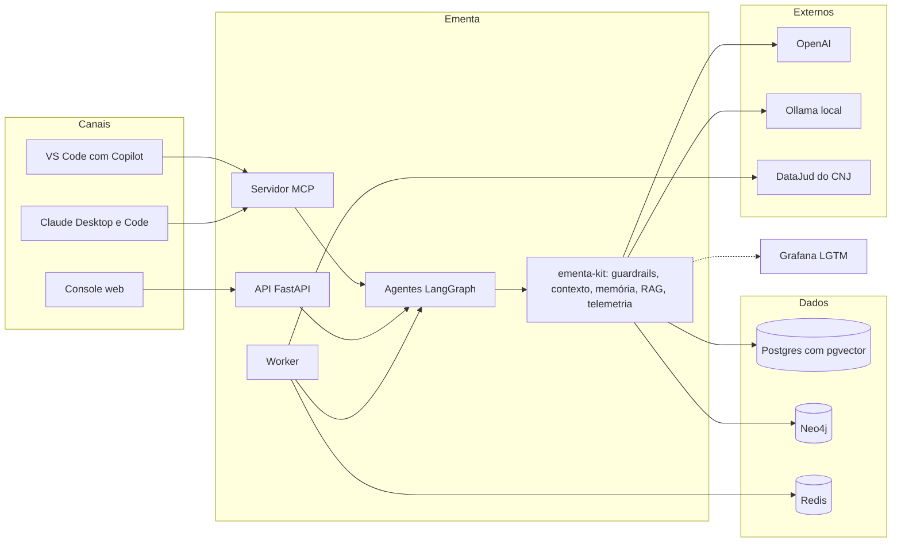

# Ementa

Plataforma de agentes de IA para escritórios de advocacia. Faz pesquisa jurídica com citações verificadas, análise de contratos, peças com revisão humana e controle de prazos, com governança em todas as etapas.

[](https://github.com/brunocs100/ementa/actions/workflows/ci.yml)   

> [!IMPORTANT]
> Projeto em construção. O código entra por fases: a F0 (fundação) e a F1 (pesquisa no CDC com citação verificada e cálculo de prazo, pelo MCP) fecham o Marco 1. A F2 (LGPD, CPC e súmulas no corpus, rerank, dados pessoais pseudonimizados, skills, API REST, MCP em HTTP e avaliação no CI) também está pronta; a próxima é a F3. Os dados de clientes são fictícios e nada aqui é aconselhamento jurídico.

## O que é

A Ementa atende um escritório fictício, o "Escritório Modelo", começando pelo Direito do Consumidor. Agentes especializados pesquisam leis e súmulas, revisam contratos, rascunham peças e acompanham processos. Nada sai do escritório sem aprovação do advogado responsável.

O projeto mostra, num produto só, como se constroem e se operam agentes de IA em ambiente corporativo: RAG com permissão, multiagentes com humano no circuito, MCP, guardrails, observabilidade, avaliação contínua e um kit reutilizável separado do domínio.

## O que os agentes fazem

| Agente ou ferramenta | O que faz | Fase |
|---|---|---|
| Pesquisa jurídica (`legal_research`) | Responde com base no corpus e confere cada citação antes de mostrar | F1 |
| Prazos (ferramenta `calculate_deadline`) | Calcula prazo processual em dias úteis, com feriados e suspensões, e lista as premissas | F1 |
| Assistente (`assistant`) | Recebe o pedido e encaminha para o agente certo | F3 |
| Contratos (`contract_review`) | Analisa cláusula por cláusula contra o playbook do escritório | F4 |
| Peças (`brief_drafting`) | Planeja, pesquisa, redige, revisa e espera a aprovação do advogado | F4 |
| Processos (`case_monitor`) | Acompanha movimentações no DataJud do CNJ e avisa sobre prazos | F5 |
| Triagem (`intake`) | Organiza o relato do cliente e verifica conflito de interesses | F5 |
| BI (`firm_analytics`) | Responde perguntas de gestão em SQL guardado | F6 |
| Compliance LGPD (`lgpd_compliance`) | Confere documentos contra a LGPD, em Semantic Kernel | F8 |
| Revisor de PR (`pr_reviewer`) | Revisa os pull requests do próprio repositório | F8 |

## Arquitetura



Detalhes em [docs/ARQUITETURA.md](docs/ARQUITETURA.md) e nos [ADRs](docs/adr/README.md).

## Destaques de engenharia

- **Citação verificada.** O modelo só pode citar ids de fonte que estão no contexto; um verificador determinístico confere cada citação, e a que não bate sai da resposta com aviso.
- **RAG com permissão no banco.** O Row Level Security do Postgres filtra os trechos que cada advogado pode recuperar. A barreira ética entre clientes vale também para a busca.
- **Sigilo decide o modelo.** Processo em segredo de justiça só roda no modelo local. Dado pessoal vira marcador (`[CPF_1]`) antes de qualquer chamada de nuvem.
- **Prazo é código, não modelo.** O cálculo é uma ferramenta testada com Hypothesis; o LLM só chama a ferramenta e explica o resultado.
- **Uma porta para todos os clientes de IA.** Copilot, Claude e o agente Semantic Kernel usam o mesmo servidor MCP, com guardrails, auditoria e classificação de saída. O cliente MCP de terceiro é tratado como modelo de nuvem.
- **Histórico só de acréscimo.** Nada é editado depois que o modelo viu, o que mantém o cache de prompt e permite trocar de provedor.
- **Observável por padrão.** Cada agente, chamada de modelo, busca, guardrail e ferramenta vira span OpenTelemetry com tokens e custo.
- **Avaliação no CI.** Perguntas douradas com citação esperada tirada do texto da lei, comparação com a linha de base e teto de custo por rodada.
- **Kit reutilizável.** O `ementa-kit` não conhece direito e serve a qualquer time; o import-linter garante a separação.

## Stack

| Camada | Tecnologia | Por quê |
|---|---|---|
| Linguagem | Python 3.12, uv workspace | Ecossistema de IA; monorepo com kit e domínio separados |
| Orquestração | LangGraph, LangChain 1.x | Grafo explícito, checkpoint, humano no circuito, map-reduce |
| Modelos | OpenAI (GPT-6.1 Terra, GPT-6 Luna, GPT-6.1 Sol), Ollama | Papéis por custo e risco; o sigiloso fica local |
| Conhecimento | Postgres 17 com pgvector e busca textual, Neo4j | Busca híbrida com RLS; grafo de citações e de conflito |
| Integração | MCP (spec 2026-07-28), FastAPI, DataJud | Clientes de IA falam MCP; REST para o resto |
| Segurança | Presidio, sqlglot, RLS, promptfoo | PII brasileira, SQL guardado, barreiras éticas, red team |
| Observabilidade | OpenTelemetry GenAI, Grafana LGTM, structlog | Trace de agente, ferramenta e custo |
| Qualidade | pytest, Hypothesis, testcontainers, ruff, mypy, import-linter | Testes por propriedade, integração real, arquitetura conferida |
| ML | QLoRA (Colab ou Kaggle), Ollama, MLflow | Triagem local e barata, com registro e cascata |
| Microsoft | Semantic Kernel, Microsoft Agent Framework | Agente LGPD consumindo o MCP |
| Entrega | GitHub Actions, GHCR, MkDocs | CI, avaliação, segurança, release e site de docs |

## Roadmap

| Marco | Fases | O que dá para mostrar | Meta | Status |
|---|---|---|---|---|
| 0 | — | Plano, arquitetura e decisões | 14/11/2026 | Pronto |
| 1 | F0, F1 | Pesquisa no CDC com citação verificada e cálculo de prazo, pelo MCP no VS Code, com traces | 19/11/2026 | Pronto |
| 2 | F2, F3 | PII pseudonimizada, skills, API, memória e supervisor | 04/12/2026 | Em andamento (F2 pronta) |
| 3 | F4 a F6 | Contratos e peças com aprovação humana, DataJud, grafo e governança completa | 15/01/2027 | Planejado |
| 4 | F7 a F10 | Operação, Semantic Kernel, Copilot, fine-tuning, MLOps e kit publicado | 19/02/2027 | Planejado |

As fases, tarefas e critérios de aceite estão em [docs/PLANO.md](docs/PLANO.md).

## Documentação

| Documento | Para quê |
|---|---|
| [Resumo](docs/RESUMO.md) | O projeto em duas páginas |
| [Plano](docs/PLANO.md) | Fases F0 a F10, entregas, critérios de aceite e estimativas |
| [Arquitetura](docs/ARQUITETURA.md) | Containers, componentes, fluxos, dados, modelos, contexto e MCP |
| [Agentes](docs/AGENTES.md) | Cada agente: grafo, estado, ferramentas, guardrails e métricas |
| [Segurança e governança](docs/SEGURANCA-E-GOVERNANCA.md) | Ameaças, OWASP LLM Top 10, guardrails, RLS, LGPD e red team |
| [Copilot corporativo](docs/COPILOT-CORPORATIVO.md) | Playbook de uso do GitHub Copilot e a configuração deste repo |
| [Observabilidade](docs/OBSERVABILIDADE.md) | Spans, métricas, dashboards, SLOs e custo |
| [Avaliação](docs/AVALIACAO.md) | Datasets dourados, métricas, gates no CI e red team |
| [ML e fine-tuning](docs/ML-E-FINE-TUNING.md) | Modelo pequeno para triagem, MLflow e cascata |
| [Competências](docs/COMPETENCIAS.md) | Onde cada competência aparece e como demonstrar |
| [Roteiro de demo](docs/ROTEIRO-DEMO.md) | Demos de 5 e de 15 minutos |
| [ADRs](docs/adr/README.md) | As 12 decisões de arquitetura, com alternativas |
| [AGENTS.md](AGENTS.md) | Instruções para agentes de código (Copilot, Claude Code) |

## Como rodar

> [!NOTE]
> Precisa de Docker (Postgres e Grafana) e de uma chave da OpenAI no `.env` (modelo em `.env.example`). Na primeira execução são baixados o modelo de embeddings (cerca de 2,2 GB) e o de rerank; a carga do corpus inteiro leva cerca de 10 minutos.

```powershell
uv sync
docker compose --profile core --profile obs up -d
uv run ementa ingest all --reset
uv run ementa ask "Comprei pela internet e me arrependi. Tenho quanto tempo para desistir?"
uv run ementa smoke --file evals/legal_research.jsonl --retrieval-only
uv run ementa-api                     # REST em http://127.0.0.1:8000/docs
uv run pytest -m "not eval"
```

No VS Code, o `.vscode/mcp.json` aponta para o servidor `ementa` via stdio; `uv run ementa-mcp --http` serve o mesmo MCP em Streamable HTTP. O Grafana fica em `http://localhost:3000`.

## Licença e avisos

Código sob licença [MIT](LICENSE). O corpus é público: leis e decisões judiciais não têm proteção de direito autoral (Lei 9.610/98, art. 8º, IV). Os dados de clientes, processos e contratos são fictícios. Nada neste repositório é aconselhamento jurídico.
