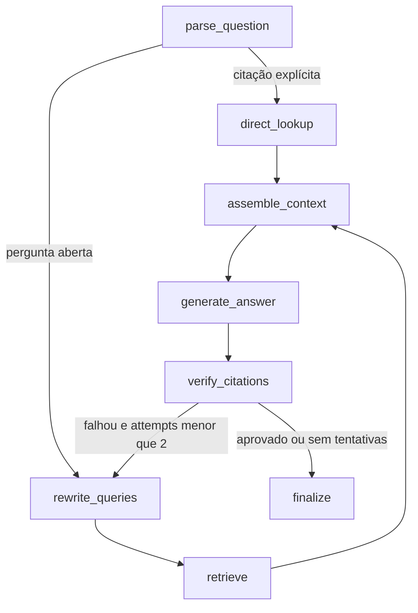
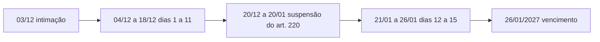
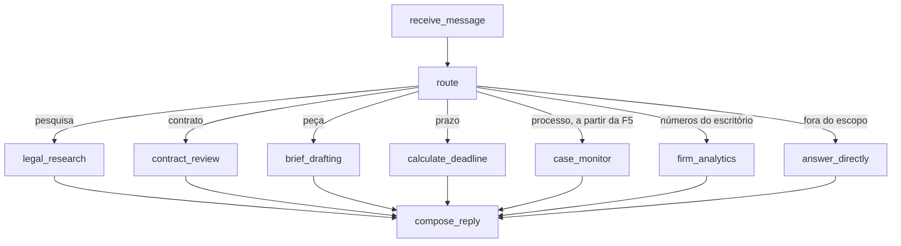
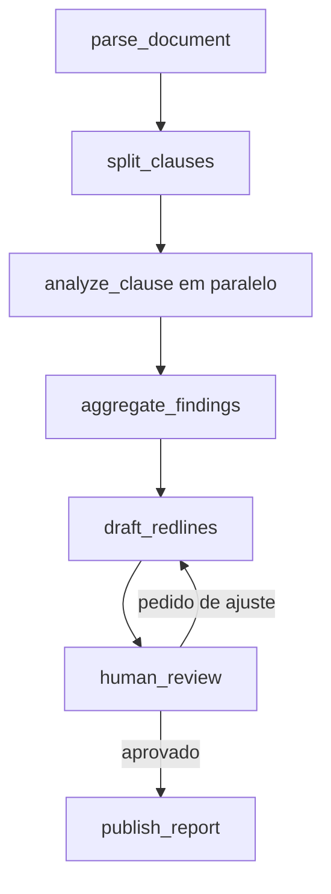
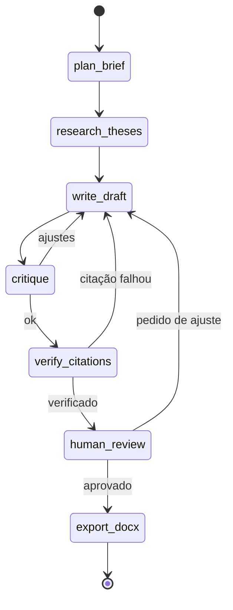
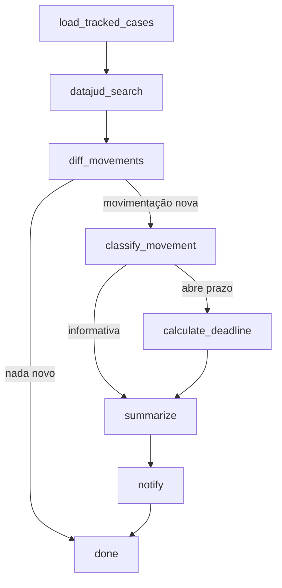
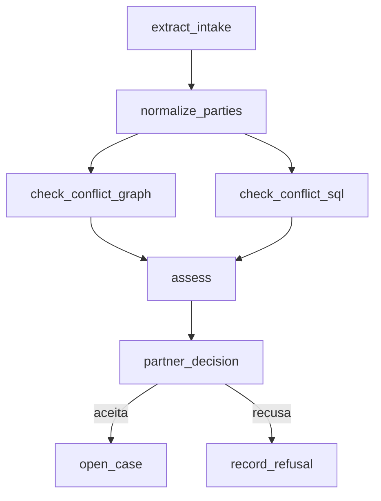
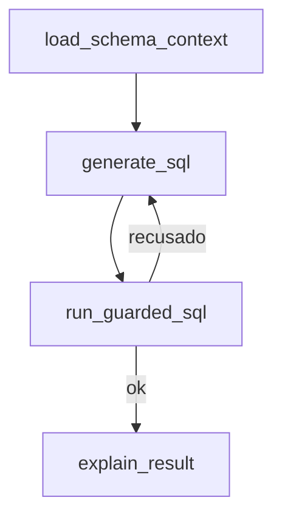
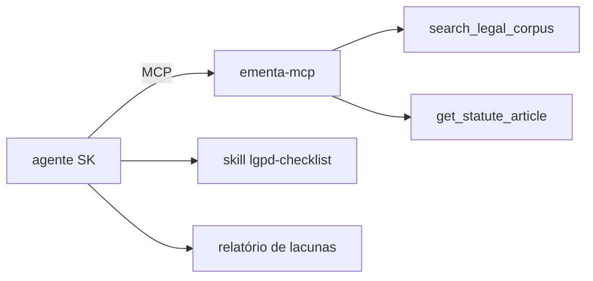
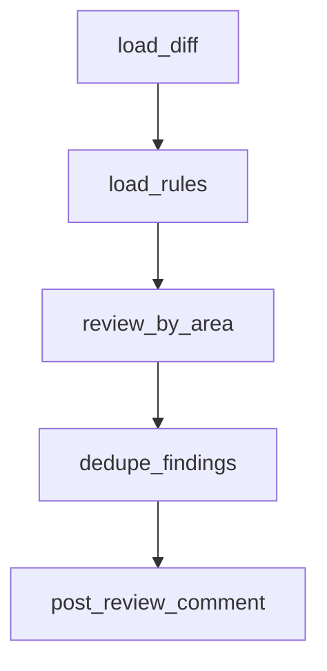

# Agentes

Catálogo dos agentes e das ferramentas da Ementa: o que cada um faz, como o grafo é montado, que modelo usa, que guardrails passam por ele e como é avaliado.

**Status:** Documentado (código a partir da F1) · **Ver também:** [Arquitetura](ARQUITETURA.md), [Plano](PLANO.md), [ADR 0002](adr/0002-langgraph-como-orquestrador.md), [Segurança e governança](SEGURANCA-E-GOVERNANCA.md)

## Visão geral

| Agente | id | Padrão | Fase | Status |
|---|---|---|---|---|
| Pesquisa jurídica | `legal_research` | RAG agêntico com reflexão | F1, F2, F5 | Documentado |
| Assistente | `assistant` | Supervisor que roteia | F3 | Documentado |
| Análise de contratos | `contract_review` | Map-reduce por cláusula | F4 | Documentado |
| Redação de peças | `brief_drafting` | Plan-and-execute com crítico e HITL | F4 | Documentado |
| Prazos e processos | `case_monitor` | Workflow agendado | F5 | Documentado |
| Triagem e conflito | `intake` | Extração estruturada e verificação em grafo | F5 | Documentado |
| BI do escritório | `firm_analytics` | Texto para SQL com guarda | F6 | Documentado |
| Compliance LGPD | `lgpd_compliance` | Agente Semantic Kernel consumindo o MCP | F8 | Documentado |
| Revisor de PR | `pr_reviewer` | Workflow no GitHub Actions | F8 | Documentado |

Ferramenta isolada que existe desde a F1: `calculate_deadline`, exposta no MCP e reaproveitada pelo `case_monitor` na F5.

Os agentes seguem três regras que valem para todos:

- O modelo nunca calcula: prazo, valor e contagem saem de ferramenta determinística testada.
- Toda resposta com citação passa pelo verificador antes de sair.
- Ação que sai do escritório (e-mail ao cliente, peça final, comentário público) para num `interrupt()` e espera aprovação humana.

## O que todo agente recebe do `AgentFactory`

O `AgentFactory` (padrão Builder, no `ementa_kit`) monta cada agente a partir de uma especificação curta. Quem escreve um agente novo declara o grafo, as ferramentas e o papel do modelo; o resto vem pronto.

| Recurso | O que o factory faz | Onde |
|---|---|---|
| Modelo por papel | Resolve `reasoning`, `default`, `fast`, `judge` ou `local` pelo registro de modelos, já com effort, timeout e retry | `ementa_kit.llm` |
| Política antes da chamada | Consulta o motor de políticas: sigilo do processo pode trocar a rota para `local` | `ementa_kit.policy` |
| Ferramentas com guardrails | Embrulha cada ferramenta com schema estrito, lista permitida por papel, nível de risco e auditoria | `ementa_kit.guardrails` |
| Contexto | Monta a visão que vai ao modelo, com orçamento por seção e histórico só de acréscimo | `ementa_kit.context` |
| Memória | Liga checkpointer e store do LangGraph no Postgres, com namespaces e permissão herdada do processo | `ementa_kit.memory` |
| Telemetria | Abre spans `invoke_agent`, `chat`, `execute_tool`, `retrieval` e `guardrail` com atributos `gen_ai.*` e `ementa.*` | `ementa_kit.telemetry` |
| Auditoria | Grava execução, ferramentas chamadas e decisões de guardrail na trilha com hash encadeado | `ementa_kit.audit` |
| Orçamento | Soma o custo por execução e para tudo quando o teto do dia ou do mês estoura | `ementa_kit.llm` |

```python
# Esboço da especificação de um agente (F1); nomes finais definidos no código.
spec = AgentSpec(
    name="legal_research",
    model_role="default",
    tools=[search_legal_corpus, get_statute_article],
    output_guardrails=["citations", "draft_disclaimer"],
    memory=None,  # entra na F3
)
graph = AgentFactory(settings).build(spec, build_graph=legal_research_graph)
```

## Pesquisa jurídica (`legal_research`)

**Objetivo.** Responder a perguntas de direito com base no corpus público, citando só fontes que existem e que estavam no contexto da resposta.

**Gatilho e canal.** Pergunta vinda do Copilot ou do Claude pelo `ementa-mcp` (ferramenta `answer_legal_question`, F1), da rota `POST /v1/legal-research` (F2) ou do `assistant` (F3).

**Padrão e por quê.** RAG agêntico com reflexão. A busca é feita por código, não pelo modelo escolhendo ferramenta a cada passo: o caminho é previsível, barato e fácil de testar. A reflexão é um laço curto: se o verificador reprova a resposta, o grafo reescreve as consultas com o motivo da falha e tenta mais uma vez.

### Grafo



- `parse_question`: detecta citação explícita ("art. 49 do CDC") e normaliza para id canônico (`cdc:art49`).
- `direct_lookup`: busca o artigo pelo id, sem passar pelo modelo.
- `rewrite_queries`: gera consultas com sinônimos jurídicos ("CDC" e "Código de Defesa do Consumidor"); na segunda volta, usa o motivo da reprovação.
- `retrieve`: busca vetorial e textual (top 30 cada) com fusão RRF; rerank para top 8 a partir da F2; a partir da F5, `expand_citation_graph` entra aqui e traz súmulas e decisões ligadas ao artigo.
- `assemble_context`: monta o contexto com os ids de fonte, dentro do orçamento de tokens.
- `generate_answer`: responde em Structured Outputs, citando só ids de fonte do contexto.
- `verify_citations`: confere cada citação contra as fontes que foram para o contexto; citação fora delas sai, mesmo que exista no corpus.
- `finalize`: remove a citação não verificada, avisa o usuário e põe o aviso de rascunho.

### Estado

| Campo | Tipo | Conteúdo |
|---|---|---|
| `question` | `str` | Pergunta original |
| `user_role` | `str` | Papel de quem pergunta (filtra fontes por permissão) |
| `queries` | `list[str]` | Consultas geradas por `rewrite_queries` |
| `candidates` | `list[Chunk]` | Resultado bruto da busca, com pontuação |
| `sources` | `list[Source]` | Fontes que entraram no contexto, com id canônico |
| `draft` | `Answer` | Resposta estruturada do modelo |
| `citations` | `list[str]` | Ids citados no rascunho |
| `verification` | `Verification` | `verified` e `unverified` |
| `attempts` | `int` | Tentativas de geração |
| `final_answer` | `Answer` | Resposta entregue |
| `cost_usd` | `float` | Custo acumulado da execução |

### Ferramentas

| Ferramenta | Tipo | Guardrails |
|---|---|---|
| `search_legal_corpus` | Leitura | Schema estrito, classe de dado público, limite de resultados |
| `get_statute_article` | Leitura | Schema estrito, id canônico validado |
| `search_sumulas` (F2) | Leitura | Schema estrito, classe de dado público |
| `expand_citation_graph` (F5) | Leitura | Profundidade máxima, classe de dado público |

### Modelo, memória e HITL

- Papel `fast` (GPT-6 Luna) em `rewrite_queries`; papel `default` (GPT-6.1 Terra, effort medium) em `generate_answer`.
- Sem memória na F1. A partir da F3, lê preferências do advogado (formato de citação) no namespace dele.
- Sem HITL: a resposta é informativa e sempre marcada como rascunho.

### Exemplo de saída

<details><summary>Resposta estruturada (formato previsto)</summary>

```json
{
  "answer": "O consumidor pode desistir em 7 dias, contados da assinatura ou do recebimento, quando a compra é feita fora do estabelecimento comercial.",
  "citations": [{"id": "cdc:art49", "label": "CDC, art. 49", "verified": true}],
  "removed_citations": [],
  "disclaimer": "Rascunho gerado por IA. Confira antes de usar.",
  "trace_id": "4bf92f3577b34da6a3ce929d0e0e4736"
}
```

</details>

### Métricas e avaliação

- Recall@5 e MRR da busca; precisão e recall de citação; taxa de citação removida; latência p95; custo por pergunta.
- F1: 10 perguntas de fumaça sobre o CDC, rodadas à mão. F2: 30 perguntas no CI, com gate contra a linha de base do `main`. Detalhes em [Avaliação](AVALIACAO.md).
- Meta: recall@5 ≥ 0,85 e 100% das citações exibidas verificadas.

**Custo estimado:** cerca de US$ 0,015 por pergunta (estimativa, conferir na F1). **Fase:** F1 (núcleo), F2 (rerank, súmulas, API), F5 (grafo). **Status:** Documentado.

## Ferramenta `calculate_deadline`

Ferramenta determinística, sem LLM. Existe para que nenhum modelo conte dias úteis. Exposta no MCP desde a F1 e usada pelo `case_monitor` na F5.

### Contrato

| Entrada | Tipo | Exemplo |
|---|---|---|
| `start_date` | data | `2026-12-03` (data da intimação) |
| `days` | inteiro | `15` |
| `count_mode` | `business_days` ou `calendar_days` | `business_days` |
| `court` | texto | `"TJRS"` |
| `state` | UF | `"RS"` |

| Saída | Conteúdo |
|---|---|
| `due_date` | Último dia do prazo |
| `skipped` | Dias pulados, com motivo (fim de semana, feriado, suspensão) |
| `rules_applied` | CPC art. 219 (dias úteis), art. 224 (exclui o dia do começo e inclui o do vencimento), art. 220 (suspensão de 20/12 a 20/01) |
| `assumptions` | Termo inicial informado pelo usuário; feriados municipais e portarias do tribunal fora do cálculo |
| `disclaimer` | Aviso de conferência pelo advogado |

### Caso fixo da demo

Intimação na quinta, 03/12/2026, 15 dias úteis no TJRS. O vencimento é terça, 26/01/2027.



Esse caso vira teste fixo na F1. Além dele, testes por propriedade com Hypothesis garantem que o vencimento nunca cai em fim de semana, feriado ou suspensão, e que aumentar `days` nunca antecipa o vencimento.

**Guardrails:** schema estrito; `days` entre 1 e 365; UF e tribunal de uma lista conhecida. **Classe de dado:** público. **Fase:** F1. **Status:** Documentado.

## Catálogo de ferramentas MCP

O que o `ementa-mcp` expõe a clientes externos (Copilot, Claude, agente SK). Cada ferramenta declara a classe de dado que devolve; a política de saída pseudonimiza o restrito e nega o sigiloso.

| Ferramenta | O que faz | Classe de dado | Agente ou módulo por trás | Fase |
|---|---|---|---|---|
| `search_legal_corpus` | Busca híbrida no corpus público | Público | RAG do `legal_research` | F1 |
| `answer_legal_question` | Resposta com citações verificadas | Público | `legal_research` | F1 |
| `get_statute_article` | Texto exato de um artigo | Público | RAG | F1 |
| `calculate_deadline` | Prazo processual com premissas | Público | Ferramenta determinística | F1 |
| `list_skills` | Nome e descrição das skills de runtime, sem as instruções | Público | `ementa_kit.skills` | F2 |
| `load_skill` | Instruções completas de uma skill, pelo nome | Público | `ementa_kit.skills` | F2 |
| `review_contract` | Análise de contrato, como tarefa longa | Restrito | `contract_review` | F4 |
| `lookup_case` | Metadados e movimentações recentes de um processo pelo número CNJ | Restrito; sigiloso negado | `DataJudClient` e `case_monitor` | F5 |
| `check_conflict` | Verifica conflito de interesses para um nome ou documento | Restrito | `check_conflict_graph` e `check_conflict_sql` do `intake` | F5 |
| `query_firm_analytics` | Pergunta de gestão em SQL guardado | Restrito | `firm_analytics` | F6 |

O `assistant` não é exposto por MCP; o cliente externo chama as ferramentas diretamente.

## Assistente (`assistant`)

**Objetivo.** Porta de entrada única de chat: entende o pedido e delega ao agente certo.

**Gatilho e canal.** Chat no console e rota `/v1/chat` com SSE (F3).

**Padrão e por quê.** Supervisor que roteia. Cada subagente roda na própria conversa com o modelo, o que isola contexto e mantém o histórico só de acréscimo em cada uma.



**Estado:** `messages`, `user_id`, `user_role`, `route`, `route_confidence`, `delegated_result`, `cost_usd`.

| Ferramenta | Tipo | Guardrails |
|---|---|---|
| Subgrafos dos agentes | Conforme o agente | Lista permitida por papel (estagiário não chega ao BI) |

- **Modelo:** `fast` no roteamento, com saída estruturada (rota e confiança); `default` na resposta final. Na F9, o roteamento pode passar para o modelo local ajustado.
- **Memória:** curta (checkpointer por thread) e longa (preferências do advogado).
- **HITL:** herda dos subagentes.
- **Métricas:** acurácia do roteamento num conjunto rotulado; taxa de "fora do escopo"; custo por conversa.
- **Custo estimado:** um roteamento custa uma fração de centavo; o resto é o do subagente. **Fase:** F3. **Status:** Documentado.

## Análise de contratos (`contract_review`)

**Objetivo.** Ler um contrato, apontar cláusulas de risco segundo o playbook do escritório e propor redlines.

**Gatilho e canal.** Upload no console ou ferramenta MCP `review_contract` (tarefa longa, F4).

**Padrão e por quê.** Map-reduce por cláusula. Cada cláusula é analisada em paralelo com `Send` do LangGraph, com contexto pequeno e focado; a redução junta os achados e elimina repetição.



**Estado:** `document_id`, `clauses`, `findings` (cláusula, regra, risco, justificativa), `redlines`, `review_decision`, `cost_usd`.

| Ferramenta | Tipo | Guardrails |
|---|---|---|
| `parse_document` | Leitura | Detecção de texto oculto em PDF e DOCX (F6), tamanho máximo |
| `classify_clause` | Leitura | Saída estruturada |
| `check_playbook_rule` | Leitura | Regra determinística do playbook antes do julgamento do modelo |

- **Modelo:** `fast` para classificar cláusulas; `reasoning` (effort high) para redlines.
- **Memória:** playbook e teses aprovadas do escritório no namespace do escritório.
- **HITL:** obrigatória antes de publicar o relatório.
- **Métricas:** F1 sobre os contratos fictícios com cláusulas plantadas; taxa de falso alarme; custo por contrato.
- **Custo estimado:** ordem de dezenas de centavos de dólar por contrato médio (estimativa, conferir na F4). **Fase:** F4. **Status:** Documentado.

## Redação de peças (`brief_drafting`)

**Objetivo.** Produzir o rascunho de uma peça (ex.: petição inicial de consumo) a partir dos fatos, com teses pesquisadas e citações verificadas.

**Gatilho e canal.** Pedido do advogado no console (F4).

**Padrão e por quê.** Plan-and-execute com crítico e verificação. O plano separa as teses; cada tese é pesquisada pelo subgrafo do `legal_research`; o crítico revisa a coerência; o verificador bloqueia peça com citação não confirmada. Peça é o produto mais arriscado do escritório, por isso a aprovação humana é obrigatória.



**Estado:** `case_id`, `facts`, `plan` (teses), `research` (fontes por tese), `draft`, `critique_notes`, `verification`, `review_decision`, `lawyer_edits`, `cost_usd`.

| Ferramenta | Tipo | Guardrails |
|---|---|---|
| Subgrafo `legal_research` | Leitura | Os da pesquisa |
| `render_template` | Leitura | Só modelos aprovados do escritório |
| `verify_citations` | Leitura | Bloqueia em vez de só remover |
| `export_docx` | Escrita | Só depois da aprovação; auditado |

- **Modelo:** `reasoning` (effort high) para plano, rascunho e crítica.
- **Memória:** ficha do processo; memória episódica com rascunhos aprovados e a edição do advogado, usada como exemplo few-shot e, na F9, como dado de treino.
- **HITL:** `interrupt()` antes de exportar; o advogado aprova, edita ou devolve.
- **Métricas:** taxa de aprovação sem edição; tamanho da edição do advogado; citações bloqueadas; custo por peça.
- **Custo estimado:** ordem de dezenas de centavos de dólar por peça (estimativa, conferir na F4). **Fase:** F4. **Status:** Documentado.

## Prazos e processos (`case_monitor`)

**Objetivo.** Acompanhar processos no DataJud, detectar movimentações novas, calcular prazos e avisar o responsável.

**Gatilho e canal.** Agendador no worker (F5). Notificação por e-mail (Mailpit no dev) e webhook de Teams ou Slack.

**Padrão e por quê.** Workflow agendado, determinístico, com LLM só onde ajuda: classificar a movimentação e resumir. Busca, comparação e cálculo são código.



**Estado:** `case_ids`, `movements_new`, `classifications`, `deadlines`, `notifications`, `errors`.

| Ferramenta | Tipo | Guardrails |
|---|---|---|
| `datajud_search` | Leitura externa | Chave por variável de ambiente, guarda de egress, limite de taxa, só metadados |
| `classify_movement` | Leitura | Saída estruturada |
| `calculate_deadline` | Leitura | Os da ferramenta |
| `notify` | Externa | Só para usuário interno; sem dado sigiloso no corpo do e-mail |

- **Modelo:** `fast` para classificar e resumir; rota `local` quando o processo é sigiloso (F6).
- **Memória:** movimentações já vistas no Postgres.
- **HITL:** não age fora do escritório; só alerta.
- **Métricas:** prazos detectados contra um conjunto de teste; atraso entre movimentação e alerta; falhas do DataJud.
- **Custo estimado:** fração de centavo por movimentação nova (estimativa). **Fase:** F5. **Status:** Documentado.

## Triagem e conflito (`intake`)

**Objetivo.** Transformar o relato do potencial cliente em ficha estruturada e verificar conflito de interesses antes de aceitar o caso.

**Gatilho e canal.** Formulário ou chat no console (F5).

**Padrão e por quê.** Extração estruturada seguida de verificação em grafo. O conflito é uma pergunta de relacionamento (essa parte contrária já foi cliente? é sócia de um cliente?), que o grafo responde melhor que SQL.



**Estado:** `narrative`, `intake` (área, subárea, urgência, partes, documentos necessários), `conflicts`, `assessment`, `decision`.

| Ferramenta | Tipo | Guardrails |
|---|---|---|
| `extract_intake` | Leitura | Pseudonimização antes da nuvem; saída estruturada |
| `check_conflict_graph` | Leitura | Pessoas só por hash com sal no Neo4j |
| `check_conflict_sql` | Leitura | RLS; só o necessário para o conflito |
| `open_case` | Escrita | Só depois da decisão da sócia; auditado |

- **Modelo:** `fast` na extração (candidato ao modelo ajustado da F9).
- **HITL:** a sócia decide.
- **Métricas:** acurácia de área e urgência; conflitos encontrados no conjunto plantado.
- **Custo estimado:** fração de centavo por triagem (estimativa). **Fase:** F5. **Status:** Documentado.

## BI do escritório (`firm_analytics`)

**Objetivo.** Responder perguntas sobre os números do escritório (prazos vencendo, horas por área, custo de IA) em linguagem natural.

**Gatilho e canal.** Pergunta no console ou ferramenta MCP `query_firm_analytics` (F6).

**Padrão e por quê.** Texto para SQL com guarda. O modelo escreve SQL; o código decide se ele roda.



**Estado:** `question`, `schema_context` (views do schema `analytics` e descrições), `sql`, `guard_result`, `rows`, `answer`, `attempts`.

| Ferramenta | Tipo | Guardrails |
|---|---|---|
| `run_guarded_sql` | Leitura | sqlglot: só SELECT em views permitidas, LIMIT obrigatório; papel `bi_reader`; `statement_timeout`; RLS com `app.user_id` |

- **Modelo:** `default`.
- **HITL:** não; só leitura.
- **Métricas:** acerto de resultado num conjunto de perguntas com SQL de gabarito; consultas recusadas pela guarda.
- **Custo estimado:** cerca de um centavo por pergunta (estimativa). **Fase:** F6. **Status:** Documentado.

## Compliance LGPD (`lgpd_compliance`)

**Objetivo.** Revisar um contrato ou fluxo de dados contra um checklist de LGPD e apontar lacunas.

**Gatilho e canal.** Pedido no console ou rotina agendada (F8).

**Padrão e por quê.** Agente Semantic Kernel consumindo as ferramentas do `ementa-mcp`. Mostra que o MCP é o contrato de integração: um agente de outro framework, em outro processo, usa as mesmas ferramentas com os mesmos guardrails. O porte para o Microsoft Agent Framework 1.x está no [ADR 0009](adr/0009-semantic-kernel-e-agent-framework.md).



| Ferramenta | Tipo | Guardrails |
|---|---|---|
| Ferramentas do `ementa-mcp` | Leitura | As do servidor MCP, incluindo a política de saída para cliente externo |

- **Modelo:** `default`, configurado no próprio SK.
- **HITL:** relatório é rascunho.
- **Métricas:** lacunas encontradas em documentos fictícios com falhas plantadas.
- **Fase:** F8. **Status:** Documentado.

## Revisor de PR (`pr_reviewer`)

**Objetivo.** Revisar pull requests do próprio repositório contra as regras do `AGENTS.md` e dos ADRs.

**Gatilho e canal.** Workflow `ai-review.yml` no GitHub Actions, a cada pull request (F8).

**Padrão e por quê.** Workflow simples: lê o diff, separa por área e confere regras concretas (ferramenta nova sem teste, guardrail não registrado, prompt mudado sem avaliação, dependência do kit para o domínio). É o agente que liga a Ementa ao ciclo de desenvolvimento.



| Ferramenta | Tipo | Guardrails |
|---|---|---|
| Leitura do diff e dos ADRs | Leitura | Só o repositório |
| Comentário no PR | Externa | Comentário apenas; o merge é humano |

- **Modelo:** `default`; orçamento por PR no CI.
- **Métricas:** achados aceitos contra descartados.
- **Fase:** F8. **Status:** Documentado.

---

[Voltar ao README](../README.md)
