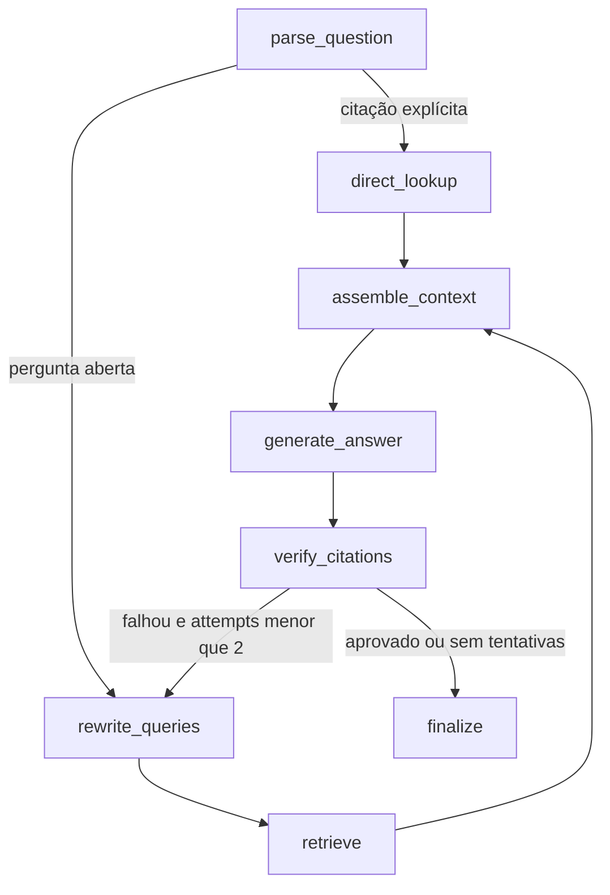
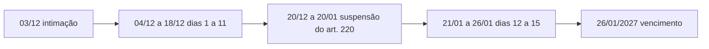
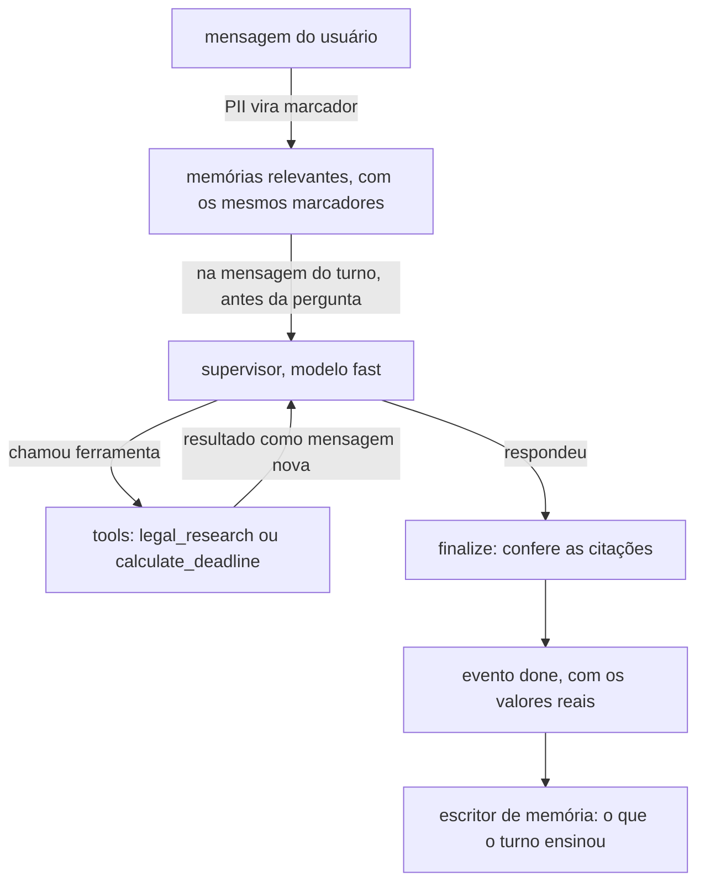
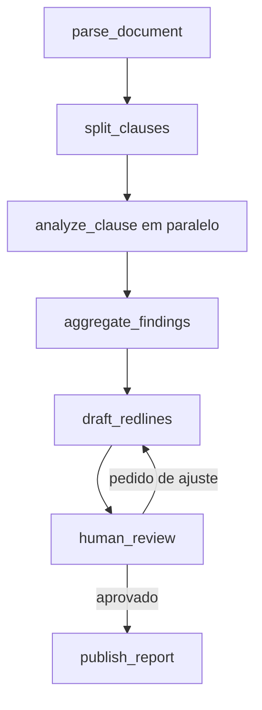
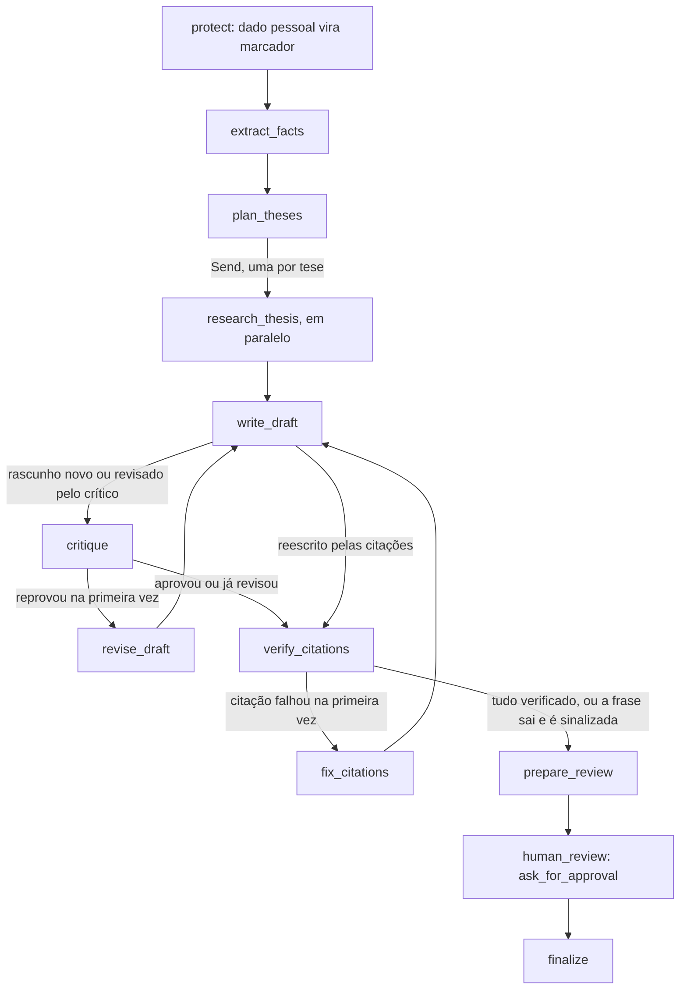
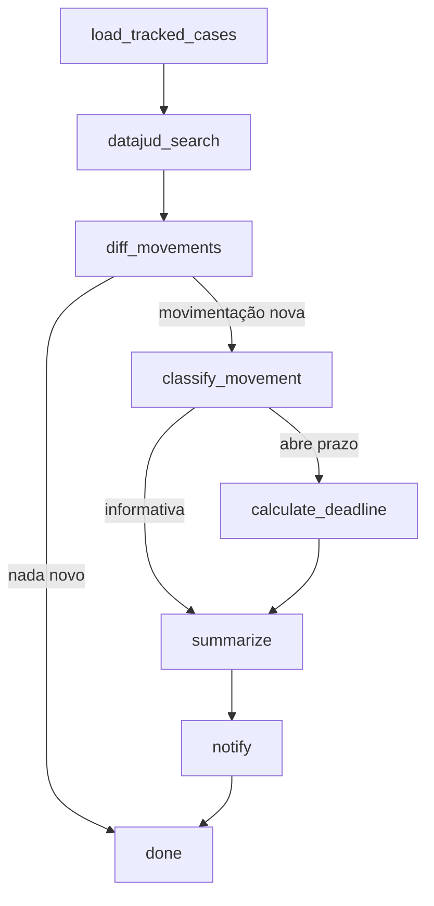
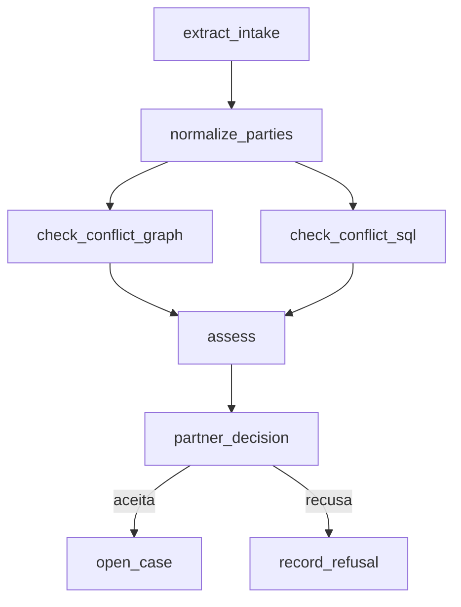
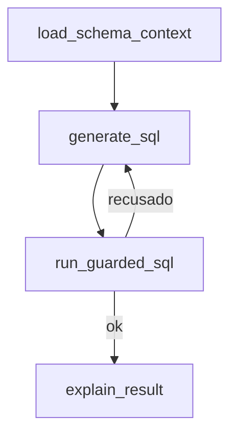
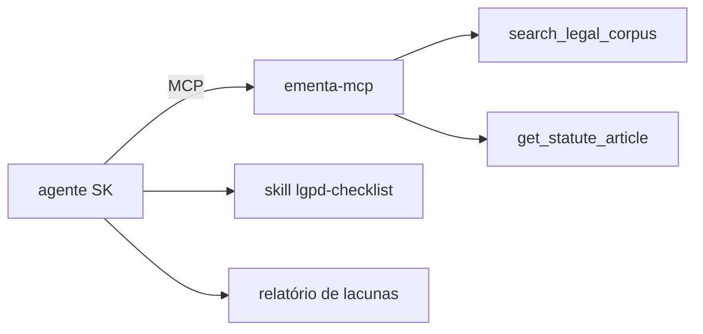
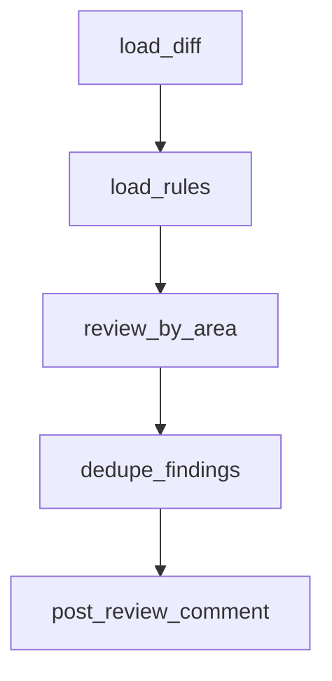

# Agentes

Catálogo dos agentes e das ferramentas da Ementa: o que cada um faz, como o grafo é montado, que modelo usa, que guardrails passam por ele e como é avaliado.

**Status:** Documentado (código a partir da F1) · **Ver também:** [Arquitetura](ARQUITETURA.md), [Plano](PLANO.md), [ADR 0002](adr/0002-langgraph-como-orquestrador.md), [Segurança e governança](SEGURANCA-E-GOVERNANCA.md)

## Visão geral

| Agente | id | Padrão | Fase | Status |
|---|---|---|---|---|
| Pesquisa jurídica | `legal_research` | RAG agêntico com reflexão | F1, F2, F5 | Documentado |
| Assistente | `assistant` | Supervisor que roteia | F3 | Implementado |
| Análise de contratos | `contract_review` | Map-reduce por cláusula | F4 | Documentado |
| Redação de peças | `brief_drafting` | Plan-and-execute com crítico e HITL | F4 | Implementado |
| Prazos e processos | `case_monitor` | Workflow agendado | F5 | Documentado |
| Triagem e conflito | `intake` | Extração estruturada e verificação em grafo | F5 | Documentado |
| BI do escritório | `firm_analytics` | Texto para SQL com guarda | F6 | Documentado |
| Compliance LGPD | `lgpd_compliance` | Agente Semantic Kernel consumindo o MCP | F8 | Documentado |
| Revisor de PR | `pr_reviewer` | Workflow no GitHub Actions | F8 | Documentado |

Ferramenta isolada que existe desde a F1: `calculate_deadline`, exposta no MCP e reaproveitada pelo `case_monitor` na F5.

Os agentes seguem três regras que valem para todos:

- O modelo nunca calcula: prazo, valor e contagem saem de ferramenta determinística testada.
- Toda resposta com citação passa pelo verificador antes de sair.
- Ação que sai do escritório (e-mail ao cliente, peça final, comentário público) para num `interrupt()` e espera aprovação humana.

## O que todo agente recebe do `AgentFactory`

O `AgentFactory` (padrão Builder, no `ementa_kit`) monta cada agente a partir de uma especificação curta. Quem escreve um agente novo declara o grafo, as ferramentas e o papel do modelo; o resto vem pronto.

| Recurso | O que o factory faz | Onde |
|---|---|---|
| Modelo por papel | Resolve `reasoning`, `default`, `fast`, `judge` ou `local` pelo registro de modelos, já com effort, timeout e retry | `ementa_kit.llm` |
| Política antes da chamada | Consulta o motor de políticas: sigilo do processo pode trocar a rota para `local` | `ementa_kit.policy` |
| Ferramentas com guardrails | Embrulha cada ferramenta com schema estrito, lista permitida por papel, nível de risco e auditoria | `ementa_kit.guardrails` |
| Contexto | Monta a visão que vai ao modelo, com orçamento por seção e histórico só de acréscimo | `ementa_kit.context` |
| Memória | Liga checkpointer e store do LangGraph no Postgres, com namespaces e permissão herdada do processo | `ementa_kit.memory` |
| Telemetria | Abre spans `invoke_agent`, `chat`, `execute_tool`, `retrieval` e `guardrail` com atributos `gen_ai.*` e `ementa.*` | `ementa_kit.telemetry` |
| Auditoria | Grava execução, ferramentas chamadas e decisões de guardrail na trilha com hash encadeado | `ementa_kit.audit` |
| Orçamento | Soma o custo por execução e para tudo quando o teto do dia ou do mês estoura | `ementa_kit.llm` |

```python
# Esboço da especificação de um agente (F1); nomes finais definidos no código.
spec = AgentSpec(
    name="legal_research",
    model_role="default",
    tools=[search_legal_corpus, get_statute_article],
    output_guardrails=["citations", "draft_disclaimer"],
    memory=None,  # entra na F3
)
graph = AgentFactory(settings).build(spec, build_graph=legal_research_graph)
```

## Agentes de redação com aprovação (F4)

O `contract_review` e o `brief_drafting` não rodam na rota que os pede. Cada execução é uma thread própria do LangGraph, movida pelo worker, que para onde o agente pede aprovação e retoma com a decisão do advogado (o fluxo está em [Arquitetura](ARQUITETURA.md#execução-com-aprovação-f4)). Do agente, o runner (`ementa_kit.hitl.runner.DraftingRunner`) espera duas coisas: que chame `ask_for_approval` (`ementa_kit.hitl`) antes de finalizar e que cumpra o protocolo `DraftingAgent`.

| Membro | O que é |
|---|---|
| `id` | O id fixo do agente, o mesmo do campo `agent` do `ApprovalRequest` que ele manda |
| `graph` | O grafo compilado com o checkpointer do Postgres (`services.checkpointer()`) |
| `example_query(request)` | O texto que busca os exemplos: os fatos da peça, o contrato |
| `build_input(request, examples)` | A entrada do grafo. `request` é o JSON que a rota aceitou; `examples`, até 3 episódios do agente, o mais próximo primeiro, com marcadores no lugar dos dados pessoais |
| `result(values)` | O que a execução devolve, em JSON, a partir do estado final; o estado inteiro fica no checkpointer |

```python
class BriefDraftingAgent:  # esboço: o agente de verdade define o grafo e o estado
    id = "brief_drafting"

    def __init__(self, models: ModelRegistry, checkpointer: BaseCheckpointSaver[Any]) -> None:
        self.graph = build_graph(models).compile(checkpointer=checkpointer)

    def example_query(self, request: Mapping[str, Any]) -> str:
        return str(request["facts"])

    def build_input(
        self, request: Mapping[str, Any], examples: Sequence[Episode]
    ) -> dict[str, Any]:
        shots = [{"draft": e.draft, "final": e.final, "diff": e.diff} for e in examples]
        return {"facts": request["facts"], "case_id": request.get("case_id"), "examples": shots}

    def result(self, values: Mapping[str, Any]) -> dict[str, Any]:
        return {"text": values["final"]}
```

O agente entra com uma linha em `services.drafting_agents()`; sem ela, a rota dele responde 503 (`/problems/agent-unavailable`). O pedido chega como a rota o aceitou: `POST /v1/briefs` manda `facts`, `kind` (`peticao_inicial` por padrão) e `case_id`, opcional; `POST /v1/contracts/{id}/review` manda `document_id`, um documento de `firm.documents` que o próprio agente lê.

O que o runner faz valer:

- O nó que chama `ask_for_approval` roda de novo desde o começo quando a execução retoma, como todo nó com `interrupt()`: o que vem antes da chamada não pode ter efeito fora do estado.
- O `ApprovalRequest` nomeia o próprio agente. Outro id, um `interrupt()` que não traga um `ApprovalRequest` ou um breakpoint estático falham a execução.
- `edit` chega com o texto do advogado em `text`; `approve` e `reject`, sem texto. O agente finaliza o que o advogado deixou passar: o rascunho no `approve`, o texto no `edit`.
- `reject` devolve o controle ao agente: ele termina, e a execução fica `rejected`, ou redige de novo e pergunta outra vez, o que abre uma aprovação nova.
- Grafo que termina sem ter perguntado falha a execução: nada sai finalizado sem decisão.
- `result` devolve JSON. O resultado fica em `ai.runs` e aparece no `run` de `GET /v1/approvals/{id}`.
- O estado guarda só valores simples: os `examples` como `dict`, a decisão como `decision.model_dump()`. O checkpointer do LangGraph 1.2 já avisa ao ler um tipo que não conhece, como `Episode` ou `ApprovalDecision`, e diz que vai recusá-lo numa versão próxima.

## Pesquisa jurídica (`legal_research`)

**Objetivo.** Responder a perguntas de direito com base no corpus público, citando só fontes que existem e que estavam no contexto da resposta.

**Gatilho e canal.** Pergunta vinda do Copilot ou do Claude pelo `ementa-mcp` (ferramenta `answer_legal_question`, F1), da rota `POST /v1/legal-research` (F2) ou do `assistant` (F3).

**Padrão e por quê.** RAG agêntico com reflexão. A busca é feita por código, não pelo modelo escolhendo ferramenta a cada passo: o caminho é previsível, barato e fácil de testar. A reflexão é um laço curto: se o verificador reprova a resposta, o grafo reescreve as consultas com o motivo da falha e tenta mais uma vez.

### Grafo



- `parse_question`: detecta citação explícita ("art. 49 do CDC") e normaliza para id canônico (`cdc:art49`).
- `direct_lookup`: busca o artigo pelo id, sem passar pelo modelo.
- `rewrite_queries`: gera consultas com sinônimos jurídicos ("CDC" e "Código de Defesa do Consumidor"); na segunda volta, usa o motivo da reprovação.
- `retrieve`: busca vetorial e textual (top 30 cada) com fusão RRF; rerank para top 8 a partir da F2; a partir da F5, `expand_citation_graph` entra aqui e traz súmulas e decisões ligadas ao artigo.
- `assemble_context`: monta o contexto com os ids de fonte, dentro do orçamento de tokens.
- `generate_answer`: responde em Structured Outputs, citando só ids de fonte do contexto.
- `verify_citations`: confere cada citação contra as fontes que foram para o contexto; citação fora delas sai, mesmo que exista no corpus.
- `finalize`: remove a citação não verificada, avisa o usuário e põe o aviso de rascunho.

### Estado

| Campo | Tipo | Conteúdo |
|---|---|---|
| `question` | `str` | Pergunta original |
| `user_role` | `str` | Papel de quem pergunta (filtra fontes por permissão) |
| `queries` | `list[str]` | Consultas geradas por `rewrite_queries` |
| `candidates` | `list[Chunk]` | Resultado bruto da busca, com pontuação |
| `sources` | `list[Source]` | Fontes que entraram no contexto, com id canônico |
| `draft` | `Answer` | Resposta estruturada do modelo |
| `citations` | `list[str]` | Ids citados no rascunho |
| `verification` | `Verification` | `verified` e `unverified` |
| `attempts` | `int` | Tentativas de geração |
| `final_answer` | `Answer` | Resposta entregue |
| `cost_usd` | `float` | Custo acumulado da execução |

### Ferramentas

| Ferramenta | Tipo | Guardrails |
|---|---|---|
| `search_legal_corpus` | Leitura | Schema estrito, classe de dado público, limite de resultados |
| `get_statute_article` | Leitura | Schema estrito, id canônico validado |
| `search_sumulas` (F2) | Leitura | Schema estrito, classe de dado público |
| `expand_citation_graph` (F5) | Leitura | Profundidade máxima, classe de dado público |

### Modelo, memória e HITL

- Papel `fast` (GPT-6 Luna) em `rewrite_queries`; papel `default` (GPT-6 Luna, effort medium, por custo) em `generate_answer`.
- Sem memória na F1. A partir da F3, lê preferências do advogado (formato de citação) no namespace dele.
- Sem HITL: a resposta é informativa e sempre marcada como rascunho.

### Exemplo de saída

<details><summary>Resposta estruturada (formato previsto)</summary>

```json
{
  "answer": "O consumidor pode desistir em 7 dias, contados da assinatura ou do recebimento, quando a compra é feita fora do estabelecimento comercial.",
  "citations": [{"id": "cdc:art49", "label": "CDC, art. 49", "verified": true}],
  "removed_citations": [],
  "disclaimer": "Rascunho gerado por IA. Confira antes de usar.",
  "trace_id": "4bf92f3577b34da6a3ce929d0e0e4736"
}
```

</details>

### Métricas e avaliação

- Recall@5 e MRR da busca; precisão e recall de citação; taxa de citação removida; latência p95; custo por pergunta.
- F1: 10 perguntas de fumaça sobre o CDC, rodadas à mão. F2: 30 perguntas no CI, com gate contra a linha de base do `main`. Detalhes em [Avaliação](AVALIACAO.md).
- Meta: recall@5 ≥ 0,85 e 100% das citações exibidas verificadas.

**Custo estimado:** cerca de US$ 0,015 por pergunta (estimativa, conferir na F1). **Fase:** F1 (núcleo), F2 (rerank, súmulas, API), F5 (grafo). **Status:** Documentado.

## Ferramenta `calculate_deadline`

Ferramenta determinística, sem LLM. Existe para que nenhum modelo conte dias úteis. Exposta no MCP desde a F1 e usada pelo `case_monitor` na F5.

### Contrato

| Entrada | Tipo | Exemplo |
|---|---|---|
| `start_date` | data | `2026-12-03` (data da intimação) |
| `days` | inteiro | `15` |
| `count_mode` | `business_days` ou `calendar_days` | `business_days` |
| `court` | texto | `"TJRS"` |
| `state` | UF | `"RS"` |

| Saída | Conteúdo |
|---|---|
| `due_date` | Último dia do prazo |
| `skipped` | Dias pulados, com motivo (fim de semana, feriado, suspensão) |
| `rules_applied` | CPC art. 219 (dias úteis), art. 224 (exclui o dia do começo e inclui o do vencimento), art. 220 (suspensão de 20/12 a 20/01) |
| `assumptions` | Termo inicial informado pelo usuário; feriados municipais e portarias do tribunal fora do cálculo |
| `disclaimer` | Aviso de conferência pelo advogado |

### Caso fixo da demo

Intimação na quinta, 03/12/2026, 15 dias úteis no TJRS. O vencimento é terça, 26/01/2027.



Esse caso vira teste fixo na F1. Além dele, testes por propriedade com Hypothesis garantem que o vencimento nunca cai em fim de semana, feriado ou suspensão, e que aumentar `days` nunca antecipa o vencimento.

**Guardrails:** schema estrito; `days` entre 1 e 365; UF e tribunal de uma lista conhecida. **Classe de dado:** público. **Fase:** F1. **Status:** Documentado.

## Catálogo de ferramentas MCP

O que o `ementa-mcp` expõe a clientes externos (Copilot, Claude, agente SK). Cada ferramenta declara a classe de dado que devolve; a política de saída pseudonimiza o restrito e nega o sigiloso.

| Ferramenta | O que faz | Classe de dado | Agente ou módulo por trás | Fase |
|---|---|---|---|---|
| `search_legal_corpus` | Busca híbrida no corpus público | Público | RAG do `legal_research` | F1 |
| `answer_legal_question` | Resposta com citações verificadas | Público | `legal_research` | F1 |
| `get_statute_article` | Texto exato de um artigo | Público | RAG | F1 |
| `calculate_deadline` | Prazo processual com premissas | Público | Ferramenta determinística | F1 |
| `list_skills` | Nome e descrição das skills de runtime, sem as instruções | Público | `ementa_kit.skills` | F2 |
| `load_skill` | Instruções completas de uma skill, pelo nome | Público | `ementa_kit.skills` | F2 |
| `review_contract` | Análise de contrato, como tarefa longa | Restrito | `contract_review` | F4 |
| `lookup_case` | Metadados e movimentações recentes de um processo pelo número CNJ | Restrito; sigiloso negado | `DataJudClient` e `case_monitor` | F5 |
| `check_conflict` | Verifica conflito de interesses para um nome ou documento | Restrito | `check_conflict_graph` e `check_conflict_sql` do `intake` | F5 |
| `query_firm_analytics` | Pergunta de gestão em SQL guardado | Restrito | `firm_analytics` | F6 |

O `assistant` não é exposto por MCP; o cliente externo chama as ferramentas diretamente.

## Assistente (`assistant`)

**Objetivo.** Porta de entrada única de chat: entende o pedido e delega ao agente certo.

**Gatilho e canal.** Rota `POST /v1/chat` com SSE (F3) e, na F4, o chat do console. O histórico de uma conversa sai em `GET /v1/threads/{id}`, só para quem a abriu.

**Padrão e por quê.** Supervisor que roteia por chamada de ferramenta. A cada turno, o modelo `fast` recebe as ferramentas que o papel de quem pergunta pode usar e decide se chama o `legal_research`, o `calculate_deadline` ou responde direto (fora do escopo, pedido de dado que falta). O mesmo modelo escreve a resposta com o que a ferramenta devolveu. Cada subagente roda na própria conversa com o modelo: o `legal_research` monta o próprio contexto com as fontes e não grava nada na conversa do chat, o que isola contexto e mantém o histórico só de acréscimo em cada uma.

Na F3, o roteamento por function calling substituiu o nó de classificação com rota e confiança do desenho: é uma chamada a menos por turno e não precisa de um nó para compor a resposta. A troca é perder o número de confiança do roteamento; a acurácia fica para o conjunto rotulado. Os agentes das fases seguintes (`contract_review`, `brief_drafting`, `case_monitor`, `firm_analytics`) entram como ferramentas novas do mesmo supervisor.



**Estado** (no checkpointer, uma thread por conversa):

| Campo | Conteúdo |
|---|---|
| `messages` | Tudo o que o modelo viu, pseudonimizado e só de acréscimo, inclusive o que ficou antes de uma compactação; o prompt de sistema é a primeira mensagem e congela quando a conversa começa |
| `view_start` | Depois de uma compactação, a posição do último resumo em `messages`: a visão do modelo é o prompt de sistema e o que vem dali em diante |
| `pii_mapping` | Marcador e valor de cada dado pessoal da conversa, os das memórias inclusive; só cresce, e o mesmo valor mantém o marcador em todos os turnos |
| `owner_id`, `prompt` | Quem abriu a conversa e o id e a versão do prompt congelado |
| `allowed_tools`, `rounds` | Ferramentas do turno, pelo papel de quem pergunta, e chamadas ao modelo no turno |
| `question` | A mensagem do turno, pseudonimizada e sem as memórias que vieram com ela: é o que o histórico mostra |
| `sources` | Fontes verificadas pelo `legal_research` na conversa |
| `turns` | Cada turno terminado como o usuário vê, ainda com marcadores: reidratado na leitura |

| Ferramenta | Tipo | Guardrails |
|---|---|---|
| `legal_research` | Subagente, leitura | Lista permitida por papel; a pergunta chega já pseudonimizada; citações verificadas dentro dele e de novo na resposta final |
| `calculate_deadline` | Leitura, determinística | Schema estrito; o vencimento vem do código, e o modelo nunca conta dias |

- **Modelo:** `fast` no roteamento e na resposta (GPT-6 Luna, effort low). Na F9, pode passar para o modelo local ajustado.
- **Prompt:** `assistant.supervisor` v1 em `prompts/assistant/`. Uma conversa aberta continua com o prompt da versão em que começou. As seções `memorias` e `resumo` chegam delimitadas por tags e o v1 não fala delas; uma v2 que as explique depende de rodar a avaliação.
- **Visão do modelo:** derivada do estado, sem editar nada: cada pedido começa com o pedido anterior inteiro (teste com `assert_append_only`, inclusive depois de reiniciar o processo). Resultado de ferramenta é truncado em 6.000 caracteres antes de entrar; o completo fica no `artifact` da mensagem, que não vai ao modelo.
- **Compactação:** quando a visão passa de `EMENTA_CONTEXT_BUDGET_TOKENS` (8.000 tokens aproximados, cerca de cinco turnos com pesquisa), o turno seguinte a resume antes de a mensagem entrar, com o `compact` do kit. O pedido de resumo é a visão inteira com o prompt `context.summarize` v1 no fim e as ferramentas do último turno com `tool_choice: none`, então reaproveita o prefixo em cache. O resumo entra em `messages` como mensagem nova e `view_start` aponta para ele: daí em diante a visão é o prompt de sistema, o resumo e o que vem depois, de novo só de acréscimo (teste também com reinício no Postgres). O estado guarda a conversa inteira para auditoria e o histórico mostra todos os turnos. O evento `ementa.context.compacted` vai para o `invoke_agent` do turno. Se o resumo falha, o erro fica no log, a visão segue inteira e o turno seguinte tenta de novo.
- **Limites:** até 3 chamadas com ferramentas por turno; a quarta vai com `tool_choice: none` e precisa responder, com as mesmas ferramentas na lista para o prefixo não mudar. Ferramenta que falha vira resultado de erro e o turno segue. Chamada de ferramenta deixada aberta por queda do processo ganha um resultado de interrupção no começo do turno seguinte, acrescentado e não editado, porque o provedor recusa histórico com chamada sem resposta.
- **Citações:** o `finalize` tira da resposta a frase que cita id fora das fontes verificadas na conversa e lista o que tirou em `removed`. Só os ids entre colchetes contam: as premissas do prazo citam "CPC, art. 219" em prosa.
- **Dados pessoais:** a mensagem passa pelo `pii_guard()` antes de entrar no grafo, com o mapeamento da conversa; as memórias lidas passam em seguida, com o mesmo mapeamento, e o valor que já tem marcador o mantém. O modelo e o `legal_research` só veem marcadores. Os tokens saem com os valores reais, palavra por palavra: o fim do texto fica retido enquanto pode virar marcador (`[CP` antes de `F_1]`), de modo que os tokens juntos dão exatamente a resposta reidratada (teste por propriedade com Hypothesis).
- **Memória:** curta no checkpointer do LangGraph no Postgres, schema `langgraph`; a conversa sobrevive a reinício do processo (teste de integração). Longa no store (`ementa.memory`): antes de o supervisor responder, o turno busca as memórias do advogado, do processo (quando quem chama passa `case_id`) e do escritório pela mensagem como foi digitada, no e5 local, e manda a seção `memorias` (até 600 tokens) na mensagem do próprio turno, antes da pergunta (`<pergunta>`), nunca numa mensagem anterior. Depois do `done`, ainda no mesmo fluxo, o `MemoryWriter` aprende com o turno (a mensagem e a resposta final) nos namespaces de `chat_targets` e com o mapeamento da conversa; `EMENTA_MEMORY_WRITE_ENABLED=false` desliga a escrita e mantém a leitura. Store ou escritor que falha fica no log e não derruba a conversa. A rota `POST /v1/chat` ainda não recebe `case_id`, porque falta conferir a permissão por processo (F6).
- **HITL:** herda dos subagentes.
- **Telemetria:** `invoke_agent assistant` com `gen_ai.conversation.id`; dentro dele, `retrieval memory`, `execute_tool legal_research` (com o `invoke_agent legal_research` embaixo) ou `execute_tool calculate_deadline`, `guardrail pii`, `guardrail citation_verifier` e, depois do `done`, `memory write`. O turno que compacta leva o evento `ementa.context.compacted`.
- **Métricas:** acurácia do roteamento num conjunto rotulado (a fazer); taxa de "fora do escopo"; custo por conversa.
- **Custo estimado:** um roteamento custa uma fração de centavo; o resto é o do subagente. A escrita de memória é mais uma chamada `fast` por turno; a compactação, uma chamada cada vez que a conversa passa do orçamento, quase toda no prefixo em cache. **Fase:** F3. **Status:** Implementado (supervisor, memória curta e longa, compactação e SSE).

Eventos do `POST /v1/chat`, um JSON por evento no `data` do SSE, com o tipo no campo `event`:

| `event` | Campos | Quando |
|---|---|---|
| `step` | `name` (`supervisor`, `legal_research`, `calculate_deadline`), `status` (`started`, `finished`, `denied`, `failed`) | Começo e fim de cada chamada ao modelo e de cada ferramenta |
| `token` | `text` | Pedaço da resposta, palavra inteira, com os valores reais |
| `citation` | `source_id`, `title`, `url` | Fonte verificada pelo `legal_research`, assim que a ferramenta volta |
| `done` | `thread_id`, `message`, `removed`, `notice` | Último evento; `message` é a resposta conferida e prevalece sobre os tokens juntos. O fluxo fecha depois, quando o escritor de memória termina |
| `error` | Campos de problema RFC 9457 (`type`, `title`, `status`, `detail`, `instance`) | Erro depois de aberto o fluxo; antes dele, a resposta é o problema com o status HTTP (404, 422, 503) |

```text
data: {"event":"step","name":"legal_research","status":"started"}

data: {"event":"citation","source_id":"cdc:art49","title":"Código de Defesa do Consumidor, art. 49","url":"https://www.planalto.gov.br/ccivil_03/leis/l8078compilado.htm"}

data: {"event":"token","text":"Pode desistir "}

data: {"event":"done","thread_id":"7c2af06a-ef81-470c-b55a-5e2cad731fe9","message":"Pode desistir em 7 dias [cdc:art49].","removed":[],"notice":"Rascunho para conferência do advogado responsável. Não é aconselhamento jurídico."}
```

## Análise de contratos (`contract_review`)

**Objetivo.** Ler um contrato, apontar cláusulas de risco segundo o playbook do escritório e propor redlines.

**Gatilho e canal.** Upload no console ou ferramenta MCP `review_contract` (tarefa longa, F4).

**Padrão e por quê.** Map-reduce por cláusula. Cada cláusula é analisada em paralelo com `Send` do LangGraph, com contexto pequeno e focado; a redução junta os achados e elimina repetição.



**Estado:** `document_id`, `clauses`, `findings` (cláusula, regra, risco, justificativa), `redlines`, `review_decision`, `cost_usd`.

| Ferramenta | Tipo | Guardrails |
|---|---|---|
| `parse_document` | Leitura | Detecção de texto oculto em PDF e DOCX (F6), tamanho máximo |
| `classify_clause` | Leitura | Saída estruturada |
| `check_playbook_rule` | Leitura | Regra determinística do playbook antes do julgamento do modelo |

- **Modelo:** `fast` para classificar cláusulas; `reasoning` (effort high) para redlines.
- **Memória:** playbook e teses aprovadas do escritório no namespace do escritório.
- **HITL:** obrigatória antes de publicar o relatório.
- **Métricas:** F1 sobre os contratos fictícios com cláusulas plantadas; taxa de falso alarme; custo por contrato.
- **Custo estimado:** ordem de dezenas de centavos de dólar por contrato médio (estimativa, conferir na F4). **Fase:** F4. **Status:** Documentado.

## Redação de peças (`brief_drafting`)

**Objetivo.** Produzir o rascunho de uma petição inicial de Direito do Consumidor a partir da descrição do caso escrita pelo advogado, com teses pesquisadas, citações verificadas e aprovação humana antes de qualquer versão final.

**Gatilho e canal.** Pedido do advogado no console (F4), por `services.brief_drafting_agent()`; a decisão do advogado volta pela API de aprovações.

**Padrão e por quê.** Plan-and-execute com crítico e verificação. O plano separa as teses; cada tese é pesquisada pelo `legal_research`, em paralelo com `Send`; o rascunho preenche um modelo aprovado do escritório; o crítico revisa pela rubrica; o verificador bloqueia citação não confirmada. Peça é o produto mais arriscado do escritório, por isso a aprovação humana é obrigatória.



- `protect`: a descrição passa pelo `pii_guard()` com um mapeamento por execução, guardado no estado. Os exemplos passam com uma cópia dele, descartada depois: um marcador de outro caso que o modelo copie fica como marcador e nunca vira o nome de outro cliente nesta peça.
- `extract_facts`: papel `fast`, prompt `brief_drafting.extract` v1. JSON com autor, réus (até três), juízo, cidade, fatos, provas, o que o cliente quer e o que falta na descrição.
- `plan_theses`: papel `reasoning`, prompt `brief_drafting.plan` v1. De uma a quatro teses, cada uma com a pergunta de pesquisa, o pedido que sustenta e o parecer do escritório que segue; o modelo recebe todos os pareceres, e id de parecer que não existe é descartado.
- `research_thesis`: uma execução do `legal_research` por tese, em threads paralelas, cada uma com a própria conversa. A peça só cita o que ele verificou. Tese sem fonte, ou cuja pesquisa falhou, fica fora da peça e vai para o resumo; orçamento estourado para a execução.
- `write_draft`: papel `reasoning`, prompt `brief_drafting.draft` v1. O modelo escreve só `<fatos>`, `<fundamentos>` e `<pedidos>`, citando por id; o código põe as seções no modelo do escritório, com as partes, o juízo, os pedidos do modelo e os fixos, em letras (a, b, c), e a data. Os exemplos entram como o diff entre o rascunho e a versão que o advogado aprovou, ou como o texto aprovado quando não houve edição: até três, com 3.000 caracteres cada. Resposta fora do formato ganha uma nova tentativa, acrescentada à conversa.
- `critique`: papel `reasoning`, prompt `brief_drafting.critique` v1, numa conversa própria. Rubrica de completude, citações, pedidos e tom, em JSON. Reprovado na primeira vez, o rascunho é reescrito uma vez na mesma conversa da redação, com as notas acrescentadas; a segunda crítica é acrescentada à primeira, e o que ela ainda apontar vai para o resumo. Crítico fora do formato deixa a revisão para o advogado, com aviso.
- `verify_citations`: o verificador do domínio confere o rascunho inteiro contra as fontes que o `legal_research` verificou para as teses, inclusive menção em prosa sem id. Falhou: o rascunho é reescrito uma vez, com o motivo acrescentado, e volta direto ao verificador; falhou de novo, a frase sai e o resumo a lista. Nenhuma citação não verificada chega à aprovação. O texto fixo dos modelos não cita nada (teste).
- `prepare_review`: os ids viram referência por extenso (`[cdc:art42:pu]` vira "(art. 42, parágrafo único, do CDC)", por `label_citations`, testado com todos os ids do corpus) e os marcadores voltam aos valores. O resumo da aprovação sai do estado, escrito pelo código: teses com e sem fonte, fontes citadas, trechos tirados, notas do crítico, o que faltou na descrição e os campos a completar.
- `human_review`: `ask_for_approval(ApprovalRequest(agent="brief_drafting", kind="brief", ...))`, classe restrita. Decisão que não se aplica, como `edit` sem texto ou um valor que não é `ApprovalDecision`, é pedida de novo: levantada dentro do nó, ela ficaria guardada como resposta à pausa e voltaria em toda retomada.
- `finalize`: `approve` finaliza o rascunho que o advogado viu, `edit` o texto do advogado e `reject` encerra sem peça; guarda quem decidiu e quando.

**Estado** (no checkpointer, uma thread por peça):

| Campo | Conteúdo |
|---|---|
| `template`, `owner_id` | Modelo do escritório e quem pediu a peça |
| `description`, `examples` | Descrição do caso e peças aprovadas antes, já com marcadores |
| `pii_mapping` | Marcador e valor da descrição; reidrata o rascunho |
| `facts`, `theses` | Fatos extraídos e teses planejadas (`t1`, `t2`...) |
| `research` | Por tese, a resposta verificada e as fontes que a peça pode citar |
| `messages`, `critic_messages` | A conversa da redação e a do crítico, só de acréscimo |
| `draft`, `drafts`, `revision` | Último rascunho, com marcadores e ids; quantos foram escritos; o motivo da última reescrita |
| `critiques`, `check` | Vereditos do crítico e o resultado do verificador |
| `review` | O que o advogado aprova: título, rascunho por extenso e resumo |
| `decision`, `outcome` | A decisão do advogado e o resultado |

| Ferramenta | Tipo | Guardrails |
|---|---|---|
| Subagente `legal_research` | Leitura | Os da pesquisa; a pergunta é sobre a regra, sem dado do caso |
| Modelos do escritório (`data/firm/templates/`) | Leitura | Só modelos aprovados; o modelo de linguagem escreve só as três seções |
| `verify_citations` | Guardrail | Bloqueia: uma reescrita e depois a frase sai, com aviso |
| `export_docx` | Escrita | Aviso de rascunho no cabeçalho até a aprovação; depois, quem aprovou e quando |

Dados do escritório, fictícios, em `data/firm/`: `templates/` com os modelos de petição inicial por negativação indevida e por vício do produto (front matter com título, orientação de cada seção e pedidos fixos; corpo com `{{juizo}}`, `{{autor}}`, `{{reu}}`, `{{fatos}}`, `{{fundamentos}}`, `{{pedidos}}` e `{{local_data}}`) e `opinions/` com três pareceres aprovados: dano moral por negativação indevida, vício do produto durável, e inversão do ônus da prova com tutela de urgência. Só o corpo de um parecer vai ao modelo; quem aprovou fica no front matter. Arquivo fora do formato derruba a montagem do agente, com o nome do arquivo.

- **Modelo:** `fast` na extração; `reasoning` (effort high) no plano, no rascunho e na crítica.
- **Entrada e saída:** `draft(descrição, template=..., user_id=..., examples=...)` roda até a aprovação e devolve `BriefPending` (thread, quem pediu e o `ApprovalRequest`); modelo desconhecido, descrição vazia ou modelo sem chave falham antes de qualquer chamada. `resume(thread, decisão)` termina e devolve `BriefOutcome` (situação, texto final, rascunho, quem decidiu, quando, citações e trechos tirados); `pending(thread)` e `outcome(thread)` leem de volta. A API de aprovações também pode retomar direto no grafo, com `Command(resume=decision.model_dump())` e o id da thread.
- **DOCX:** `export_docx(título, texto)` gera o arquivo (python-docx 1.2, MIT) com "Rascunho para conferência do advogado responsável" no cabeçalho de cada página; com `approved_by` e `approved_at`, o cabeçalho diz quem aprovou e quando, no horário de Brasília. O arquivo é gerado sob demanda e não vai para o checkpoint.
- **Memória:** curta no checkpointer do Postgres: a peça espera dias pela aprovação e sobrevive a reinício do processo (teste de integração). Episódica: `examples` recebe peças aprovadas com a edição do advogado (`BriefExample`: rascunho, versão final e comentário), que a memória episódica fornece; na F9, o mesmo par vira dado de treino.
- **HITL:** obrigatória. Nada vira final sem a decisão do advogado.
- **Telemetria:** `invoke_agent brief_drafting` na execução e de novo na retomada, com `gen_ai.conversation.id`; dentro dele, `guardrail pii`, um `execute_tool legal_research` por tese (com o `invoke_agent legal_research` embaixo) e `guardrail citation_verifier` (`pass`, `block` quando volta para reescrita, `modified` quando a frase sai). Eventos `ementa.context.section_tokens`, a cada pedido montado, e `ementa.brief.critique`, a cada crítica.
- **Métricas:** taxa de aprovação sem edição; linhas mudadas pelo advogado (`ementa.brief.changed_lines`); citações bloqueadas; custo por peça.
- **Custo estimado:** de três a seis chamadas `reasoning` (plano, de um a três rascunhos, uma ou duas críticas) e uma `fast` por peça, mais uma pesquisa por tese; ordem de dezenas de centavos de dólar (estimativa: nenhuma chamada paga foi feita nesta fase). **Fase:** F4. **Status:** Implementado (grafo, aprovação e DOCX, testados com modelos falsos); a rota `POST /v1/briefs` e o console entram com a API de aprovações.

## Prazos e processos (`case_monitor`)

**Objetivo.** Acompanhar processos no DataJud, detectar movimentações novas, calcular prazos e avisar o responsável.

**Gatilho e canal.** Agendador no worker (F5). Notificação por e-mail (Mailpit no dev) e webhook de Teams ou Slack.

**Padrão e por quê.** Workflow agendado, determinístico, com LLM só onde ajuda: classificar a movimentação e resumir. Busca, comparação e cálculo são código.



**Estado:** `case_ids`, `movements_new`, `classifications`, `deadlines`, `notifications`, `errors`.

| Ferramenta | Tipo | Guardrails |
|---|---|---|
| `datajud_search` | Leitura externa | Chave por variável de ambiente, guarda de egress, limite de taxa, só metadados |
| `classify_movement` | Leitura | Saída estruturada |
| `calculate_deadline` | Leitura | Os da ferramenta |
| `notify` | Externa | Só para usuário interno; sem dado sigiloso no corpo do e-mail |

- **Modelo:** `fast` para classificar e resumir; rota `local` quando o processo é sigiloso (F6).
- **Memória:** movimentações já vistas no Postgres.
- **HITL:** não age fora do escritório; só alerta.
- **Métricas:** prazos detectados contra um conjunto de teste; atraso entre movimentação e alerta; falhas do DataJud.
- **Custo estimado:** fração de centavo por movimentação nova (estimativa). **Fase:** F5. **Status:** Documentado.

## Triagem e conflito (`intake`)

**Objetivo.** Transformar o relato do potencial cliente em ficha estruturada e verificar conflito de interesses antes de aceitar o caso.

**Gatilho e canal.** Formulário ou chat no console (F5).

**Padrão e por quê.** Extração estruturada seguida de verificação em grafo. O conflito é uma pergunta de relacionamento (essa parte contrária já foi cliente? é sócia de um cliente?), que o grafo responde melhor que SQL.



**Estado:** `narrative`, `intake` (área, subárea, urgência, partes, documentos necessários), `conflicts`, `assessment`, `decision`.

| Ferramenta | Tipo | Guardrails |
|---|---|---|
| `extract_intake` | Leitura | Pseudonimização antes da nuvem; saída estruturada |
| `check_conflict_graph` | Leitura | Pessoas só por hash com sal no Neo4j |
| `check_conflict_sql` | Leitura | RLS; só o necessário para o conflito |
| `open_case` | Escrita | Só depois da decisão da sócia; auditado |

- **Modelo:** `fast` na extração (candidato ao modelo ajustado da F9).
- **HITL:** a sócia decide.
- **Métricas:** acurácia de área e urgência; conflitos encontrados no conjunto plantado.
- **Custo estimado:** fração de centavo por triagem (estimativa). **Fase:** F5. **Status:** Documentado.

## BI do escritório (`firm_analytics`)

**Objetivo.** Responder perguntas sobre os números do escritório (prazos vencendo, horas por área, custo de IA) em linguagem natural.

**Gatilho e canal.** Pergunta no console ou ferramenta MCP `query_firm_analytics` (F6).

**Padrão e por quê.** Texto para SQL com guarda. O modelo escreve SQL; o código decide se ele roda.



**Estado:** `question`, `schema_context` (views do schema `analytics` e descrições), `sql`, `guard_result`, `rows`, `answer`, `attempts`.

| Ferramenta | Tipo | Guardrails |
|---|---|---|
| `run_guarded_sql` | Leitura | sqlglot: só SELECT em views permitidas, LIMIT obrigatório; papel `bi_reader`; `statement_timeout`; RLS com `app.user_id` |

- **Modelo:** `default`.
- **HITL:** não; só leitura.
- **Métricas:** acerto de resultado num conjunto de perguntas com SQL de gabarito; consultas recusadas pela guarda.
- **Custo estimado:** cerca de um centavo por pergunta (estimativa). **Fase:** F6. **Status:** Documentado.

## Compliance LGPD (`lgpd_compliance`)

**Objetivo.** Revisar um contrato ou fluxo de dados contra um checklist de LGPD e apontar lacunas.

**Gatilho e canal.** Pedido no console ou rotina agendada (F8).

**Padrão e por quê.** Agente Semantic Kernel consumindo as ferramentas do `ementa-mcp`. Mostra que o MCP é o contrato de integração: um agente de outro framework, em outro processo, usa as mesmas ferramentas com os mesmos guardrails. O porte para o Microsoft Agent Framework 1.x está no [ADR 0009](adr/0009-semantic-kernel-e-agent-framework.md).



| Ferramenta | Tipo | Guardrails |
|---|---|---|
| Ferramentas do `ementa-mcp` | Leitura | As do servidor MCP, incluindo a política de saída para cliente externo |

- **Modelo:** `default`, configurado no próprio SK.
- **HITL:** relatório é rascunho.
- **Métricas:** lacunas encontradas em documentos fictícios com falhas plantadas.
- **Fase:** F8. **Status:** Documentado.

## Revisor de PR (`pr_reviewer`)

**Objetivo.** Revisar pull requests do próprio repositório contra as regras do `AGENTS.md` e dos ADRs.

**Gatilho e canal.** Workflow `ai-review.yml` no GitHub Actions, a cada pull request (F8).

**Padrão e por quê.** Workflow simples: lê o diff, separa por área e confere regras concretas (ferramenta nova sem teste, guardrail não registrado, prompt mudado sem avaliação, dependência do kit para o domínio). É o agente que liga a Ementa ao ciclo de desenvolvimento.



| Ferramenta | Tipo | Guardrails |
|---|---|---|
| Leitura do diff e dos ADRs | Leitura | Só o repositório |
| Comentário no PR | Externa | Comentário apenas; o merge é humano |

- **Modelo:** `default`; orçamento por PR no CI.
- **Métricas:** achados aceitos contra descartados.
- **Fase:** F8. **Status:** Documentado.

---

[Voltar ao README](../README.md)
