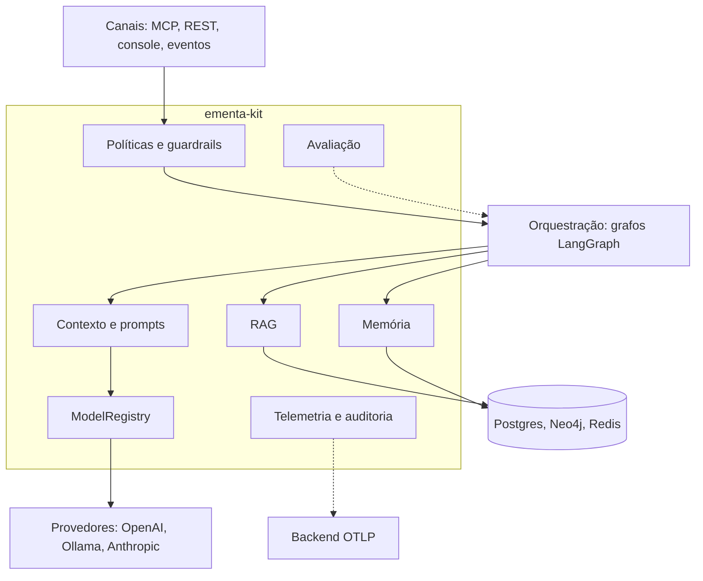
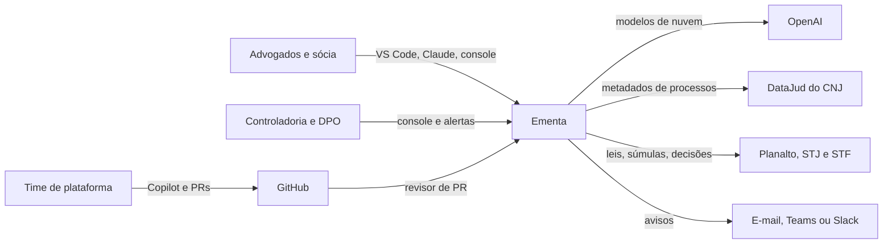
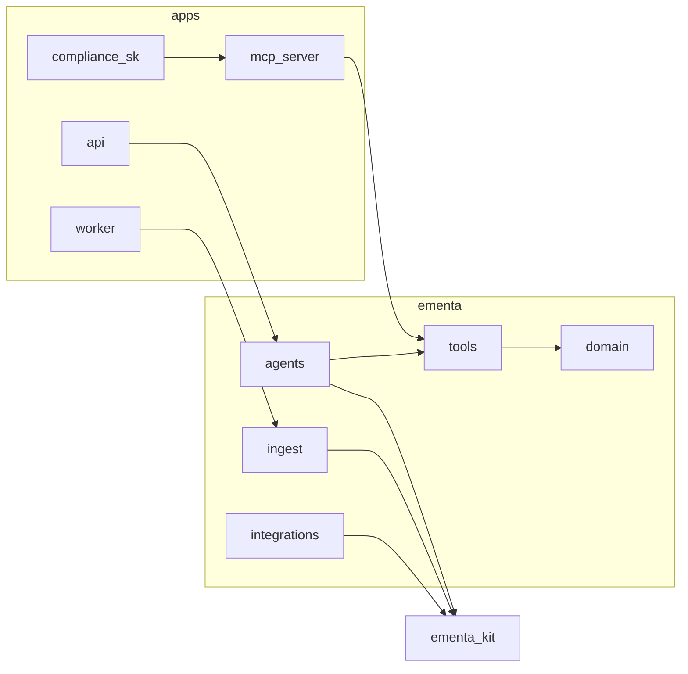
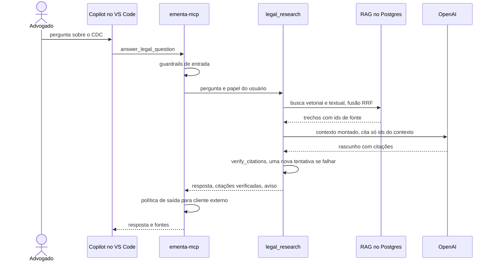
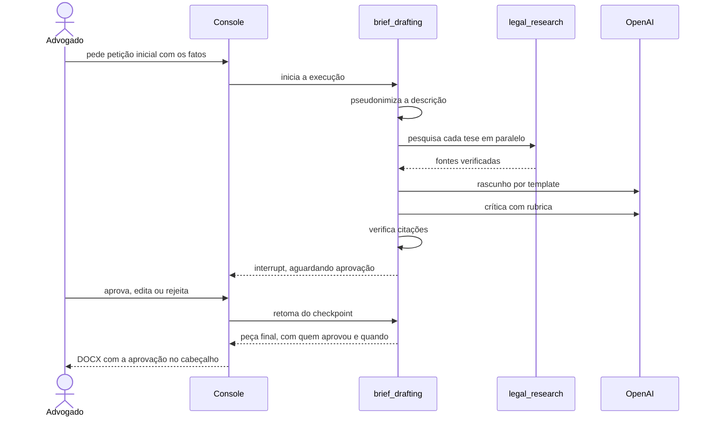
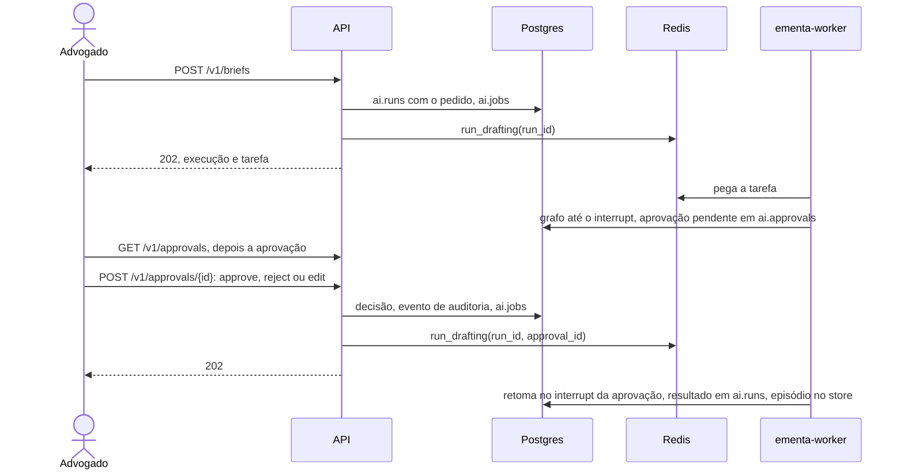
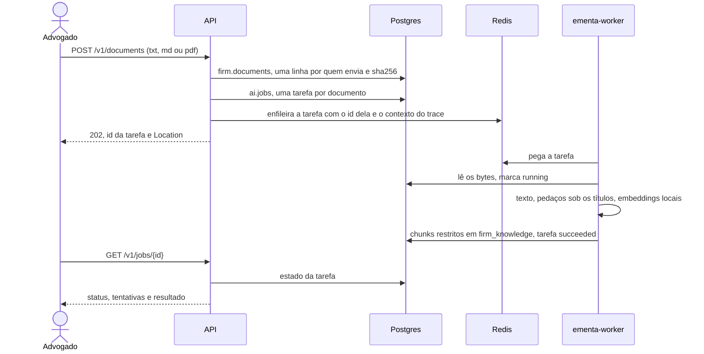
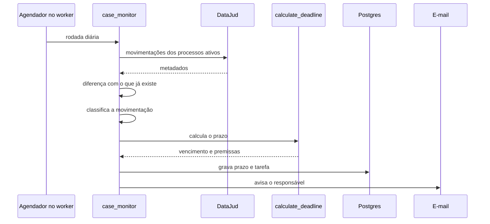
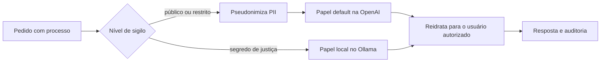
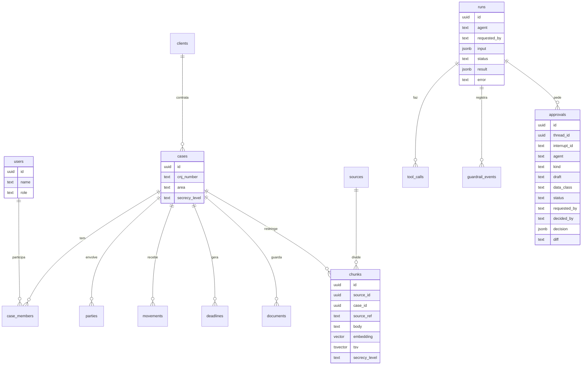

# Arquitetura

Como a Ementa é montada: princípios, arquitetura de referência, containers, componentes, fluxos, dados, modelos, contexto, memória, MCP e skills.

**Status:** Documentado; implementação a partir da F0 · **Ver também:** [Agentes](AGENTES.md), [Segurança e governança](SEGURANCA-E-GOVERNANCA.md), [Observabilidade](OBSERVABILIDADE.md), [ADRs](adr/README.md)

## Princípios

| Princípio | Na prática |
|---|---|
| Determinístico onde dá | Prazo, verificação de citação, SQL guardado e parsing são código testado; o LLM decide e redige |
| A IA rascunha, o advogado decide | Ação externa e peça final passam por aprovação humana (`interrupt()` do LangGraph) |
| Defesa em profundidade | RBAC na API, política antes do modelo, RLS no banco, guardrails na saída e no MCP |
| Dado sensível não sai sem necessidade | Embeddings locais, pseudonimização antes da nuvem, sigilo vai para o modelo local |
| Observável por padrão | Todo agente, chamada de modelo, busca, ferramenta e guardrail é um span |
| Agnóstico de provedor | Papéis de modelo no `ModelRegistry`; trocar provedor é configuração |
| Histórico só de acréscimo | O que o modelo já viu não é editado; mantém o cache e a portabilidade |
| Kit separado do domínio | O `ementa-kit` não conhece direito; o domínio jurídico usa o kit |
| Portas e adaptadores | Arquitetura hexagonal: o domínio fala com portas (`VectorStore`, `GraphStore`, `ChatModel`, `DocumentStorage`); Postgres, Neo4j e provedores são adaptadores trocáveis |

Os diagramas seguem os níveis do modelo C4: contexto, containers e componentes.

## Padrões de projeto

| Padrão | Onde | Para quê |
|---|---|---|
| Strategy | Provedores no `ModelRegistry` | Trocar OpenAI, Ollama ou Anthropic sem mudar o agente |
| Adapter | `VectorStore`, `GraphStore`, `DocumentStorage` | Isolar Postgres, Neo4j e disco atrás de portas |
| Chain of Responsibility | Pipeline de guardrails | Cada verificação decide permitir, mascarar, marcar ou bloquear |
| Repository | Acesso a `firm` e `knowledge` | Consultas e RLS num lugar só, testáveis com banco real |
| Builder | `AgentFactory` | Montar modelo, ferramentas, guardrails, memória e telemetria de um agente |
| Template Method | Template Copier `novo-agente` | Esqueleto fixo com os pontos de extensão de cada agente |
| Observer | Eventos de telemetria e auditoria | Guardrail, ferramenta e modelo publicam; span e trilha registram |

## Arquitetura de referência

A parte genérica, que qualquer time pode reaproveitar com o `ementa-kit`. O domínio jurídico é só uma instância dela.



| Camada | Responsabilidade | Contrato para o domínio |
|---|---|---|
| Canais | Autenticar, limitar taxa, traduzir para chamada de agente | Ferramenta com schema Pydantic e classe de dado |
| Políticas e guardrails | Decidir se pode, por qual modelo, e o que sai | Checks plugáveis em entrada, ferramenta e saída |
| Orquestração | Grafo com estado, checkpoint, HITL, paralelismo | `AgentFactory` monta o grafo com tudo ligado |
| Contexto e prompts | Montar o que vai ao modelo, com orçamento | Seções declaradas e prompts versionados |
| Memória | Curta, longa, episódica e esquecimento | Namespaces e permissões herdadas |
| RAG | Ingestão, busca híbrida, rerank, grafo | Porta `VectorStore` e `GraphStore` |
| ModelRegistry | Papéis, provedores, custo, orçamento | Nunca instanciar provedor no agente |
| Telemetria e auditoria | Spans, métricas, trilha imutável | Atributos `gen_ai.*` e `ementa.*` |
| Avaliação | Datasets, métricas, gates | JSONL e marcador `eval` no pytest |

## Contexto (C4 nível 1)



## Containers (C4 nível 2)

| Serviço | Imagem ou execução | Perfil | Porta | RAM aproximada | Fase |
|---|---|---|---|---|---|
| `postgres` | `pgvector/pgvector:pg17` | `core` | 5432 | 300 MB | F0 |
| `otel-lgtm` | `grafana/otel-lgtm` (OTel Collector, Prometheus, Tempo, Loki, Pyroscope) | `obs` | 3000, 4317, 4318 | 1 a 1,5 GB | F0 |
| `mcp` | `apps/mcp_server` (HTTP); stdio roda local | `mcp` | 8100 | 300 MB | F2 |
| `api` | `apps/api` (FastAPI e console) | `core` | 8000 | 500 MB | F2 |
| `redis` | `redis:8.10.3-alpine`, com arquivo append-only e `noeviction` | `core` | 6379, só em 127.0.0.1 | até 128 MB | F3 |
| `worker` | `apps/worker` (arq); `uv run ementa-worker` roda local | `core` | — | 500 MB a 1 GB (embeddings) | F3 |
| `neo4j` | `neo4j:5` Community | `grafo` | 7474, 7687 | 1 GB | F5 |
| `mailpit` | `axllent/mailpit` | `mail` | 1025, 8025 | 50 MB | F5 |
| `mlflow` | MLflow com SQLite | `ml` | 5000 | 300 MB | F9 |
| `compliance-sk` | `apps/compliance_sk` | `ms` | 8200 | 300 MB | F8 |
| Ollama | Nativo no Windows | (host) | 11434 | 3 a 4 GB com modelo de 3B | F6 |

Com 15,4 GB de RAM e 8 GB para o WSL2, o dia a dia usa `core` e `obs`; os demais perfis sobem só quando a fase precisa.

## Componentes (C4 nível 3)



Regras do import-linter:

- `ementa_kit` não importa `ementa` nem `apps`.
- `ementa.domain` não importa `ementa_kit`, `ementa.integrations` nem bibliotecas de infraestrutura.
- `apps` importam só módulos públicos de `ementa` e `ementa_kit`.

## Estrutura de pastas

```text
ementa/
├── packages/ementa-kit/src/ementa_kit/
│   ├── config/  llm/  telemetry/  guardrails/  policy/  rag/
│   └── context/  memory/  skills/  mcp/  evals/  audit/
├── packages/ementa/src/ementa/
│   ├── domain/  ingest/  integrations/  tools/  agents/  prompts/
├── apps/  api/  worker/  mcp_server/  compliance_sk/
├── skills/  data/  evals/  ml/  infra/  templates/novo-agente/
├── .github/  .vscode/mcp.json
└── docs/
```

## Fluxos

### Pesquisa com citação verificada (F1)



O grafo do agente, nó por nó, está em [Agentes](AGENTES.md).

### Peça com revisão humana (F4)



### Execução com aprovação (F4)



O agente de redação só pede aprovação (`ask_for_approval`, em `ementa_kit.hitl`) e cumpre o protocolo `DraftingAgent` ([Agentes](AGENTES.md#agentes-de-redação-com-aprovação-f4)). O resto fica no kit, em `ementa_kit.hitl.runner`: `DraftingIntake` grava e enfileira, do lado da API; `DraftingRunner` move o grafo, do lado do worker.

| Item | Como funciona |
|---|---|
| Execução | Uma linha em `ai.runs`; o id é o da thread do LangGraph. Guarda o pedido como a rota o aceitou, que é de onde o worker começa o grafo, o estado (`queued`, `running`, `awaiting_approval`, `finalized`, `rejected` ou `failed`) e, no fim, o resultado do agente |
| Aprovação | Uma linha em `ai.approvals` por `interrupt`: o `ApprovalRequest` (agente, tipo, título, rascunho, resumo e classe de dado), quem pediu a execução, a decisão exatamente como retoma o grafo (`decision`), quem decidiu, quando, e o diff do rascunho ao texto final |
| Pernas | O início e cada retomada são a tarefa `run_drafting` do worker da F3: um grafo chama modelos por minutos e, depois de um `reject`, o agente pode redigir e perguntar de novo. A rota só grava e enfileira, e responde 202 |
| Retomada | `Command(resume={interrupt_id: decisão})`, endereçada ao interrupt da aprovação: uma retomada repetida nunca responde a pergunta seguinte |
| Repetição | A tarefa roda pelo menos uma vez, então o runner lê onde a thread parou antes de movê-la. Thread nova começa do pedido; thread parada por uma falha continua do último checkpoint; thread que já passou daquela aprovação só registra onde está |
| Concorrência | Lock consultivo do Postgres por execução, enquanto o grafo anda: dois workers nunca movem a mesma thread |
| Decisão única | O `update` só pega aprovação pendente. A mesma decisão da mesma pessoa de novo é uma nova tentativa (a fila estava fora, ou a retomada falhou de vez): não grava nada e põe a retomada na fila outra vez. Outra decisão responde 409 |
| Nada sem decisão | O grafo não passa do `ask_for_approval` sem retomada, o runner só retoma com decisão gravada e o grafo que termina sem ter perguntado falha a execução |
| Idempotência | `Idempotency-Key` nos dois POST que iniciam execução: a mesma chave, do mesmo usuário para o mesmo agente, dá a mesma execução (uuid5 dos três); a chave com outro pedido responde 422; execução que tinha falhado volta para a fila |
| Exemplos | No início, até 3 episódios do agente, os mais próximos de `example_query(pedido)`, entram em `build_input`. No `approve` e no `edit`, o rascunho vira episódio (memória episódica, abaixo). Store fora custa os exemplos, não a execução |
| Tempo | A perna não tem limite por tentativa: cada chamada de modelo tem o seu, e uma tentativa cortada continuaria rodando na thread ao lado da nova. O limite do arq, de 1 h, é o último recurso |
| Agentes | `services.drafting_agents()` liga cada agente pelo id; até o agente entrar, a rota dele responde 503 |

O worker tem uma vaga (`max_jobs = 1`), dividida entre a ingestão, que é CPU, e as pernas, que esperam o modelo. Uma perna longa atrasa a ingestão; um segundo processo do worker resolve, e o lock por execução deixa isso seguro.

### Documento do escritório em fila (F3)



- Idempotência: o mesmo arquivo enviado de novo pelo mesmo usuário devolve a mesma tarefa e não grava nada; o arq recusa um segundo job com um id que já tem. A tarefa volta para a fila só se tinha falhado, ou se o Redis a perdeu.
- A tarefa roda pelo menos uma vez (de novo se o worker cair no meio). Por isso ela é idempotente: documento já indexado não é reprocessado e os chunks de um documento são trocados numa transação só.
- Erro que pode passar (banco, download do modelo, tentativa acima de 10 minutos) volta com backoff exponencial e jitter: a segunda tentativa espera de 2,5 a 5 s, cada uma seguinte o dobro, até 5 tentativas. Arquivo ilegível falha de vez, com o motivo na tarefa.
- O estado da tarefa fica no Postgres; o arq não guarda resultado. Os argumentos do job vão em JSON, nunca em pickle (o padrão do arq): quem escreve no Redis não roda código no worker.
- Formatos: texto e Markdown em UTF-8; PDF com camada de texto, pelo `pypdf` (Python puro, BSD, mantido). PDF escaneado é recusado: não há OCR. Limite de 2 MiB por arquivo.

### Prazos via DataJud (F5)



### Roteamento por sigilo (F6)



## Modelo de dados



`ai.runs` e `ai.approvals` (F4) são as execuções dos agentes de redação e as pausas delas para aprovação; a execução tem também `created_at`, `updated_at` e `finished_at`, e a aprovação, `title`, `summary`, `created_at` e `decided_at`. Uma aprovação por `interrupt` (`unique (thread_id, interrupt_id)`), e a decisão existe se e só se a aprovação não está pendente (`check`). O custo de cada chamada de modelo fica em `ai.model_usage` e no trace.

Schemas: `firm` (users, clients, cases, case_members, parties, deadlines, movements, documents, time_entries), `knowledge` (sources, chunks), `firm_knowledge` (sources, chunks dos documentos do escritório), `ai` (runs, tool_calls, guardrail_events, approvals, feedback, eval_runs, eval_results, jobs, model_usage), `audit` (events, só inserção, com hash encadeado), `analytics` (views para o BI) e `langgraph` (checkpointer e store).

Documentos do escritório (F3): `firm.documents` guarda os bytes, quem enviou (`uploaded_by`), o dono (`owner_id`), quem pode ler (`acl`, que começa com o dono) e `secrecy_level = 'restricted'`. Os chunks deles herdam o nível e a lista e ficam em `firm_knowledge`, separados do corpus público, até o RLS da F6: assim nenhuma busca do `knowledge` alcança dado do escritório e o `ementa ingest --reset`, que recria o `knowledge`, não apaga documento de ninguém. Na F6 as policies usam `owner_id` e `acl` e decidem se os dois índices se juntam.

RLS nos chunks: trecho público (corpus) aparece para todos; trecho de processo só para quem é membro do processo.

```sql
ALTER TABLE knowledge.chunks ENABLE ROW LEVEL SECURITY;

CREATE POLICY chunks_read ON knowledge.chunks
FOR SELECT USING (
    case_id IS NULL
    OR EXISTS (
        SELECT 1
        FROM firm.case_members m
        WHERE m.case_id = knowledge.chunks.case_id
          AND m.user_id = current_setting('app.user_id')::uuid
    )
);
```

A aplicação faz `SET LOCAL app.user_id = '<id>'` em cada transação; o papel da aplicação não tem `BYPASSRLS`.

Busca textual em português sem acento: o acento sai no Python (`ementa_kit.rag.fold`), no documento e na consulta, antes do `to_tsvector('portuguese', ...)`. Assim a busca não depende da extensão `unaccent` estar instalada (decisão da F1, ver [ADR 0003](adr/0003-postgres-pgvector-busca-hibrida.md)):

```sql
search_text text NOT NULL,  -- título, caminho e texto, em minúsculas e sem acento
tsv tsvector GENERATED ALWAYS AS (to_tsvector('portuguese', search_text)) STORED
```

## Grafo de conhecimento

| Nó | Exemplo | Origem |
|---|---|---|
| `Statute` | CDC, LGPD, CPC | Corpus |
| `Article` | `cdc:art49` | Parser |
| `Sumula` | `stj:sumula:385` | Corpus |
| `Decision` | Decisão da amostra do STJ | Dados abertos |
| `Court`, `Topic` | STJ; "cobrança indevida" | Metadados |
| `Client`, `Person`, `Company`, `Case`, `Lawyer` | Partes e responsáveis, por hash com sal | Postgres |

Arestas: `PART_OF`, `CITES`, `APPLIES`, `INTERPRETS`, `ABOUT`, `PARTY_IN {side}`, `RESPONSIBLE_FOR`, `RELATED_TO`.

Súmulas e decisões ligadas a um artigo (expansão do GraphRAG):

```cypher
MATCH (a:Article {id: $article_id})<-[:CITES|INTERPRETS]-(x)
WHERE x:Sumula OR x:Decision
RETURN x.id, labels(x)[0] AS kind
LIMIT 10
```

Conflito de interesses: caminho de até 3 saltos entre a nova parte contrária e um cliente atual.

```cypher
MATCH (novo:Person {hash: $party_hash}), (c:Client)
MATCH p = shortestPath((novo)-[:PARTY_IN|RELATED_TO*..3]-(c))
WHERE NOT EXISTS {
    MATCH (novo)-[s1:PARTY_IN]->(k:Case)<-[s2:PARTY_IN]-(c)
    WHERE s1.side = s2.side
}
RETURN c.id, length(p) AS hops, [n IN nodes(p) | labels(n)[0]] AS path
ORDER BY hops
LIMIT 5
```

## Modelos

| Papel | Uso | Referência | Observação |
|---|---|---|---|
| `reasoning` | Redação, crítica, contratos | GPT-6.1 Terra, effort high | Sol é candidato, medido na régua |
| `default` | Resposta da pesquisa, supervisor | GPT-6 Luna, effort medium | Terra antes de 15/11/2026; trocado por custo (10 vezes mais barato) |
| `fast` | Roteamento, extração, classificação | GPT-6 Luna | Candidato ao modelo local ajustado (F9) |
| `judge` | Avaliações, em amostra | GPT-6.1 Sol | Modelo diferente do que responde |
| `local` | Sigiloso, triagem ajustada | Modelo aberto de 3 a 4B no Ollama | CPU |
| `embeddings` | RAG | Multilíngue local | Escolhido por recall@k |
| `rerank` | RAG | Cross-encoder multilíngue local | F2 |

```yaml
# infra/models.yaml
roles:
  reasoning: {provider: openai, model: gpt-6.1-terra, effort: high}    # conferir id na F1
  default:   {provider: openai, model: gpt-6.1-terra, effort: medium}  # conferir id na F1
  fast:      {provider: openai, model: gpt-6-luna}                     # conferir id na F1
  judge:     {provider: openai, model: gpt-6.1-sol, effort: medium}    # conferir id na F1
  local:     {provider: ollama, model: "<modelo de 3 a 4B>"}
budget:
  usd_per_day: 2
  usd_per_month: 30
  on_exceed: stop
```

- Preços de referência: Terra US$ 1 / US$ 5 por milhão de tokens; Luna US$ 0,10 / US$ 0,50; Sol US$ 2 / US$ 10. A conferir na página oficial no começo da F1.
- Recursos da OpenAI no desenho: Responses API com `store: false` e raciocínio criptografado devolvido intacto a cada turno; Structured Outputs e function calling com `strict`; cache de prompt automático no prefixo estável, com `prompt_cache_key`; esforço de raciocínio por rota; endpoint de moderação como guardrail opcional. Nomes de parâmetro a conferir na F1.
- Acesso via chat models do LangChain (ChatOpenAI, ChatOllama e, por configuração, ChatAnthropic). Se o LangChain não expuser um recurso, a rota usa o SDK oficial direto.
- Detalhes e alternativas no [ADR 0005](adr/0005-camada-de-modelos-agnostica.md).

## RAG

| Etapa | Como | Fase |
|---|---|---|
| Coleta | Snapshot com URL, data e hash; testes rodam sobre o snapshot | F1 |
| Parsing | Lei, título, capítulo, artigo, parágrafo e inciso; id canônico (`cdc:art42:pu`) | F1 |
| Chunk | Um por artigo, com o caminho completo no cabeçalho; artigo longo dividido por parágrafo | F1 |
| Embedding | Modelo multilíngue local; versão gravada na linhagem | F1 |
| Índice | HNSW no `embedding`, GIN no `tsv` (português, acento tirado no Python) | F1 |
| Consulta | Citação explícita vira busca direta; senão multi-query com sinônimos jurídicos | F1 |
| Busca | Vetorial e textual, top 30 cada, fusão RRF com k = 60 | F1 |
| Rerank | Cross-encoder, top 8 | F2 |
| Grafo | Súmulas e decisões ligadas aos artigos recuperados | F5 |
| Permissão | RLS no próprio banco | F1 (corpus público), F6 (processos) |

Fusão RRF numa consulta só (versão resumida; a completa está em `ementa_kit/rag/store.py`). Os termos da consulta textual entram com OU, não com E, porque a pergunta vem em linguagem natural:

```sql
WITH vec AS (
    SELECT id, row_number() OVER (ORDER BY distance, id) AS r
    FROM (SELECT id, embedding <=> $1 AS distance
          FROM knowledge.chunks ORDER BY distance LIMIT 30) AS nearest
), query AS (
    SELECT replace(plainto_tsquery('portuguese', $2)::text, '&', '|')::tsquery AS tsq
), txt AS (
    SELECT c.id, row_number() OVER (ORDER BY ts_rank_cd(c.tsv, q.tsq) DESC, c.id) AS r
    FROM knowledge.chunks c, query q
    WHERE c.tsv @@ q.tsq
    ORDER BY ts_rank_cd(c.tsv, q.tsq) DESC, c.id
    LIMIT 30
)
SELECT id, coalesce(1.0 / (60 + vec.r), 0) + coalesce(1.0 / (60 + txt.r), 0) AS score
FROM vec FULL OUTER JOIN txt USING (id)
ORDER BY score DESC
LIMIT 8;
```

Com várias consultas (a pergunta e as reescritas do modelo `fast`), cada uma roda essa busca e o Python funde os rankings de novo por RRF.

## Engenharia de prompt e de contexto

Prompts são arquivos versionados em `packages/ementa/src/ementa/prompts/`, com id, versão e changelog. Cada span de chamada grava `ementa.prompt.id` e `ementa.prompt.version`; mudou o prompt, roda a avaliação. O `PromptRegistry` do kit carrega todos de uma vez e falha ao montar se dois arquivos tiverem o mesmo id e versão ou se o changelog não tiver a entrada da própria versão (`v2 ...` no changelog da versão 2); `get_prompt` lê dele.

O montador de contexto (`ementa_kit.context`) monta cada chamada a partir de seções com orçamento de tokens:

| Ordem | Seção | Orçamento inicial | Observação |
|---|---|---|---|
| 1 | Sistema e regras | 1.500 | Congela no início da conversa; entra no cache |
| 2 | Definições de ferramentas | 1.000 | Lista fixa por conversa |
| 3 | Índice de skills | 300 | Só nome e descrição (F2) |
| 4 | Memórias relevantes | 600 | Top-k por namespace (F3) |
| 5 | Fontes recuperadas | 3.500 | Com id de fonte em cada trecho |
| 6 | Resumo da conversa | 800 | Só depois de compactar |
| 7 | Últimos turnos e resultados de ferramenta | 2.000 | Resultado truncado antes de entrar |
| 8 | Pergunta | — | Sempre por último |

O tamanho de cada seção vai como evento no trace: `build_context` grava `ementa.context.section_tokens` no span corrente (no `legal_research`, o `invoke_agent`), com `<seção>.chars` e `<seção>.tokens` para `system`, cada seção e a `pergunta`. Os tokens são aproximados, 4 caracteres por token; o número exato é o uso que o provedor devolve no span `chat`. As técnicas aparecem com nome: escrever (estado e rascunho no grafo), selecionar (busca, memória e skills sob demanda), comprimir (truncar resultado, resumir conversa) e isolar (cada subagente com o próprio contexto).

Regras do histórico só de acréscimo:

- O prompt de sistema e a lista de ferramentas congelam no início da conversa.
- Contexto novo entra como mensagem nova, nunca editando uma anterior.
- Resultado de ferramenta é truncado antes de o modelo ver, nunca depois.
- Compactar é começar uma conversa nova a partir de um resumo.
- Cada subagente tem a própria conversa.
- O raciocínio criptografado da OpenAI volta intacto a cada turno.
- O estado completo fica no checkpointer para auditoria; a visão que vai ao modelo é derivada dele.

O motivo é duplo: o cache de prompt só funciona com prefixo estável, e alguns provedores recusam histórico editado (o Claude devolve erro 400 quando o prefixo de um bloco de raciocínio muda; conferir na documentação da Anthropic). Um teste no CI compara pedidos consecutivos e falha se o prefixo mudar (F2): `assert_append_only` (`ementa_kit.context`) recebe os pedidos que um modelo falso gravou e aponta a mensagem e o caractere que mudaram; o caminho de nova tentativa do `legal_research` passa por ele.

A compactação (`compact`, em `ementa_kit.context`, F3) segue as mesmas regras. Enquanto a conversa cabe no orçamento, ela devolve `None`. Passou do orçamento, o pedido de resumo é a conversa inteira, intacta, com o prompt `context.summarize` v1 acrescentado no fim: o prefixo em cache vale até para esse pedido. A conversa nova começa com o mesmo prompt de sistema e o resumo na seção `resumo`, cortado em 800 tokens. A conversa antiga não é tocada. O evento `ementa.context.compacted` registra no span corrente as mensagens e os tokens antes, os tokens depois e o prompt. Chame entre turnos, antes de a próxima pergunta entrar.

No `assistant`, a compactação roda no começo do turno, quando a visão do modelo passou de `EMENTA_CONTEXT_BUDGET_TOKENS` (8.000 por padrão, no mínimo 2.000, para caber o prompt de sistema e o resumo). O pedido de resumo vai com as ferramentas do último turno e `tool_choice: none`, para o prefixo em cache valer inteiro, lista de ferramentas inclusive; por isso `compact` aceita qualquer `Runnable` de modelo, não só o `BaseChatModel`. O resumo entra no estado como mensagem nova, e `view_start` guarda onde ele está: a visão (`model_view`) passa a ser o prompt de sistema, o resumo e o que vem depois. Nada sai do estado, que continua com a conversa inteira para auditoria, e a visão é derivada dele, então outro processo manda o mesmo pedido depois de um reinício (teste de integração no Postgres).

## Memória

| Tipo | Onde | Exemplo | Fase |
|---|---|---|---|
| Curta | Checkpointer do LangGraph no Postgres, por thread | A conversa atual | F3 |
| Longa | Store do LangGraph com índice vetorial | Preferência de estilo do advogado; ficha do processo; teses aprovadas | F3 |
| Episódica | Store, namespace `("episodes", agente)` | Rascunho aprovado e a edição do advogado | F4 |
| Procedural | Skills e prompts versionados | Como revisar um contrato de serviços | F2, F4 |

- Namespaces: `("lawyer", id)`, `("case", id)`, `("firm",)`.
- A memória herda a permissão do processo; a leitura passa pela mesma regra do RLS.
- Escrita depois da execução, com deduplicação por similaridade e confiança mínima.
- Direito do titular (LGPD, art. 18): `DELETE /v1/data-subjects/{id}/memories` apaga as memórias ligadas àquela pessoa (F3); os chunks de documento de processo entram quando esses documentos existirem.

A memória longa da F3, em `ementa_kit.memory` (genérico) e `ementa.memory` (namespaces do escritório):

| Item | Como funciona |
|---|---|
| Store | `PostgresStore` do `langgraph-checkpoint-postgres` 3.2, no schema `langgraph` pelo `search_path` de cada conexão: tabelas `store`, `store_vectors` e as de migração, ao lado das do checkpointer, que têm outros nomes. `services.memory_store()` abre um pool de conexões e roda as migrações no primeiro uso |
| Índice | pgvector no campo `text`, com o mesmo e5 local da busca (`services.local_embedder()`, carregado uma vez por processo). Busca exata, sem HNSW: filtrada por namespace, a busca aproximada pode devolver menos itens que o pedido, e a memória de um escritório é pequena. O store embute o que grava e o que busca pela mesma chamada, então os dois lados levam o prefixo `query: `, como o E5 pede em tarefa simétrica |
| Item | `text` (com os dados como foram ditos, no banco do escritório), `subjects` (ids dos titulares citados, em ordem), `confidence` e `owner` (tipo e id do dono do namespace) |
| Escrita | `MemoryWriter.write(turno, alvos, mapping)`, depois da execução. O turno passa pelo guardrail de PII; o papel `fast`, com o prompt `memory.extract` v1, devolve candidatas em JSON com marcadores (`[PESSOA_1]`); cada marcador volta ao valor só para o store. Até 5 por turno; abaixo de `EMENTA_MEMORY_MIN_CONFIDENCE` (0,7) fica de fora; marcador inventado pelo modelo descarta a candidata; JSON inválido ganha uma nova tentativa, acrescentada à conversa. No chat, roda depois do evento `done`, ainda no mesmo fluxo SSE, com a mensagem do usuário, a resposta final e o mapeamento da conversa; `EMENTA_MEMORY_WRITE_ENABLED=false` a desliga, e uma falha fica no log sem derrubar a conversa |
| Alvos | Quem chama diz onde o turno pode escrever, pelo tipo do namespace. Um turno de chat escreve na preferência do advogado e na ficha do processo (`chat_targets`); a tese do escritório só entra por um fluxo de aprovação |
| Deduplicação | A candidata substitui a memória mais parecida do mesmo namespace com exatamente os mesmos titulares, se o cosseno chega a `EMENTA_MEMORY_DEDUPE_SIMILARITY` (0,97); senão, entra como nova. Titulares diferentes nunca se juntam: no e5, "João quer acordo" e "Maria quer acordo" dão 0,973, mais que muitas reescritas do mesmo fato |
| Titulares | O id é `ds_` mais o HMAC-SHA-256, com a chave `EMENTA_DATA_SUBJECT_KEY`, do tipo e do valor na forma que o guardrail compara: `123.456.789-09` e `12345678909` dão o mesmo id. Todo valor achado no texto final vira etiqueta, venha de marcador ou não. Sem a chave, o id não leva ao valor, nem testando todos os CPFs |
| Leitura | `relevant_memories(store, pergunta, user_id=..., case_id=...)`: até 3 por namespace (o do advogado, o do processo e o do escritório), o mais próximo primeiro. `memory_section` monta a seção `memorias` dentro dos 600 tokens. O texto vem com os dados em claro: pseudonimize com o mapeamento da conversa antes do modelo de nuvem. O `assistant` busca pela mensagem como foi digitada (o e5 roda local), mascara a seção com o mapeamento da thread e a manda na mensagem do turno, antes da pergunta; o histórico mostra só a mensagem digitada. Store que falha deixa o turno sem memórias, não sem resposta |
| Permissão | O namespace guarda o dono. Quem chama passa só o `case_id` de um processo que o usuário pode ver; a regra do RLS chega na F6 |
| Esquecimento | `forget_subject(store, id)` apaga as memórias do titular em todos os namespaces e devolve quantas; o span guarda só a contagem. Lê o store inteiro, porque o filtro do store só compara igualdade. Basta no tamanho de um escritório; depois, um índice GIN em `subjects` |

O limiar de 0,97 saiu de 30 pares fictícios medidos com o e5 (14 reescritas ou atualizações do mesmo fato e 16 fatos distintos do mesmo escopo):

| Limiar | Reescritas juntadas | Fatos distintos juntados por engano |
|---|---|---|
| 0,95 | 12 de 14 | 6 de 16 |
| 0,96 | 11 de 14 | 3 de 16 |
| 0,97 | 10 de 14 | 0 de 16 |
| 0,98 | 7 de 14 | 0 de 16 |

Juntar por engano apaga um fato verdadeiro; perder uma reescrita só deixa duas memórias parecidas. Por isso o limiar fica no menor valor sem erro. O custo: uma atualização escrita de outro jeito ("quer acordo" e depois "não quer acordo", 0,968) fica como duas memórias.

A memória episódica da F4, em `ementa_kit.memory.episodes` (`services.episodes()`), no mesmo store:

| Item | Como funciona |
|---|---|
| Item | Um por aprovação, com o id dela como chave: título, rascunho, texto final, o diff unificado entre os dois (uma linha de contexto), a ação (`approve` ou `edit`), o comentário, quem decidiu, `subjects` e `text`, que é o título com o texto final, o campo do índice |
| Escrita | `Episodes.record`, na retomada de um `approve` ou `edit`; um `reject` não vira exemplo. Gravar a mesma aprovação de novo troca o episódio, então uma tarefa repetida não duplica. Falha fica no log e a execução termina como terminaria |
| Pseudonimização | Título, rascunho, texto final e comentário passam pelo guardrail de PII antes de gravar, com um mapeamento só: o mesmo nome tem o mesmo marcador nos quatro, e o diff mostra só o que o advogado mudou. O episódio de um processo vira exemplo no processo de outro cliente, onde aqueles nomes não têm lugar, e o modelo tende a copiar do exemplo; o que o exemplo ensina é a forma do texto, que os marcadores mantêm. A aprovação em `ai.approvals` guarda o texto em claro |
| Titulares | Os ids dos valores trocados etiquetam o episódio como qualquer memória: o esquecimento (`DELETE /v1/data-subjects/{id}/memories`) também o apaga |
| Leitura | `Episodes.examples_for(agente, consulta, k)`: até `k` episódios do agente (3 por padrão), o mais próximo da consulta primeiro, pelo e5 local. O runner chama com o `example_query` do pedido e passa os episódios ao `build_input` do agente |

## Padrões multiagente

| Padrão | Onde | Por quê |
|---|---|---|
| RAG agêntico com reflexão | `legal_research` | Refaz a busca quando a citação não se sustenta |
| Supervisor | `assistant` | Um ponto de entrada, roteamento barato pelo papel `fast` |
| Map-reduce | `contract_review` | Cláusulas independentes em paralelo (`Send`) |
| Plan-and-execute com crítico | `brief_drafting` | Peça longa precisa de plano, revisão e verificação |
| Workflow agendado | `case_monitor` | Previsível; LLM só onde precisa |
| Humano no circuito | `contract_review`, `brief_drafting`, `intake` | Responsabilidade do advogado |
| Agente remoto por protocolo | `lgpd_compliance` | Semantic Kernel conversando pelo MCP |

## MCP

| Item | Detalhe |
|---|---|
| Servidor | `ementa-mcp`, SDK oficial em Python, spec 2026-07-28 (sem estado: sem handshake nem sessão; conferir na F1) |
| Transportes | stdio local (F1); HTTP atrás de balanceador (F2) |
| Ferramentas | `search_legal_corpus`, `answer_legal_question`, `get_statute_article`, `calculate_deadline` (F1); `list_skills`, `load_skill` (F2); `review_contract` (F4); `lookup_case`, `check_conflict` (F5); `query_firm_analytics` (F6) |
| Recursos | `ementa://statutes/{id}/articles/{n}`, `ementa://templates/{kind}`, `ementa://playbooks/contracts` |
| Prompts | `review-contract`, `summarize-case` |
| Autenticação | stdio sem token; HTTP com JWT (F3) e OAuth (F6) |
| Saída | Cada ferramenta declara a classe de dado; restrito sai pseudonimizado; sigiloso é negado com aviso |

O cliente MCP de terceiro (Copilot, Claude Desktop) é tratado como modelo de nuvem: ele vê o que o usuário digita e o que a ferramenta devolve. Por isso a política de saída vale para toda resposta de ferramenta. Configuração no VS Code:

```json
{
  "servers": {
    "ementa": {
      "type": "stdio",
      "command": "uv",
      "args": ["run", "ementa-mcp"]
    }
  }
}
```

## Skills

| Tipo | Onde | Exemplos | Quem usa |
|---|---|---|---|
| Runtime | `skills/<nome>/SKILL.md` | `legal-research`, `deadline-calculation`, `contract-review-services`, `initial-petition-consumer`, `lgpd-checklist` | Agentes da Ementa |
| Desenvolvimento | `.github/skills/<nome>/SKILL.md` | `new-mcp-tool`, `new-legal-skill`, `new-eval-case`, `investigate-trace` | Copilot e Claude Code trabalhando no repo |

Os dois tipos seguem o padrão aberto Agent Skills. O loader do kit faz divulgação progressiva: o prompt recebe só nome e descrição; a ferramenta `load_skill` traz as instruções completas quando o agente precisa; scripts rodam só se estiverem na lista permitida, com tempo limite.

O loader de runtime (`ementa_kit.skills`, F2):

| Item | Como funciona |
|---|---|
| Onde | `skills/<nome>/SKILL.md` na raiz do repositório (`ementa.services.SKILLS_DIR`); `services.skill_library()` monta a biblioteca uma vez por processo |
| Formato | Front matter YAML com `name` (igual ao nome da pasta; minúsculas, dígitos e hífen simples; até 64 caracteres) e `description` (até 1.024); opcionais `license`, `compatibility`, `metadata` e `allowed-tools`. Campo desconhecido ou corpo vazio é erro |
| Falha | Uma skill malformada derruba a montagem da biblioteca, com o arquivo e o motivo |
| Índice | `index()` e `render_index()`: só nome e descrição, dentro dos 300 tokens da seção (teste) |
| Instruções | `load_skill(nome)`; pelo MCP, `list_skills` e `load_skill` |
| Scripts | `run_script(skill, script)` roda `scripts/<script>` da skill (só `.py`) se `"<skill>/<script>"` estiver em `EMENTA_SKILL_SCRIPTS_ALLOWED`, uma lista JSON vazia por padrão, como `["deadline-calculation/check.py"]`. Roda com o Python do processo, sem shell, na pasta da skill, com um ambiente reduzido (`PATH`, pastas temporárias e idioma; chaves e banco ficam de fora) e com o limite de `EMENTA_SKILL_SCRIPT_TIMEOUT_S` (10 s). O resto é recusado e registrado |

## API REST

| Rota | Faz | Fase |
|---|---|---|
| `POST /v1/legal-research` | Pesquisa com citações | F2 |
| `POST /v1/auth/token` | Login OAuth2 de senha; devolve JWT de 15 minutos | F3 |
| `GET /v1/audit/events` | Trilha de auditoria, paginada por cursor (sócia, DPO e TI) | F3 |
| `POST /v1/chat` | Conversa com o `assistant`, em SSE | F3 |
| `GET /v1/threads/{id}` | Histórico de uma conversa | F3 |
| `POST /v1/documents` | Upload e ingestão em fila | F3 |
| `GET /v1/jobs/{id}` | Estado de uma tarefa longa | F3 |
| `POST /v1/contracts/{id}/review` | Inicia a análise de um contrato enviado em `POST /v1/documents`; 202 | F4 |
| `POST /v1/briefs` | Inicia a redação de peça; 202 | F4 |
| `GET /v1/approvals` | Caixa de aprovações, pendentes por padrão, paginada por cursor | F4 |
| `GET /v1/approvals/{id}` | Uma aprovação: rascunho, decisão, diff e o estado da execução | F4 |
| `POST /v1/approvals/{id}` | Aprova, rejeita ou edita um passo pendente; 202 | F4 |
| `GET /v1/deadlines` | Prazos a vencer | F5 |
| `POST /v1/intake` | Triagem e conflito | F5 |
| `POST /v1/analytics/query` | Pergunta de gestão em SQL guardado | F6 |
| `DELETE /v1/data-subjects/{id}/memories` | Esquecimento (LGPD) | F3 |
| `GET /healthz`, `GET /readyz` | Saúde e prontidão | F2 |

Convenções: JWT de curta duração com papel; erros no formato RFC 9457 (`application/problem+json`); `Idempotency-Key` nos POST que iniciam tarefa (em `POST /v1/documents` a chave é o próprio conteúdo: sha256 por usuário); paginação por cursor; limite de taxa por usuário no Redis; OpenAPI com exemplos.

Problemas próprios da F3: `/problems/budget-exceeded` (429, com o limite atingido no `detail` e `Retry-After` até a virada), `/problems/document-too-large` (413), `/problems/unsupported-media-type` (415), `/problems/invalid-document` (422) e `/problems/queue-unavailable` (503; reenviar o arquivo não duplica nada). A tarefa de outro usuário responde 404, como se não existisse.

Problemas próprios da F4: `/problems/agent-unavailable` (503, o agente ainda não está ligado), `/problems/idempotency-key-reused` (422, a chave já iniciou outro pedido), `/problems/approval-decided` (409, a aprovação já tem outra decisão) e `/problems/queue-unavailable` (503) também nas rotas de redação: a execução ou a decisão já está gravada, e repetir o pedido com a mesma `Idempotency-Key`, ou a mesma decisão, a põe na fila. Aprovação de execução alheia, para o associado, e contrato de outra pessoa respondem 404, como os que não existem. Decisão fora do formato (`edit` sem `text`, `text` com `approve` ou `reject`) é 422.

### Chat em SSE (F3)

`POST /v1/chat` recebe `message` e, para continuar uma conversa, `thread_id`; sem ele, começa uma nova. A resposta é `text/event-stream` com o SSE nativo do FastAPI: cada evento leva um JSON tipado em `data`, com o tipo no campo `event` (`step`, `token`, `citation`, `done` e `error`), e o OpenAPI descreve a união com discriminador. Os campos de cada evento estão em [Agentes](AGENTES.md#assistente-assistant). O `done` traz o `thread_id`.

| Situação | Resposta |
|---|---|
| Corpo inválido | 422, problema sem os valores enviados |
| `thread_id` de outra pessoa ou que não existe | 404, igual nos dois casos: um id de conversa não revela nada |
| Modelo sem chave | 503, antes de abrir o fluxo |
| Erro com o fluxo aberto | Último evento `error`, com o mesmo problema RFC 9457 que o handler daria; o status 200 já tinha saído |

O que pode falhar antes do primeiro evento é conferido numa dependência da rota, antes da resposta começar, para ainda caber um status HTTP. A rota passa a cada turno as ferramentas que o papel pode usar (`can_use_tool(papel, ferramenta)`, ligado à matriz de RBAC) e o agente só oferece essas ao modelo.

Dois detalhes do streaming:

- **Marcadores.** O modelo responde com `[CPF_1]` e o usuário precisa ver o CPF. Um marcador pode chegar partido entre pedaços (`[CP` e `F_1]`), então o `MarkerStream` do kit segura o fim do texto enquanto ele pode virar marcador (um `[` sem `]` até 40 caracteres atrás e a última palavra) e solta o resto já reidratado. Os tokens saem palavra por palavra, e juntos dão exatamente a resposta reidratada inteira (teste por propriedade). A alternativa de reidratar só no `done` mostraria marcadores ao usuário durante a resposta; a de mandar o marcador e o mapeamento ao cliente levaria o dado pessoal a mais um lugar.
- **Trace.** O FastAPI puxa cada evento numa thread de trabalho, cada uma com a própria cópia do contexto. O span `invoke_agent assistant` é ativado só durante cada passo e nunca atravessa um `yield`; preso entre passos, ele seria desligado noutro contexto e deixaria órfãos os spans seguintes (teste pela rota HTTP).

A conversa fica no checkpointer do LangGraph no Postgres, no schema `langgraph` (`ementa_kit.memory.postgres_checkpointer`, pacote `langgraph-checkpoint-postgres`), com todos os checkpoints da thread guardados. `GET /v1/threads/{id}` lê os turnos terminados de lá e os reidrata para quem abriu a conversa.

## Falhas e resiliência

| Falha | Tratamento |
|---|---|
| Provedor lento | Timeout por papel; streaming com evento de progresso |
| Erro transitório (429, 5xx) | Retry com backoff exponencial e jitter, limitado |
| Provedor fora | Circuit breaker por provedor; fallback configurado por papel ou erro claro |
| Orçamento estourado | Parada antes da chamada (`BudgetExceededError`), com erro explicando o limite; na API, 429 com `Retry-After` |
| Saída fora do schema | Rejeita e refaz uma vez; depois falha com o motivo |
| Citação não verificada | Remove e avisa; em peça, bloqueia a finalização |
| Worker reiniciado | Retoma do checkpoint; o arq roda de novo a tarefa interrompida, que é idempotente |
| Redis fora | `POST /v1/documents` responde 503; o documento e a tarefa já estão no Postgres e reenviar o arquivo enfileira de novo |
| Redis fora numa execução de redação | A rota responde 503 com a execução ou a decisão já gravadas; a mesma `Idempotency-Key`, ou a mesma decisão, enfileira de novo sem duplicar |
| Worker cai no meio de um grafo | O arq roda a perna de novo; o runner continua do último checkpoint, e o lock por execução impede duas execuções na mesma thread |
| DataJud indisponível | Nova tentativa na próxima rodada; alerta depois de 24 h |

## Glossário

| Português (docs) | Código | Observação |
|---|---|---|
| Processo | `case` | Número no padrão CNJ em `cnj_number` |
| Movimentação | `movement` | Vem do DataJud |
| Prazo | `deadline` | Calculado por `calculate_deadline` |
| Intimação | `start_date` | Termo inicial informado pelo usuário |
| Peça | `brief` | Petição, contestação, recurso |
| Súmula | `sumula` | Sem tradução fiel |
| Ementa | `ementa` | Nome do produto e resumo de decisão |
| Parte | `party` | Com lado (`side`) |
| Cliente | `client` | Pessoa ou empresa atendida |
| Sigilo | `secrecy_level` | `public`, `restricted`, `secret` |
| Barreira ética | RLS | Por `case_members` |
| Triagem | `intake` | Agente e fluxo |
| Escritório | `firm` | Schema e namespace |
| Fonte | `source` | Lei, súmula, decisão ou documento |
| Trecho | `chunk` | Unidade de busca |

---

[Voltar ao README](../README.md)
