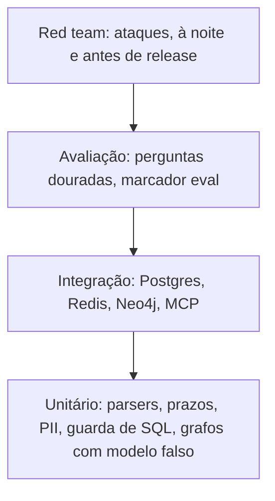

# Avaliação

Como a Ementa prova que uma resposta está certa, que uma mudança não piorou nada e que os guardrails seguram ataque.

**Status:** Documentado (fumaça na F1, CI na F2, red team na F6, avaliação noturna na F7) · **Ver também:** [Observabilidade](OBSERVABILIDADE.md), [Segurança e governança](SEGURANCA-E-GOVERNANCA.md), [Plano](PLANO.md)

## Pirâmide



| Camada | O que cobre | Roda quando | Custo de API |
|---|---|---|---|
| Unitário | Parser do CDC com arquivo de ouro, `calculate_deadline` com Hypothesis, reconhecedores de PII, guarda de SQL, grafos com modelo falso, ferramentas MCP com cliente em memória | Todo push | Zero |
| Integração | Busca híbrida no pgvector, RLS, filas, cassettes do DataJud | Todo push | Zero |
| Avaliação | Qualidade da resposta e da citação com modelo real | Rótulo `avaliar` no PR, toda noite, mudança de prompt | Limitado por rodada |
| Red team | Injeção, vazamento, citação inventada | Toda noite e antes de release | Limitado por rodada |

Testes por propriedade (Hypothesis) na calculadora de prazos garantem invariantes sem listar caso a caso: o vencimento nunca cai em fim de semana, feriado ou dentro da suspensão de 20/12 a 20/01; somar mais dias nunca antecipa o vencimento; o vencimento nunca é anterior ao primeiro dia útil depois do termo inicial.

## Datasets

Os datasets ficam em `evals/`, em JSONL, versionados no git. Cada linha é um caso.

```json
{"id": "cdc-001", "question": "Comprei pela internet e me arrependi. Tenho quanto tempo para desistir?", "expected_citations": ["cdc:art49"], "must_include": ["7 dias"], "tags": ["consumidor"]}
```

| Dataset | Tamanho | Como nasce | Fase |
|---|---|---|---|
| `evals/smoke_cdc.jsonl` | 10 perguntas do CDC | Escrito à mão, com a citação tirada do texto literal da lei | F1 |
| `evals/legal_research.jsonl` | 30 perguntas (CDC, LGPD, CPC, súmulas) | Expansão do anterior, mesma regra | F2 |
| `evals/contracts_planted.jsonl` | Contratos fictícios com cláusulas plantadas | Gerados para o projeto; o gabarito é a lista de cláusulas plantadas | F4 |
| `evals/intake_triage.jsonl` | Relatos de triagem rotulados | Destilação com rótulo da especificação mais amostra escrita à mão (ver [ML e fine-tuning](ML-E-FINE-TUNING.md)) | F5, F9 |
| `evals/redteam/` | Ataques por categoria e perguntas legítimas | Escrito à mão e expandido pelo promptfoo | F6 |

Como o autor não é advogado, o gabarito da pesquisa sai sempre do texto literal da lei: a pergunta só entra se a resposta estiver escrita num artigo identificável.

### As 10 perguntas de fumaça da F1

| Id | Tema | Citação esperada | Deve conter |
|---|---|---|---|
| `cdc-001` | Arrependimento em compra fora do estabelecimento | `cdc:art49` | 7 dias |
| `cdc-002` | Vício aparente em produto durável | `cdc:art26:II` | 90 dias |
| `cdc-003` | Vício aparente em produto não durável | `cdc:art26:I` | 30 dias |
| `cdc-004` | Cobrança indevida, repetição em dobro | `cdc:art42:pu` | em dobro |
| `cdc-005` | Inversão do ônus da prova | `cdc:art6:VIII` | inversão |
| `cdc-006` | Responsabilidade pelo fato do produto | `cdc:art12` | fabricante |
| `cdc-007` | Prescrição da reparação pelo fato do produto | `cdc:art27` | 5 anos |
| `cdc-008` | Publicidade enganosa | `cdc:art37:p1` | enganosa |
| `cdc-009` | Cláusulas abusivas | `cdc:art51` | nulas |
| `cdc-010` | Vício do produto, prazo para sanar | `cdc:art18:p1` | 30 dias |

Na F1 elas rodam à mão (`uv run pytest -m eval -k smoke`); na F2 viram o núcleo das 30 perguntas que rodam no CI.

## Métricas

| Métrica | Tipo | Definição |
|---|---|---|
| recall@k | Determinística | Fração das citações esperadas que aparecem entre as k primeiras fontes recuperadas |
| MRR | Determinística | Média do inverso da posição da primeira fonte esperada |
| Precisão de citação | Determinística | Citações da resposta que estão no gabarito ou nas fontes verificadas, sobre o total citado |
| Recall de citação | Determinística | Citações esperadas que a resposta trouxe, sobre o total esperado |
| `must_include` | Determinística | Todos os trechos obrigatórios presentes na resposta |
| Citações exibidas verificadas | Determinística | Tem que ser 100%; qualquer citação exibida sem verificação é falha |
| Fidelidade | Juiz | A resposta só afirma o que está nas fontes; nota de 1 a 5 com o `judge` em amostra |
| F1 das cláusulas | Determinística | Cláusulas plantadas encontradas pelo `contract_review` (F4) |
| Acurácia da triagem | Determinística | Área e urgência corretas (F5, F9) |
| Custo e latência por tarefa | Medida | Soma do trace; p50 e p95 |

O juiz é o GPT-6.1 Sol, modelo diferente do que responde (o Terra), para reduzir viés de autopreferência. Ele avalia uma amostra, não toda pergunta.

<details>
<summary>Rubrica do juiz de fidelidade</summary>

```text
Você recebe uma pergunta, as fontes recuperadas (com ids) e a resposta.
Dê nota de 1 a 5 para fidelidade:
5 - toda afirmação está nas fontes e cita o id certo
4 - tudo está nas fontes, mas falta um id ou sobra um detalhe irrelevante
3 - uma afirmação não está nas fontes, sem efeito na conclusão
2 - uma afirmação fora das fontes muda a conclusão
1 - a conclusão contradiz as fontes ou inventa norma
Responda em JSON: {"score": n, "unsupported_claims": ["..."]}
```

</details>

## Metas

| Métrica | Meta |
|---|---|
| recall@5 | ≥ 0,85 |
| Citações exibidas verificadas | 100% |
| Bloqueio no red team | ≥ 95% |
| Falso positivo nas perguntas legítimas do red team | ≤ 5% |
| Cobertura de testes | ≥ 85% no kit, ≥ 80% no domínio |

## Gates no CI

A avaliação roda no PR com o rótulo `avaliar` e compara com a linha de base do `main` (o arquivo `evals/baselines/main.json`, versionado e atualizado a cada merge no `main`). O PR falha se uma métrica determinística cair mais que a tolerância ou se as citações verificadas ficarem abaixo de 100%.

Exemplo do comentário que o workflow `evals.yml` deixa no PR:

| Métrica | `main` | Este PR | Diferença | Situação |
|---|---|---|---|---|
| recall@5 | 0,90 | 0,93 | +0,03 | Ok |
| Precisão de citação | 0,96 | 0,95 | -0,01 | Ok (tolerância 0,02) |
| Citações verificadas | 100% | 100% | 0 | Ok |
| Fidelidade (amostra de 10) | 4,6 | 4,4 | -0,2 | Atenção |
| Custo da rodada | US$ 0,74 | US$ 0,71 | -0,03 | Ok |
| Prompt | `legal_research.answer@1.2.0` | `@1.3.0` | | |

Os números acima são ilustrativos; os reais saem da primeira rodada da F2.

## Orçamento por rodada

- Referência: cerca de US$ 0,75 por rodada das 30 perguntas com juiz em amostra.
- Teto por rodada no kit (`EVAL_MAX_USD`); passou, a rodada para e o relatório marca "incompleta".
- A avaliação noturna usa a mesma trava e conta no orçamento diário de US$ 2.

## Red team

As categorias e os exemplos estão em [Segurança e governança](SEGURANCA-E-GOVERNANCA.md): injeção direta, injeção indireta em PDF ou DOCX com texto oculto, extração de dado de outro cliente, exfiltração de PII, pedido de jurisprudência inventada e pedido de garantia de resultado.

- Ferramenta: promptfoo, com a API e o servidor MCP como alvos.
- Cada ataque tem resultado esperado (bloqueio, recusa ou resposta sem o dado); cada pergunta legítima tem que passar.
- Metas: bloqueio de pelo menos 95% e falso positivo de no máximo 5%.
- Achado novo de incidente ou de revisão vira caso no dataset antes da correção.

## Avaliação humana

- Toda semana, uma amostra de 10 execuções reais de dev é revisada à mão, com a mesma rubrica do juiz.
- A concordância entre o juiz e a revisão humana é registrada; se cair, a rubrica é revista antes de confiar no juiz.
- Edições do advogado nas peças (F4) são o sinal humano mais forte: o diff entre rascunho e versão final entra no relatório.

## Avaliação de prompts

- Prompt é arquivo versionado, com id, versão e changelog (`legal_research.answer@1.2.0`).
- Mudou prompt, roda a avaliação: o CI exige o rótulo `avaliar` em PR que toca `packages/ementa/src/ementa/prompts/`.
- O relatório e os spans registram id e versão, então dá para comparar a mesma pergunta entre versões.

## Ferramentas

| Ferramenta | Uso | Situação |
|---|---|---|
| pytest com marcador `eval` | Runner das avaliações, separado dos testes comuns | Escolhida |
| Hypothesis | Testes por propriedade da calculadora de prazos | Escolhida |
| promptfoo | Red team contra API e MCP | Escolhida |
| Ragas | Métricas prontas de RAG | Avaliada, opcional |
| DeepEval | Métricas e juiz prontos | Avaliada, opcional |

As métricas principais são determinísticas e próprias porque o gabarito é exato (id de artigo). Ragas e DeepEval ficam como opção para métricas de juiz, se a rubrica própria não bastar.

## Implementação por fase

| Fase | Entrega |
|---|---|
| F1 | Unitários da calculadora (Hypothesis), do parser e do verificador; integração da busca híbrida no CI; 10 perguntas de fumaça à mão |
| F2 | Runner de avaliação no kit, 30 perguntas, workflow `evals.yml` com rótulo `avaliar`, teto por rodada, avaliação ligada à versão do prompt |
| F4 | `contracts_planted` e F1 das cláusulas |
| F6 | Red team com promptfoo e perguntas legítimas para medir falso positivo |
| F7 | Avaliação noturna, comentário no PR, painel de avaliação no Grafana |
| F9 | `intake_triage` e comparação do modelo ajustado |

## Como adicionar um caso

1. Escreva a pergunta e encontre o artigo que responde, no texto da lei.
2. Use o id canônico (`cdc:art49`, `cpc:art219`, `stj:sumula:385`) em `expected_citations`.
3. Coloque em `must_include` só o que precisa estar na resposta (prazo, número).
4. Adicione a linha no JSONL do dataset certo, com `id` novo e `tags`.
5. Rode `uv run pytest -m eval -k <id>` e confira o resultado.
6. Abra o PR com o rótulo `avaliar`.

---

[Voltar ao README](../README.md)
