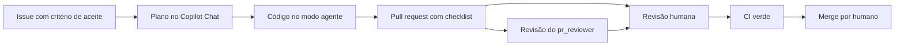

# Copilot corporativo

Playbook de uso do GitHub Copilot num time que constrói agentes de IA, com o que a Ementa demonstra no próprio repositório e o que fica só documentado.

**Status:** Documentado (artefatos básicos na F0, completos na F8) · **Ver também:** [Arquitetura](ARQUITETURA.md), [Segurança e governança](SEGURANCA-E-GOVERNANCA.md), [ADR 0007](adr/0007-mcp-como-padrao-de-integracao.md)

## O que dá para mostrar e o que fica no papel

O projeto usa Copilot Free ou Pro, numa conta pessoal. Parte do que uma empresa precisa só existe nos planos Business e Enterprise, dentro de uma organização.

| Tema | Demonstrável no Free/Pro | Só documentado (Business ou Enterprise) |
|---|---|---|
| Instruções do repositório e por caminho | Sim | |
| Prompts, agentes customizados e skills do repo | Sim | |
| Servidor MCP próprio no modo agente do VS Code | Sim (conferir limites do plano Free na F8) | |
| Revisor de PR próprio (`pr_reviewer`) | Sim, no GitHub Actions | |
| Modelos permitidos por política | | Sim |
| Exclusão de conteúdo | | Sim |
| Filtro de sugestões que batem com código público | Parcial, como configuração pessoal (conferir na F8) | Sim, como política |
| Lista permitida e registro de servidores MCP | | Sim |
| Políticas do agente de nuvem do Copilot | | Sim |
| Auditoria e métricas de uso | | Sim |

> [!NOTE]
> Os nomes de recurso e de configuração do Copilot mudam com frequência. Conferir todos os nomes desta página na documentação oficial na F8.

## Artefatos do repositório

| Arquivo | Propósito | Quem lê |
|---|---|---|
| `AGENTS.md` | Regras do projeto para qualquer agente de código: comandos, arquitetura, convenções, segurança | Copilot, Claude Code e outros |
| `.github/copilot-instructions.md` | Instruções gerais do Copilot; aponta para o `AGENTS.md` e reforça o essencial | Copilot |
| `.github/instructions/kit.instructions.md` | Regras só para o kit, aplicadas por caminho | Copilot, ao mexer em `packages/ementa-kit/**` |
| `.github/prompts/new-mcp-tool.prompt.md` | Prompt reutilizável para criar uma ferramenta MCP no padrão do projeto | Copilot Chat, por comando |
| `.github/agents/security-reviewer.agent.md` | Agente customizado de revisão de segurança, com ferramentas restritas | Copilot, modo agente |
| `.github/skills/new-mcp-tool/SKILL.md` | Skill de desenvolvimento com o passo a passo, arquivos de exemplo e checklist | Copilot e Claude Code (padrão aberto Agent Skills) |
| `.vscode/mcp.json` | Liga o servidor `ementa-mcp` ao modo agente do VS Code | VS Code |

### Instruções por caminho

```markdown
---
applyTo: "packages/ementa-kit/**"
---

- O kit não importa nada de `ementa` (o import-linter quebra o CI).
- Toda função pública tem tipo completo e docstring curta.
- Guardrail novo entra no pipeline e ganha teste de permitir e de negar.
- Nada de exemplo jurídico aqui: o kit é genérico.
```

### Prompt reutilizável

```markdown
---
description: "Cria uma ferramenta MCP nova no padrão da Ementa"
---

Crie a ferramenta `${input:toolName}` em `packages/ementa/src/ementa/tools/`.

1. Schema de entrada e saída em Pydantic, com `strict`.
2. Declare a classe de dado (public, restricted ou secret).
3. Registre no servidor em `apps/mcp_server/` com guardrails, auditoria e span `execute_tool`.
4. Escreva teste unitário e teste com o cliente MCP em memória.
5. Atualize docs/AGENTES.md se um agente passar a usar a ferramenta.
```

### Agente customizado com ferramentas restritas

```markdown
---
description: "Revisa mudanças procurando falhas de segurança e de privacidade"
tools: ["codebase", "search", "usages"]
---

Você revisa diffs da Ementa. Procure: dado pessoal em log ou span, ferramenta sem classe de dado,
SQL fora da guarda, segredo no código, ação externa sem HITL. Não edite arquivos; responda com
uma lista `arquivo:linha: problema. correção.`
```

A lista `tools` limita o agente a leitura e busca; ele não edita nem roda comando (nomes das ferramentas: conferir na F8).

### Skill de desenvolvimento

```markdown
---
name: new-mcp-tool
description: Use quando for criar ou alterar uma ferramenta do servidor ementa-mcp.
---

# Nova ferramenta MCP

1. Leia `apps/mcp_server/registry.py` para ver o padrão de registro.
2. Copie `examples/tool_template.py` e ajuste o schema.
3. Classe de dado obrigatória; sigiloso nunca responde a cliente externo.
4. Rode `uv run pytest -k mcp` antes de abrir o PR.
```

### Servidor MCP no VS Code

```json
{
  "servers": {
    "ementa": {
      "type": "stdio",
      "command": "uv",
      "args": ["run", "ementa-mcp"],
      "envFile": "${workspaceFolder}/.env"
    }
  }
}
```

Com isso, o modo agente do Copilot enxerga `search_legal_corpus`, `answer_legal_question`, `get_statute_article` e `calculate_deadline`, pelo comando `uv run ementa-mcp`.

## Fluxo de trabalho com IA



- A issue diz o que é pronto; o plano vira comentário na issue antes do código.
- O agente escreve código e testes; quem faz o merge é sempre uma pessoa.
- O `pr_reviewer` (F8) é o agente de SDLC da própria Ementa: lê o diff, os ADRs e o `AGENTS.md` e aponta ferramenta sem teste, guardrail não registrado, prompt sem avaliação e doc desatualizado.

## Políticas de organização (documentadas)

| Política | Configuração sugerida | Por quê |
|---|---|---|
| Modelos permitidos | Lista curta aprovada por segurança e jurídico | Controla para onde vai o código |
| Exclusão de conteúdo | Excluir `data/clientes/**`, `**/*.env` e pastas de contrato real | Dado de cliente não entra no contexto do Copilot |
| Sugestões iguais a código público | Bloquear, ou permitir com referência de origem | Reduz risco de licença |
| Servidores MCP | Lista permitida e registro interno; o resto bloqueado | MCP de terceiro pode ler e mandar dado |
| Agente de nuvem do Copilot | Liberado só em repositórios piloto, com rede restrita | Agente autônomo com acesso a código merece escopo menor |
| Auditoria | Eventos do Copilot no log de auditoria da organização, exportados para o SIEM | Rastro de quem mudou política |
| Métricas de uso | Painel e API de métricas, revisados por mês | Adoção baseada em dado |

Exemplo de exclusão de conteúdo no nível do repositório (formato a conferir na F8):

```yaml
- "data/clientes/**"
- "**/*.env"
- "infra/secrets/**"
```

## Riscos e mitigação

| Risco | Exemplo | Mitigação |
|---|---|---|
| Segredo em prompt | Chave colada no chat para "testar rápido" | gitleaks no pre-commit e no CI, chave de projeto com limite, rotação imediata |
| Pacote alucinado (slopsquatting) | Sugestão de dependência que não existe e alguém registra depois | Dependência nova só com revisão humana, `uv.lock`, pip-audit |
| Licença | Trecho igual a código com licença incompatível | Filtro de código público, revisão de dependências |
| Dado de cliente no contexto | Copilot lê um contrato real aberto no editor | Exclusão de conteúdo, dados fictícios no repo |
| Excesso de confiança | Merge de código gerado sem entender | Revisão humana obrigatória, testes exigidos no checklist do PR |
| Agente com permissão demais | Agente customizado que pode rodar comando | `tools` restrito no `.agent.md`, revisão das instruções em PR |

## Plano de adoção

1. Piloto: um time, um repositório, quatro semanas, com KPIs medidos antes e depois.
2. Champions: uma pessoa por time, que mantém as instruções e os prompts do repo.
3. Treinamento: uma sessão sobre o modo agente, MCP e o que nunca colar no chat.
4. Office hours semanais nas primeiras oito semanas.
5. Expansão por ondas, depois de revisar incidentes e métricas do piloto.

## KPIs

| KPI | Como medir | Meta inicial |
|---|---|---|
| Tempo de ciclo de PR | Abertura até merge, mediana | Cair 20% no piloto |
| Taxa de aceitação de sugestões | Métricas de uso do Copilot | Acompanhar, sem meta fixa |
| Incidentes ligados à IA | Segredo vazado, dependência ruim, dado de cliente | Zero |
| Satisfação do time | Pesquisa curta mensal | Pelo menos 4 de 5 |
| Cobertura de testes em código novo | Relatório do CI | Não cair |

## Checklist por repositório

- [ ] `AGENTS.md` com comandos, arquitetura e regras de segurança.
- [ ] `.github/copilot-instructions.md` apontando para o `AGENTS.md`.
- [ ] Instruções por caminho nas áreas sensíveis.
- [ ] Prompts e skills para as tarefas repetidas do time.
- [ ] `.vscode/mcp.json` só com servidores da lista permitida.
- [ ] Exclusão de conteúdo configurada para pastas com dado real.
- [ ] gitleaks e pip-audit no CI.
- [ ] Template de PR com checklist de testes e revisão humana.
- [ ] Dono do repositório revisa as instruções a cada trimestre.

---

[Voltar ao README](../README.md)
