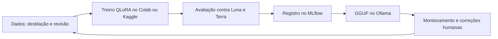
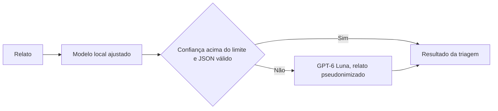

# ML e fine-tuning

Como a Ementa ajusta um modelo pequeno para a triagem de casos e trata esse modelo com o ciclo de vida de MLOps.

**Status:** Documentado (código na F9) · **Ver também:** [Arquitetura](ARQUITETURA.md), [Avaliação](AVALIACAO.md), [ADR 0011](adr/0011-fine-tuning-de-modelo-pequeno.md), [ADR 0010](adr/0010-embeddings-e-rerank-locais.md)

## Problema

O agente `intake` recebe o relato do cliente em texto livre e precisa devolver, em JSON:

| Campo | Exemplo |
|---|---|
| `area` | `consumidor` |
| `subarea` | `cobranca_indevida` |
| `urgency` | `alta` (prazo correndo, audiência marcada, negativação) |
| `documents_needed` | `["fatura", "comprovante de pagamento", "protocolo de atendimento"]` |

No desenho, essa tarefa roda no papel `fast` (GPT-6 Luna) com prompt. A F9 testa se um modelo aberto pequeno, ajustado e rodando local, faz o mesmo trabalho.

## Por que ajustar um modelo pequeno

- Dado do cliente fica no escritório: o relato da triagem é o texto mais pessoal que o sistema recebe, e o modelo local não manda nada para fora.
- Custo marginal perto de zero: depois do treino, cada triagem só gasta CPU.
- Latência previsível: sem fila de provedor nem limite de taxa.
- Tarefa estreita e com formato fixo, que é onde modelo pequeno ajustado costuma competir com modelo grande.

O ajuste só vai para produção se ganhar da linha de base na régua (ver "Avaliação contra a linha de base").

## Ciclo



## Dados

- Relatos sintéticos gerados por destilação: o modelo grande escreve relatos a partir de uma especificação (área, subárea, urgência, documentos) e o rótulo vem da própria especificação, não de uma segunda leitura.
- Controle de diversidade na geração: persona (idade, escolaridade, profissão), região do país, registro de fala (formal, coloquial, áudio transcrito), tamanho do relato e erros de digitação.
- Amostra revisada à mão (pelo menos 10% do treino) para achar rótulo errado e relato artificial demais.
- Conjunto de teste separado e com exemplos escritos à mão, que nunca passam pelo gerador.
- Cuidado com vazamento entre treino e teste: separar por especificação, não por relato, para que variações da mesma especificação não caiam nos dois lados; checar duplicatas quase iguais por similaridade de embedding.
- Tudo fictício. Nenhum relato real entra no dataset; correções humanas de produção só entram depois de pseudonimizadas.

| Conjunto | Tamanho inicial | Origem |
|---|---|---|
| Treino | 2.000 a 3.000 relatos | Destilação, com revisão por amostra |
| Validação | 300 relatos | Destilação, especificações separadas |
| Teste | 150 relatos | Escritos à mão |

Os tamanhos são ponto de partida e mudam conforme a curva de aprendizado.

## Modelo base

| Critério | Por quê |
|---|---|
| Aberto, entre 1 e 4B parâmetros | Cabe em CPU com quantização e treina na GPU grátis do Colab ou do Kaggle |
| Licença que permite uso comercial e ajuste | Evita problema se o projeto virar produto |
| Desempenho em português | Os relatos são em português coloquial |
| Suporte no Ollama e no llama.cpp | Serving local sem código próprio |

A escolha final sai de um teste curto de 2 ou 3 candidatos no conjunto de validação, antes do ajuste (conferir candidatos na F9).

## Treino com QLoRA

QLoRA congela o modelo base quantizado em 4 bits e treina só adaptadores LoRA, matrizes pequenas de baixo posto. Cabe numa GPU de 16 GB.

- Bibliotecas: transformers, peft, trl (SFTTrainer), bitsandbytes; Unsloth para treinar mais rápido no Colab.
- Ambiente: notebook versionado em `ml/notebooks/`, rodando no Colab ou no Kaggle; a máquina local não tem CUDA.
- Formato: instrução e relato na entrada, JSON na saída, com o mesmo schema do Structured Outputs.

```yaml
# ml/configs/triage-qlora.yaml (ponto de partida, ajustar na F9)
base_model: "<a definir na F9>"
quantization: nf4
lora:
  r: 16
  alpha: 32
  dropout: 0.05
  target_modules: ["q_proj", "k_proj", "v_proj", "o_proj"]
training:
  epochs: 3
  learning_rate: 2.0e-4
  max_seq_length: 1024
  batch_size: 8
  gradient_accumulation: 2
seed: 42
```

## Avaliação contra a linha de base

| Candidato | Como roda |
|---|---|
| GPT-6 Luna com prompt | Papel `fast` do desenho |
| GPT-6.1 Terra com prompt | Teto de qualidade de referência |
| Modelo base sem ajuste | Mostra o ganho do ajuste |
| Modelo ajustado | Candidato |

| Métrica | Critério para ir para produção |
|---|---|
| F1 macro de `area` e `subarea` | Até 2 pontos abaixo da linha de base |
| Acurácia de `urgency` | Até 2 pontos abaixo da linha de base |
| JSON válido no schema | Pelo menos 99% |
| Latência em CPU, p95 | Medida e publicada; a rota local não tem SLO, e esse número alimenta uma decisão futura |
| Custo por triagem | Perto de zero no local; comparado ao custo do Luna |

O resultado, com a matriz de confusão, entra no model card e no MLflow.

## Exportação e serving

- O adaptador é mesclado ao modelo base e convertido para GGUF com as ferramentas do llama.cpp, em quantização Q4 (conferir variante na F9).
- O Ollama serve o modelo a partir de um Modelfile versionado:

```text
FROM ./ementa-triage-q4.gguf
PARAMETER temperature 0
PARAMETER num_ctx 2048
SYSTEM """Classifique o relato e responda só com o JSON do schema de triagem."""
```

- O papel `local` do registro de modelos aponta para modelos por rota: o modelo geral do sigilo (F6) e este modelo ajustado na rota de triagem (F9). A troca é configuração, sem mudar o agente.

## MLflow

- Experimentos: cada treino registra parâmetros, hash do dataset, métricas de validação e teste, e artefatos (adaptador, matriz de confusão, model card).
- Registro de modelos com aliases: `champion` é o que está servindo; `challenger` é o candidato. A promoção é manual, depois da avaliação.
- O container `mlflow` sobe no perfil `ml` do Docker Compose.

## Cascata por confiança



- A confiança vem da probabilidade dos tokens do rótulo; o limite é escolhido na validação para manter a acurácia final no nível do Luna.
- Processo sigiloso nunca sobe para o Luna: abaixo do limite, a triagem vai para revisão humana.
- O span registra qual modelo decidiu, para medir quanto da carga o modelo local absorve.

## Drift e retreino

- Toda triagem fica com o rótulo previsto; a decisão da sócia (F5) vira o rótulo humano.
- Métrica semanal: concordância entre previsto e humano, por área. Queda de mais de 5 pontos em relação ao teste dispara revisão.
- Gatilhos de retreino: queda de concordância, área nova no escritório ou mudança no schema.
- O retreino usa o dataset sintético mais as correções humanas pseudonimizadas, e passa pela mesma avaliação antes de virar `champion`.

## Model card

```markdown
# Model card: ementa-triage

- Tarefa: triagem de relato de cliente (área, subárea, urgência, documentos)
- Modelo base e licença:
- Dados: sintéticos por destilação + teste escrito à mão; nenhum dado real
- Métricas no teste: F1 macro, acurácia de urgência, JSON válido, latência p95 em CPU
- Comparação com a linha de base (Luna, Terra, base sem ajuste):
- Limitações conhecidas: áreas fora do treino, relatos muito longos, gírias regionais raras
- Uso fora do escopo: decidir aceite de caso sem revisão humana
- Versão, data, hash do dataset, run do MLflow:
```

## Experimento de embeddings

A F1 escolhe o modelo de embedding por uma medição rápida de recall@k nas perguntas de fumaça. A F9 registra essa escolha no MLflow e a reconfere com o dataset completo (ver [ADR 0010](adr/0010-embeddings-e-rerank-locais.md)).

| Candidato | Onde roda |
|---|---|
| Modelos multilíngues locais (fastembed ou sentence-transformers) | CPU local |
| Embeddings da OpenAI | API, como comparação |

- Métricas: recall@5, recall@10 e MRR sobre o dataset `evals/legal_research.jsonl`, mais tempo de indexação e tamanho do vetor.
- O vencedor só troca o modelo da busca se ganhar com folga; trocar exige reindexar e registrar a versão do embedding na linhagem do chunk.

---

[Voltar ao README](../README.md)
