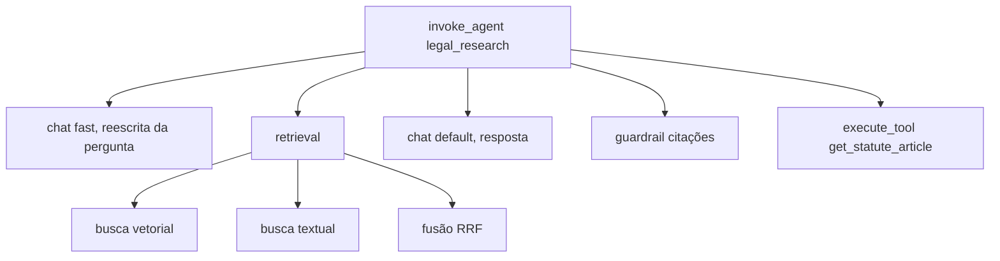

# Observabilidade

O que a Ementa mede em cada execução de agente, como os dados chegam ao Grafana e como investigar uma resposta ruim.

**Status:** Documentado (traces na F1, operação completa na F7) · **Ver também:** [Arquitetura](ARQUITETURA.md), [Avaliação](AVALIACAO.md), [ADR 0008](adr/0008-opentelemetry-e-grafana-lgtm.md)

## O que medir e por quê

| Pergunta de quem opera | Sinal | Onde |
|---|---|---|
| A resposta demorou por quê? | Duração por span: busca, modelo, ferramenta, guardrail | Traces (Tempo) |
| Quanto custou esta pergunta, esta área, este mês? | Tokens e custo por chamada, somados por execução | Atributos de span e métricas (Prometheus) |
| A resposta usou o que o modelo viu? | Ids das fontes recuperadas e citações verificadas ou removidas | Atributos e eventos do span |
| Algum guardrail agiu? | Decisão e motivo de cada verificação | Span `guardrail` e métrica de bloqueios |
| Dado sigiloso foi para a nuvem? | Rota da política em cada chamada | `ementa.policy.route` |
| O prompt mudou e a qualidade caiu? | Id e versão do prompt em cada chamada | `ementa.prompt.id`, `ementa.prompt.version` |
| O cache de prompt está funcionando? | Tokens de entrada em cache por chamada | Métrica de cache |

## Spans

A instrumentação segue as convenções semânticas de GenAI do OpenTelemetry. Essas convenções ainda estão em desenvolvimento; os nomes podem mudar. A versão usada fica fixada no `uv.lock` e anotada no [ADR 0008](adr/0008-opentelemetry-e-grafana-lgtm.md) na F1.

| Span | Quando abre | Atributos principais |
|---|---|---|
| `invoke_agent` | Início de uma execução de agente | `gen_ai.operation.name`, `gen_ai.agent.name`, `gen_ai.conversation.id`, `ementa.cost_usd` (soma) |
| `chat` | Cada chamada a modelo | `gen_ai.provider.name`, `gen_ai.request.model`, `gen_ai.response.model`, `gen_ai.usage.input_tokens`, `gen_ai.usage.output_tokens`, `ementa.prompt.id`, `ementa.prompt.version`, `ementa.policy.route`, `ementa.cost_usd` |
| `execute_tool` | Cada ferramenta | `gen_ai.tool.name`, classe de dado, resultado (ok ou erro), tamanho da saída |
| `retrieval` | Cada busca na base de conhecimento ou na memória (`retrieval memory`) | Modo (vetorial, textual, fusão, rerank), top_k, ids das fontes, duração por etapa |
| `guardrail` | Cada verificação do pipeline | Nome da verificação, `ementa.guardrail.decision`, motivo |
| `memory` | Escrita da memória depois da execução (`memory write`) e esquecimento de um titular (`memory forget`) | `ementa.memory.operation` e contagens; nunca texto nem id de titular |
| `send <tarefa>` | A API põe uma tarefa na fila (produtor) | `messaging.system` (`arq`), `messaging.destination.name`, `messaging.message.id` (id da tarefa), `ementa.job.kind`, `ementa.job.enqueued` |
| `process <tarefa>` | Cada tentativa de uma tarefa no worker (consumidor), filho do `send` | `messaging.message.id`, `ementa.job.kind`, `ementa.job.attempt`, `ementa.job.outcome`, `ementa.job.retry_in_s`, `ementa.document.id`, `ementa.document.chunks` |
| `embeddings <modelo>` | Embeddings locais de um documento no worker | `gen_ai.operation.name`, `gen_ai.request.model`, `ementa.embedding.passages` |

O contexto do trace vai junto com a tarefa no Redis, então o upload e a indexação aparecem num trace só, com a API no serviço `ementa` e o worker no `ementa-worker`.

Atributos próprios do projeto:

| Atributo | Tipo | Exemplo |
|---|---|---|
| `ementa.cost_usd` | double | `0.0142` |
| `ementa.prompt.id` | string | `legal_research.answer` |
| `ementa.prompt.version` | string | `1.2.0` |
| `ementa.policy.route` | string | `cloud` ou `local` |
| `ementa.guardrail.decision` | string | `allow`, `flag`, `mask`, `block` |
| `ementa.guardrail.stage` | string | `input` ou `output` |
| `ementa.pii.count.<tipo>` | int | `ementa.pii.count.cpf = 2`, um atributo por tipo achado |
| `ementa.pii.total` | int | `4`, valores trocados por marcador na chamada |
| `ementa.tool.status` | string | No `execute_tool` do `assistant`: `finished`, `denied` (fora das ferramentas do papel) ou `failed` |
| `ementa.assistant.tools` | string[] | No `invoke_agent assistant`: ferramentas oferecidas ao modelo no turno |
| `ementa.context.section_tokens` | evento no span corrente (`invoke_agent`), com `<seção>.chars` e `<seção>.tokens` (aproximado, 4 caracteres por token) | `{"system.chars": 1245, "system.tokens": 312, "fontes.tokens": 3100, "pergunta.tokens": 14, ...}` |
| `ementa.case.pseudo_id` | string | Hash do id do processo, nunca o número real |
| `ementa.memory.candidates`, `ementa.memory.inserted`, `ementa.memory.updated` | int | Candidatas do modelo, memórias novas e memórias substituídas num turno |
| `ementa.memory.removed` | int | Memórias apagadas num esquecimento; o span não leva mais nada |
| `ementa.memory.hits` | int | Memórias que a busca trouxe |
| `ementa.context.compacted` | evento no span corrente, com `messages.before`, `tokens.before`, `tokens.after` e o prompt do resumo | `{"messages.before": 41, "tokens.before": 9120, "tokens.after": 520, ...}` |
| `ementa.area` | string | `consumidor`: área de atuação dos spans GenAI abertos dentro de `practice_area()` |
| `ementa.job.outcome` | string | `succeeded`, `retry` ou `failed`, por tentativa |

As chamadas à OpenAI usam a instrumentação oficial (`opentelemetry-instrumentation-openai-v2` 2.4b0, que cobre Chat Completions e embeddings; a Responses API não é coberta, por isso a F1 usa Chat Completions). FastAPI, httpx e psycopg entram com instrumentação automática.

## Cascata de um trace da pesquisa



Leitura típica: se a resposta demorou, o span `chat` da resposta costuma dominar; se a citação foi removida, o evento do `guardrail` de citações mostra qual id não estava nas fontes do `retrieval`.

## Métricas

| Métrica | Tipo | Rótulos |
|---|---|---|
| `gen_ai.client.token.usage` | Histograma | `gen_ai.request.model`, `gen_ai.token.type` (entrada ou saída), agente |
| `gen_ai.client.operation.duration` | Histograma | `gen_ai.request.model`, `gen_ai.operation.name`, agente |
| `ementa_cost_usd_total` | Contador | Modelo, agente, área, rota |
| `ementa_guardrail_decisions_total` | Contador | Verificação, decisão |
| `ementa_citations_removed_total` | Contador | Agente, motivo |
| `ementa_prompt_cache_tokens_total` | Contador | Modelo, tipo (em cache ou não) |
| `ementa_agent_runs_total` | Contador | Agente, status (ok, erro, parcial) |
| `ementa_retrieval_duration_seconds` | Histograma | Etapa (vetorial, textual, fusão, rerank) |
| `ementa_budget_remaining_usd` | Gauge | Janela (dia ou mês) |
| `ementa_eval_score` | Gauge | Métrica da avaliação, dataset, versão do prompt |

Rótulo de alta cardinalidade (id de usuário, id de processo) não entra em métrica; fica só no trace.

## Logs

- structlog em JSON, com `trace_id` e `span_id` em toda linha, para pular do log ao trace no Grafana.
- Nível `info` para eventos de negócio (execução começou, terminou, custo); `warning` para guardrail que agiu; `error` com exceção completa.
- Nada de conteúdo de prompt, resposta ou documento no log.

## Dashboards

Os dashboards ficam versionados em `infra/grafana/` e sobem junto com o container.

| Dashboard | Painéis |
|---|---|
| Visão geral dos agentes | Execuções por agente, taxa de erro, p50 e p95 por rota, custo do dia |
| Guardrails | Decisões por verificação, bloqueios por hora, citações removidas, PII mascarada |
| RAG | Duração por etapa da busca, fontes por resposta, taxa de resposta sem fonte |
| Custos | Custo por modelo, por agente, por área e por advogado; orçamento restante do dia e do mês; taxa de cache |
| Prazos | Prazos calculados, prazos vencendo em 7 dias, notificações enviadas (F5) |
| Avaliação | Recall@5, precisão de citação e fidelidade ao longo do tempo, por versão de prompt |

## SLOs e alertas

| Rota | SLO | Observação |
|---|---|---|
| Pesquisa em nuvem (SLO a partir da F7) | p95 até 20 s; primeiro evento de progresso em até 2 s | Alvo inicial; revisto depois de medir a linha de base |
| Rota local (sigiloso e triagem) | Sem SLO | Roda em CPU; a latência é medida e publicada; o número da F9 alimenta uma decisão futura |
| Ferramentas determinísticas | p95 até 500 ms | `calculate_deadline`, `get_statute_article` |

| Alerta | Condição | Ação |
|---|---|---|
| Orçamento | 80% do diário ou do mensal | Aviso; em 100%, o kit para as chamadas |
| Erro | Taxa de erro acima de 5% em 15 minutos | Abrir o trace das falhas |
| Qualidade | Recall@5 da avaliação noturna abaixo de 0,85 | Comparar versões de prompt e de embedding |
| Rota | Qualquer span `chat` com rota `cloud` em contexto sigiloso | Incidente (ver [Segurança e governança](SEGURANCA-E-GOVERNANCA.md)) |

## Custo

- Tabela de preço por modelo versionada no repo (`ementa_kit/llm/prices.toml`), com data da última conferência.
- Custo por chamada = tokens de entrada sem cache × preço de entrada + tokens em cache × preço de cache + tokens de saída × preço de saída.
- O span `chat` grava o custo; o `invoke_agent` soma; a métrica `ementa_cost_usd_total` agrega por modelo, agente, área e rota. O custo por advogado sai do trace (atributo do usuário), não de rótulo de métrica.
- Referência: cerca de US$ 0,015 por pergunta de pesquisa e US$ 0,75 por rodada de avaliação; teto de US$ 2 por dia e US$ 30 por mês.

```yaml
# ementa_kit/llm/prices.yaml (valores a conferir na F1)
checked_at: "2026-11-xx"
models:
  gpt-6.1-terra:   # conferir id na F1
    input_per_mtok: 1.00
    output_per_mtok: 5.00
  gpt-6-luna:      # conferir id na F1
    input_per_mtok: 0.10
    output_per_mtok: 0.50
  gpt-6.1-sol:     # conferir id na F1
    input_per_mtok: 2.00
    output_per_mtok: 10.00
```

### Orçamento com parada (F3)

O teto do plano é aplicado no kit (`ementa_kit.llm.budget`), em toda chamada que passa pelo `ModelRegistry`:

| Peça | O que faz |
|---|---|
| `UsageRecorder` | Processador de spans: lê o uso que a instrumentação da OpenAI grava no span `chat` (o mesmo que o `CostMeter` lê), calcula o custo com `cost_usd` e grava uma linha em `ai.model_usage` (ambiente, área, modelo, tokens, custo, trace e span) |
| `BudgetGuard` | Callback do LangChain em cada modelo do registro: antes do pedido sair, soma o gasto do dia e do mês e lança `BudgetExceededError` quando um teto foi atingido. Vale para `invoke`, `ainvoke`, `stream` e depois de `bind` |
| Tetos | `EMENTA_BUDGET_DAILY_USD` (2) e `EMENTA_BUDGET_MONTHLY_USD` (30), contados por ambiente (`EMENTA_ENV`); por área de atuação, `EMENTA_BUDGET_AREAS` em JSON. A área vem de `practice_area("consumidor")` em volta da chamada |
| Janela | Dia e mês em UTC, como no painel da OpenAI |
| Erro | O texto diz qual teto, quanto foi gasto e quando volta; a API responde 429 `/problems/budget-exceeded` com `Retry-After` |

O custo só é conhecido depois da resposta, então a chamada que cruza o teto termina e a seguinte é recusada. O registro depende de todo span `chat` ser gravado: a amostragem fica no coletor, nunca no SDK. Se a gravação falhar (banco fora), a chamada que já aconteceu não falha; a próxima verificação do teto falha com o banco e nada sai. Modelo sem preço em `prices.toml` é gravado com custo nulo e um aviso no log.

## Como investigar um trace

1. Ache a execução: no dashboard de visão geral, clique no ponto de p95 alto ou no erro; ou busque no Tempo por `gen_ai.conversation.id`.
2. Abra a cascata e veja qual span domina o tempo.
3. No `retrieval`, confira os ids das fontes: a resposta certa estava entre elas?
4. No `guardrail` de citações, veja o que foi removido e por quê.
5. No `chat`, confira modelo, versão do prompt, tokens e cache; no `invoke_agent`, o evento `ementa.context.section_tokens`: alguma seção estourou o orçamento?
6. Pule para os logs pelo `trace_id` para ver exceções.
7. Se for problema de qualidade, transforme o caso em pergunta do dataset (ver [Avaliação](AVALIACAO.md)).

## Stack

| Ambiente | Stack |
|---|---|
| Desenvolvimento | Container `grafana/otel-lgtm`: OTel Collector, Prometheus, Tempo, Loki e Pyroscope, com Grafana na porta 3000 e OTLP nas portas 4317 (gRPC) e 4318 (HTTP) |
| Produção | Qualquer backend que aceite OTLP: Grafana Cloud, Tempo, Mimir e Loki próprios, ou um fornecedor compatível. A aplicação não muda; muda o endpoint do exportador |

## Amostragem e retenção

- Dev e demo: 100% dos traces, retenção curta no próprio container.
- Produção: 100% das execuções com erro, bloqueio de guardrail ou custo acima do p95; amostra das demais (decisão no coletor, por cauda).
- Métricas não são amostradas; o custo e os bloqueios batem sempre com a realidade.

## Implementação por fase

| Fase | Entrega |
|---|---|
| F0 | Container `otel-lgtm` no perfil `obs`, setup do OTel no kit, structlog |
| F1 | Spans `invoke_agent`, `chat`, `execute_tool`, `retrieval` e `guardrail` de citações; custo por chamada; trace da demo no Grafana Explore |
| F2 | Evento `ementa.context.section_tokens`, `ementa.prompt.id` e versão, span de PII |
| F3 | Orçamento com parada automática (feito: `ai.model_usage` e `BudgetExceededError`), spans das tarefas em fila e da memória e evento `ementa.context.compacted` (feitos); métrica `ementa_budget_remaining_usd` pendente |
| F6 | `ementa.policy.route` e alerta de rota em contexto sigiloso |
| F7 | Dashboards completos, SLOs por rota, alertas, atribuição de custo por área e advogado, runbooks |

## Privacidade na telemetria

> [!IMPORTANT]
> Por padrão, conteúdo de prompt, resposta, documento e resultado de ferramenta não entra em span nem em log. A telemetria guarda só tamanhos, ids, modelos, tokens, custo e decisões.

- A captura de conteúdo da instrumentação da OpenAI fica desligada (variável de ambiente; conferir nome na F1).
- O id do processo aparece só como `ementa.case.pseudo_id`.
- Em dev, dá para ligar a captura de conteúdo com dados fictícios, nunca com dado real.

---

[Voltar ao README](../README.md)
