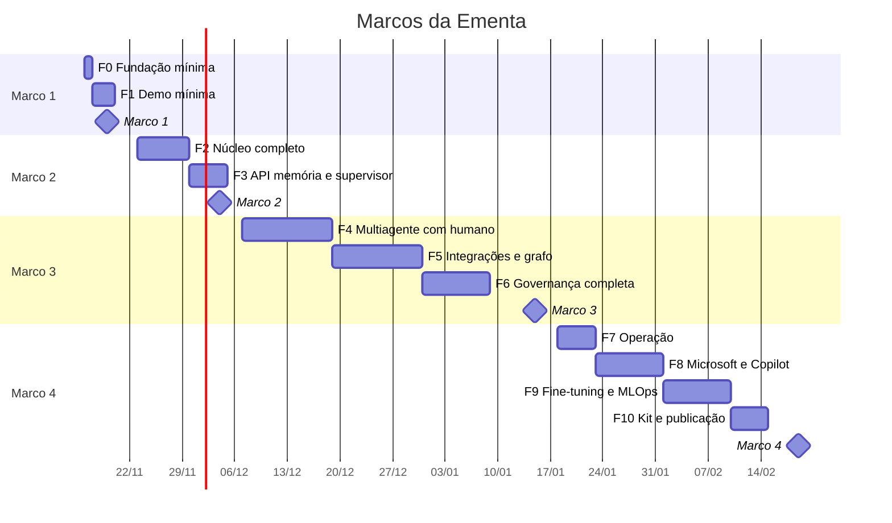
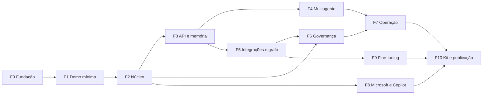

# Plano de implementação

As fases F0 a F10 da Ementa, cada uma com objetivo, entregas, tarefas, critérios de aceite, testes, competências cobertas, estimativa e riscos.

**Status:** Documentado; F0 começa em 16/11/2026 · **Ver também:** [Resumo](RESUMO.md), [Arquitetura](ARQUITETURA.md), [Agentes](AGENTES.md), [Competências](COMPETENCIAS.md)

## Objetivo e critério de sucesso

Construir, fase por fase, uma plataforma de agentes jurídicos que sirva de prova concreta das competências de Engenheiro de Agentes de IA. O projeto está bem-sucedido quando:

- cada fase termina com algo demonstrável, testado e com CI verde;
- toda competência da [matriz](COMPETENCIAS.md) tem onde aparecer, como demonstrar e status honesto;
- a demo roda ao vivo, com plano B gravado: 5 minutos no Marco 1 e 15 minutos nos demais;
- o gasto de API fica dentro do teto (US$ 2/dia, US$ 30/mês).

## Premissas

| Tema | Premissa |
|---|---|
| Máquina | Windows 11, Ryzen 5 5600G, 15,4 GB de RAM, GPU AMD integrada sem CUDA, 538 GB livres |
| Ferramentas | Python 3.12, git, gh e Node já instalados; uv, Docker Desktop e Ollama a instalar |
| Tempo | 12 a 15 h no Marco 1 (semana de 16/11, com o feriado de 20/11); depois cerca de 15 h por semana |
| Custo | OpenAI com projeto e chave próprios, limite de gasto no painel e teto no kit |
| Dados | Clientes, processos e contratos fictícios; corpus público com fonte, data e hash |
| Fine-tuning | GPU grátis no Colab ou no Kaggle; modelo local só pequeno, em CPU |
| Jurídico | O gabarito sai do texto literal da lei; nenhuma tese é inventada |

## Preparação da máquina

```powershell
winget install -e --id astral-sh.uv
wsl --install                              # se o WSL2 não estiver ativo; pede reinício
winget install -e --id Docker.DockerDesktop
gh auth login
gh repo create ementa --public --source C:\projetos\ementa --remote origin --push
```

Limite de memória do Docker, em `%UserProfile%\.wslconfig`:

```ini
[wsl2]
memory=8GB
processors=6
```

Antes da F1: criar o projeto "ementa" no painel da OpenAI, com limite de gasto, e pôr a chave em `.env` (`OPENAI_API_KEY`). O Ollama (`winget install -e --id Ollama.Ollama`) só é necessário a partir da F6.

## Linha do tempo



## Dependências entre fases



## Resumo das fases

| Fase | Entrega principal | Horas | Marco |
|---|---|---|---|
| F0 | Monorepo, Compose, CI | 3–4 | 1 |
| F1 | Pesquisa no CDC com citação verificada, prazo, MCP e traces | 9–11 | 1 |
| F2 | Corpus completo, PII, skills, MCP HTTP, REST, avaliação no CI | 14–18 | 2 |
| F3 | API `/v1`, memória, supervisor, auditoria, worker | 10–12 | 2 |
| F4 | Contratos e peças com aprovação humana, console | 16–20 | 3 |
| F5 | DataJud, notificações, grafo, triagem com conflito | 14–18 | 3 |
| F6 | Sigilo no modelo local, RLS, injeção, BI, red team, OAuth | 14–18 | 3 |
| F7 | Dashboards, SLOs, alertas, avaliação noturna, custo | 8–10 | 4 |
| F8 | Semantic Kernel e Agent Framework, Copilot, revisor de PR | 12–16 | 4 |
| F9 | Fine-tuning da triagem, MLflow, cascata | 12–16 | 4 |
| F10 | Kit publicado, template, site de docs, release | 8–10 | 4 |
| Total | | 120–153 | |

## F0: Fundação mínima

**Objetivo:** esqueleto que roda, testa e sobe no CI, para a F1 começar direto no domínio.

**Entregas:** uv workspace com `packages/ementa-kit`, `packages/ementa` e `apps/mcp_server`; settings com pydantic-settings; logs JSON com structlog; `infra/compose.yaml` com `postgres` (pgvector, PG 17) no perfil `core` e `otel-lgtm` no perfil `obs`; `.github/workflows/ci.yml`; `.env.example`; `.vscode/mcp.json`.

**Tarefas:**

- [x] `pyproject.toml` raiz com `[tool.uv.workspace]` e os três membros
- [x] `ementa_kit.config` com `Settings` (prefixo `EMENTA_`) e perfis dev, ci e prod
- [x] `ementa_kit.telemetry.setup()` com exportador OTLP para o otel-lgtm
- [x] Compose com healthcheck do Postgres e extensão `vector` habilitada no SQL inicial
- [x] CI: uv com cache, `ruff check`, `ruff format --check`, `mypy`, `pytest`
- [x] `.vscode/mcp.json` com o servidor `ementa` via stdio (`uv run ementa-mcp`)
- [x] Teste de fumaça: importa os pacotes e lê settings

**Status:** em andamento. Feito e conferido localmente: `uv sync`, `pytest`, `ruff`, `mypy` e o servidor MCP respondendo via stdio. Falta conferir com Docker instalado: o Compose saudável, o span no Grafana e o CI verde no primeiro PR.

**Critérios de aceite:** `uv sync` e `uv run pytest` passam numa máquina limpa; `docker compose --profile core --profile obs up -d` sobe os dois serviços saudáveis; o CI fica verde no primeiro PR; um span de teste aparece no Grafana.

**Testes:** fumaça de import e de settings; healthcheck do Compose.

**Competências:** arquitetura, Git, CI, testes, Copilot e VS Code.

**Estimativa:** 3 a 4 h. **Riscos:** WSL2 e Docker Desktop na primeira instalação; mitigação: instalar antes de começar e reservar 1 h.

## F1: Demo mínima

**Objetivo:** a demo do Marco 1. Pergunta sobre o CDC respondida com citação verificada e cálculo de prazo, ambos pelo MCP no VS Code, com trace no Grafana.

**Entregas:** snapshot e parser do CDC; embeddings locais; busca híbrida no Postgres; agente `legal_research`; verificador de citações; prompt v1 e montador de contexto v1; ferramenta `calculate_deadline`; servidor MCP stdio com 4 ferramentas; traces; 10 perguntas de fumaça.

**Tarefas:**

- [x] Snapshot do CDC (Lei 8.078/1990) em `data/corpus/raw/` com URL, data e hash
- [x] Parser por artigo, parágrafo e inciso, com ids canônicos (`cdc:art49`, `cdc:art42:pu`, `cdc:art26:II`)
- [x] Schema `knowledge` com `sources` e `chunks` (`embedding` HNSW, `tsv` GIN com configuração portuguesa; o acento sai no Python, sem depender do `unaccent`)
- [x] Embeddings multilíngues locais e comando `uv run ementa ingest cdc`
- [x] Busca vetorial e textual (top 30 cada) com fusão RRF (k = 60) numa consulta SQL
- [x] Grafo `legal_research`: `parse_question`, `direct_lookup`, `rewrite_queries`, `retrieve`, `assemble_context`, `generate_answer`, `verify_citations`, `finalize`, com uma nova tentativa
- [x] Verificador: extrai citações, compara com os ids recuperados, remove e avisa o que não bate
- [x] Prompt `legal_research.answer` v1 em arquivo versionado; id e versão no span
- [x] Montador de contexto v1 com seções fixas e histórico só de acréscimo
- [x] `calculate_deadline` com CPC arts. 219, 220 e 224, feriados nacionais e do RS, premissas na saída
- [x] Servidor MCP stdio com `search_legal_corpus`, `answer_legal_question`, `get_statute_article`, `calculate_deadline`
- [ ] Spans `invoke_agent`, `retrieval`, `chat`, `execute_tool`, `guardrail`, com a instrumentação da OpenAI
- [x] 10 perguntas de fumaça em `evals/smoke_cdc.jsonl` e comando para rodá-las (`uv run ementa smoke`)
- [ ] Teste de integração da busca no CI com Postgres de serviço

**Status:** em andamento, quase pronta. Rodando e conferido em 15/11/2026: as 4 ferramentas pelo MCP via stdio; as 10 perguntas de fumaça com o agente trazem a citação esperada no top 5 e na resposta (10/10, nenhuma citação removida, 4 a 11 s e cerca de US$ 0,004 por pergunta); o caso fixo de prazo dá 26/01/2027; os spans saem num trace só (`invoke_agent`, `chat`, `retrieval`, `guardrail`, `execute_tool`). Sem o Docker, a busca foi testada num Postgres 16 com pgvector 0.6 local (pacote `pgserver`, fora do repositório). Faltam: ver o trace no Grafana e o CI verde (precisam do Docker e do repositório no GitHub). Decisões tomadas aqui: Chat Completions em vez da Responses API ([ADR 0005](adr/0005-camada-de-modelos-agnostica.md)), acento tirado no Python em vez do `unaccent` ([ADR 0003](adr/0003-postgres-pgvector-busca-hibrida.md)) e `multilingual-e5-large` como embedding ([ADR 0010](adr/0010-embeddings-e-rerank-locais.md)).

**Critérios de aceite:** as 10 perguntas trazem a citação esperada no top 5; nenhuma resposta mostra citação não verificada; o caso fixo de prazo (intimação em 03/12/2026, 15 dias úteis, TJRS) devolve 26/01/2027; o Copilot do VS Code lista e chama as 4 ferramentas; o trace completo aparece no Grafana; CI verde.

**Testes:** parser com arquivo de ouro; Hypothesis na calculadora (o vencimento cai em dia útil; mais dias nunca antecipam o vencimento; nenhum dia contado cai na suspensão); verificador com citações boas e falsas; grafo com modelo falso; ferramentas com cliente MCP em memória; integração da busca híbrida.

**Competências:** RAG, embeddings, base vetorial, function calling, MCP, guardrail de citação, prompt e contexto, OpenTelemetry, SQL, Copilot e VS Code.

**Estimativa:** 9 a 11 h. **Riscos:** HTML irregular do Planalto (mitigação: arquivo de ouro e LexML como alternativa); tempo curto (mitigação: o rerank já ficou para a F2; o verificador e a ferramenta de prazo não saem do escopo).

## F2: Núcleo completo

**Objetivo:** fechar o núcleo de pesquisa com mais corpus, proteção de PII, skills, MCP em HTTP, REST e avaliação no CI.

**Entregas:** LGPD, CPC (prazos) e súmulas do STJ e do STF no corpus; rerank; pseudonimização; loader de skills e as skills `legal-research` e `deadline-calculation`; MCP HTTP com política de saída; rota `POST /v1/legal-research`; 30 perguntas no CI; registro de prompts; teste do prefixo; mypy strict, import-linter, pre-commit, gitleaks e pip-audit.

**Tarefas:**

- [ ] Parsers de LGPD, CPC e súmulas, com ids `lgpd:art7`, `cpc:art219`, `stj:sumula:385`
- [ ] Cross-encoder multilíngue local para rerank (top 8)
- [ ] Presidio com reconhecedores de CPF e CNPJ (dígito verificador), RG, OAB, telefone, CEP, e-mail e NER em português; troca por marcador e reidratação
- [ ] `ementa_kit.skills` com divulgação progressiva e `load_skill`; scripts só da lista permitida
- [ ] Transporte HTTP do MCP (spec 2026-07-28, sem estado) e classe de dado por ferramenta
- [ ] Política de saída: pseudonimiza o restrito, nega o sigiloso, registra o cliente
- [ ] FastAPI mínima com `POST /v1/legal-research` e erros no formato RFC 9457
- [ ] `evals/legal_research.jsonl` com 30 perguntas e `evals.yml` com o rótulo `avaliar`
- [ ] Registro de prompts (id, versão, changelog) e eventos de tamanho por seção do contexto
- [ ] Teste que compara pedidos consecutivos ao modelo e falha se o prefixo mudar
- [ ] mypy strict, contratos do import-linter, pre-commit, gitleaks e pip-audit no CI

**Critérios de aceite:** recall@5 ≥ 0,85 nas 30 perguntas; CPF digitado na API chega ao modelo como `[CPF_1]` e volta reidratado para o usuário autorizado; ferramenta marcada como sigilosa nega cliente MCP externo; a avaliação comenta a tabela no PR e respeita o teto de custo; o teste do prefixo passa.

**Testes:** matriz de PII (CPF válido, inválido, formatado e sem máscara); skills com e sem permissão de script; política de saída do MCP; contrato OpenAPI; avaliação com `-m eval`.

**Competências:** guardrails, skills customizadas, REST, avaliação, engenharia de contexto, segurança.

**Estimativa:** 14 a 18 h. **Riscos:** falso positivo de PII em número de processo e de artigo (mitigação: lista de exceções testada).

## F3: API, memória e supervisor

**Objetivo:** transformar os agentes em serviço: API completa, memória, supervisor, auditoria e orçamento.

**Entregas:** rotas `/v1` com JWT e RBAC; SSE; checkpointer e store do LangGraph no Postgres; escrita de memória e esquecimento; agente `assistant`; auditoria com hash encadeado; orçamentos; Redis e worker (arq).

**Tarefas:**

- [ ] Usuários e papéis fictícios (sócia, associado, estagiário, controladoria, DPO, TI)
- [ ] JWT de curta duração, RBAC por rota e por ferramenta
- [ ] `POST /v1/chat` com SSE (tokens, passos, citações) e `GET /v1/threads/{id}`
- [ ] Checkpointer e store do LangGraph no schema `langgraph`; namespaces por advogado, processo e escritório
- [ ] Escritor de memória pós-execução com deduplicação por similaridade; `DELETE /v1/data-subjects/{id}/memories`
- [ ] `assistant` roteando para `legal_research` e `calculate_deadline` (papel `fast`)
- [ ] Tabela `audit.events` com `prev_hash` e `hash`; conferência da cadeia
- [ ] Orçamento por ambiente e por área, com parada automática
- [ ] Redis, worker arq e ingestão em fila, com idempotência
- [ ] Compactação: conversa nova a partir de resumo quando passar do orçamento de contexto

**Critérios de aceite:** a conversa sobrevive a reinício do processo; o estagiário não acessa rota de sócia; a memória de um titular apagada some da busca; a cadeia de auditoria acusa adulteração; o orçamento estourado bloqueia a chamada com erro claro.

**Testes:** autenticação e autorização; retomada do grafo depois de reinício; esquecimento; integridade da auditoria; parada por orçamento.

**Competências:** memória de agentes, REST, agentes em produção, supervisor multiagente.

**Estimativa:** 10 a 12 h. **Riscos:** acoplamento entre estado do grafo e visão do modelo (mitigação: a visão é derivada do estado, nunca editada).

## F4: Multiagente com humano

**Objetivo:** os dois fluxos multiagente com aprovação humana: revisão de contrato e redação de peça.

**Entregas:** dados internos fictícios (pareceres, modelos de peça, playbook de contratos, contratos com cláusulas plantadas); `contract_review`; `brief_drafting`; HITL; console HTMX; exportação DOCX; memória episódica; skills `contract-review-services` e `initial-petition-consumer`.

**Tarefas:**

- [ ] Playbook de contratos em YAML (regras determinísticas e critérios para o LLM)
- [ ] 10 contratos fictícios com cláusulas plantadas e gabarito
- [ ] `contract_review`: parse, segmentação, map por cláusula com `Send`, reduce em matriz de risco, redlines
- [ ] `brief_drafting`: fatos, teses em paralelo, rascunho por template, crítico com rubrica, verificação de citações
- [ ] `interrupt()` antes de finalizar; `POST /v1/approvals/{id}` com aprovar, rejeitar e editar
- [ ] Console em FastAPI, Jinja2 e HTMX: caixa de aprovações, diff do rascunho, trace da execução
- [ ] Exportação DOCX com aviso de rascunho
- [ ] Rascunho aprovado e edição do advogado gravados como memória episódica

**Critérios de aceite:** F1 ≥ 0,8 na detecção das cláusulas plantadas; nenhuma peça é finalizada sem aprovação; a edição do advogado aparece como exemplo na execução seguinte; o fluxo de aprovação passa no teste ponta a ponta.

**Testes:** map-reduce com modelo falso; HITL com retomada; avaliação das cláusulas plantadas; console com fluxo de aprovação.

**Competências:** arquiteturas multiagentes, humano no circuito, memória episódica, REST.

**Estimativa:** 16 a 20 h. **Riscos:** console consumindo tempo de design (mitigação: telas mínimas, skill de design só no acabamento).

## F5: Integrações e grafo

**Objetivo:** ligar a Ementa a sistemas externos e ao grafo de conhecimento.

**Entregas:** cliente do DataJud e agente `case_monitor`; notificações por e-mail (Mailpit) e webhook de Teams ou Slack; Neo4j com leis, súmulas, decisões e partes; expansão GraphRAG no `legal_research`; agente `intake` com conflito de interesses; guarda de egress.

**Tarefas:**

- [ ] `DataJudClient` com chave por variável de ambiente, consulta por tribunal e cassettes nos testes
- [ ] `case_monitor` agendado no worker: novas movimentações, classificação, `calculate_deadline`, tarefa e aviso
- [ ] Amostra de decisões do portal de dados abertos do STJ (conferir formato), com extração de citações
- [ ] Carga do grafo a partir do Postgres; pessoas por hash com sal
- [ ] `expand_citation_graph` entre `retrieve` e `assemble_context`
- [ ] `intake` com extração estruturada, `check_conflict_graph` (até 3 saltos) e `check_conflict_sql`
- [ ] Lista de domínios permitidos para qualquer chamada de rede

**Critérios de aceite:** a movimentação nova gera prazo e e-mail no Mailpit; conflito plantado é encontrado; o recall nas perguntas sobre súmula sobe com a expansão do grafo (medido); chamada a domínio fora da lista é bloqueada.

**Testes:** DataJud com cassettes; conflito com casos plantados; expansão do grafo; egress.

**Competências:** integração com sistemas corporativos, knowledge graphs, GraphRAG.

**Estimativa:** 14 a 18 h. **Riscos:** mudança na chave ou nos termos do DataJud (mitigação: chave na wiki do CNJ, só metadados, cassettes).

## F6: Governança completa

**Objetivo:** fechar a governança: sigilo, barreira ética, injeção, BI guardado, red team e OAuth.

**Entregas:** roteamento de sigilo para o modelo `local` (Ollama); RLS em casos, documentos e chunks; detecção de injeção (inclusive texto oculto); agente `firm_analytics`; red team com promptfoo; LGPD documentada; OAuth no MCP HTTP.

**Tarefas:**

- [ ] Ollama nativo com modelo de 3 a 4B; papel `local` no `ModelRegistry`
- [ ] Motor de políticas em YAML: classe de dado, papel, cliente e modelo permitido
- [ ] Policies de RLS com `current_setting('app.user_id')` e `case_members`
- [ ] Detector de injeção: heurísticas, spotlighting do conteúdo recuperado, texto oculto em PDF e DOCX
- [ ] `firm_analytics`: views em `analytics`, papel `bi_reader`, sqlglot (só SELECT, LIMIT, `statement_timeout`)
- [ ] Red team: injeção direta e indireta, dado de outro cliente, exfiltração de PII, jurisprudência inventada, promessa de resultado
- [ ] OAuth no transporte HTTP do MCP
- [ ] Registro das operações de tratamento e direitos do titular documentados

**Critérios de aceite:** processo sigiloso nunca gera chamada para a OpenAI (conferido no trace); advogado A não recupera chunk do processo B; red team com bloqueio ≥ 95% e falso positivo ≤ 5%; SQL fora da regra é recusado.

**Testes:** RLS; roteamento de sigilo; matriz do sqlglot; red team; OAuth.

**Competências:** governança e segurança para IA, guardrails, SQL, LGPD.

**Estimativa:** 14 a 18 h. **Riscos:** modelo local lento em CPU (mitigação: modelo pequeno, sem SLO até a F7).

## F7: Operação

**Objetivo:** operar como produção: dashboards, SLOs, alertas, avaliação noturna e custo atribuído.

**Entregas:** dashboards versionados; SLOs por rota; alertas de orçamento, erro e queda de recall; avaliação noturna com comentário no PR; atribuição de custo por área e advogado; runbooks.

**Tarefas:**

- [ ] Dashboards: visão geral, guardrails, RAG, custos, prazos, avaliação
- [ ] SLOs a partir da linha de base medida na F1 a F6
- [ ] Alertas no Grafana
- [ ] Avaliação noturna e comparação com o `main`
- [ ] Tabela de preço por modelo versionada e custo por execução
- [ ] Runbooks: provedor fora, orçamento estourado, queda de recall, vazamento suspeito

**Critérios de aceite:** um incidente simulado (provedor fora) aparece no alerta e o runbook resolve; o custo do mês bate com o painel da OpenAI dentro de 5%.

**Testes:** simulação de falha do provedor; conferência de custo.

**Competências:** agentes em produção, OpenTelemetry e observabilidade de agentes.

**Estimativa:** 8 a 10 h. **Riscos:** convenções GenAI mudarem de nome (mitigação: mapeamento num só lugar do kit).

## F8: Microsoft e Copilot

**Objetivo:** cobrir o ecossistema Microsoft e o ciclo de desenvolvimento com IA.

**Entregas:** agente `lgpd_compliance` em Semantic Kernel consumindo o `ementa-mcp`, com porte para o Microsoft Agent Framework 1.x; skill `lgpd-checklist`; artefatos do Copilot (instruções por caminho, prompts, agentes, skills de desenvolvimento); playbook final; agente `pr_reviewer` no GitHub Actions.

**Tarefas:**

- [ ] `apps/compliance_sk` com SK em Python e o MCP como plugin
- [ ] Porte para o Agent Framework, com o diff registrado num ADR novo (0013)
- [ ] `.github/copilot-instructions.md`, `.github/instructions/*.instructions.md`, `.github/prompts/*.prompt.md`, `.github/agents/*.agent.md`
- [ ] Skills de desenvolvimento: `new-mcp-tool`, `new-legal-skill`, `new-eval-case`, `investigate-trace`
- [ ] `ai-review.yml`: o `pr_reviewer` confere testes, guardrails, avaliação e docs de cada PR
- [ ] Conferir nomes de recursos e limites do Copilot Free e Pro

**Critérios de aceite:** as duas versões do agente LGPD passam na mesma avaliação; o Copilot usa a skill `new-mcp-tool` para criar uma ferramenta que passa no CI; o `pr_reviewer` comenta num PR real.

**Testes:** avaliação do checklist LGPD nas duas versões; teste do `pr_reviewer` com diff fixo.

**Competências:** Semantic Kernel, ecossistema Copilot e VS Code, agentes para o ciclo de desenvolvimento, skills.

**Estimativa:** 12 a 16 h. **Riscos:** API do Agent Framework ainda mudando (mitigação: versão fixada e porte pequeno).

## F9: Fine-tuning e MLOps

**Objetivo:** um modelo pequeno ajustado para a triagem, rodando local, com ciclo de MLOps completo.

**Entregas:** dataset de triagem; QLoRA no Colab ou no Kaggle; avaliação contra Luna e Terra; GGUF no Ollama; MLflow com registro e aliases; cascata por confiança; model card; experimento de embeddings.

**Tarefas:**

- [ ] Geração de relatos sintéticos com controle de diversidade e revisão de amostra
- [ ] Notebook de treino QLoRA reprodutível
- [ ] Avaliação: F1 macro, JSON válido, latência em CPU, custo
- [ ] Exportação GGUF e Modelfile do Ollama
- [ ] MLflow no perfil `ml` com aliases champion e challenger
- [ ] Cascata: modelo local primeiro, sobe para o Luna abaixo do limite de confiança
- [ ] Monitoramento das correções humanas e gatilho de retreino

**Critérios de aceite:** F1 macro até 2 pontos abaixo da linha de base, com custo marginal perto de zero; cascata medida; model card publicado.

**Testes:** avaliação no conjunto de teste separado; teste da cascata.

**Competências:** fine-tuning, MLOps.

**Estimativa:** 12 a 16 h. **Riscos:** cota de GPU grátis (mitigação: modelo pequeno, checkpoints salvos).

## F10: Kit e publicação

**Objetivo:** empacotar o que é reutilizável e publicar.

**Entregas:** API pública do `ementa-kit` documentada; template Copier `templates/novo-agente` testado no CI; site de docs com MkDocs Material no GitHub Pages; release com release-please, imagens no GHCR e wheel do kit; deploy de demonstração opcional.

**Tarefas:**

- [ ] Revisar a API do kit e gerar referência com mkdocstrings
- [ ] Template que gera agente com grafo, ferramentas, prompts, avaliação, testes e telemetria
- [ ] Job no CI que gera um agente pelo template e roda os testes dele
- [ ] `docs.yml`, `release.yml`, `security.yml` completos (CodeQL, Trivy, SBOM)
- [ ] Decidir sobre o deploy de demonstração (custo, login, orçamento travado)

**Critérios de aceite:** um agente novo sai do template e passa no CI sem editar nada; o site de docs publica; a release gera imagens e wheel.

**Testes:** geração pelo template; build das imagens.

**Competências:** criação de frameworks e componentes reutilizáveis para agentes.

**Estimativa:** 8 a 10 h. **Riscos:** custo e abuso no deploy público (mitigação: login, orçamento diário e desligar fora da entrevista).

## Fora de escopo

- C# e Java (o porte .NET do agente SK fica como extra opcional).
- Peticionamento real no PJe ou no e-SAJ e assinatura digital.
- Dados reais de clientes.
- Kubernetes e SaaS multiempresa.
- LangSmith pago.

## Orçamento de API

| Item | Estimativa |
|---|---|
| Pergunta de pesquisa (Terra, mais reescrita no Luna) | ~US$ 0,015 |
| Rodada de avaliação (30 perguntas e juiz em amostra) | ~US$ 0,75 |
| Marco 1 inteiro, com desenvolvimento e fumaça | até US$ 5 |
| Teto | US$ 2/dia e US$ 30/mês, com parada automática em dev e no CI |

Preços e ids de modelo são conferidos na página oficial da OpenAI no começo da F1.

## Jeito de trabalhar

- Uma fase por sessão, num branch `feat/fN-<tema>`, com PR e checklist.
- Commits no formato Conventional Commits, em inglês.
- Ao fim de cada fase: status atualizado no [README](../README.md), na [matriz](COMPETENCIAS.md) e aqui.
- Definição de pronto: código tipado, testes passando, span e guardrail no lugar, avaliação rodada se mexeu em prompt ou modelo, docs atualizados, sem segredo, CI verde.

---

[Voltar ao README](../README.md)
