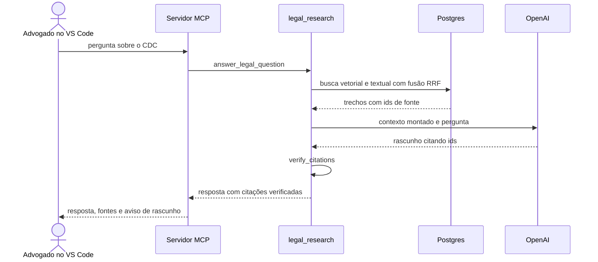

# Resumo do projeto

A Ementa em duas páginas: o que é, por que existe, como funciona e o que dá para mostrar.

**Status:** Documentado; primeira demo no Marco 1 (19/11/2026) · **Ver também:** [Plano](PLANO.md), [Arquitetura](ARQUITETURA.md), [Competências](COMPETENCIAS.md)

## Em uma frase

A Ementa é uma plataforma de agentes de IA para escritórios de advocacia, em Python, que pesquisa com citação verificada, calcula prazos por código, revisa contratos e rascunha peças com aprovação humana, tudo com permissão no banco, sigilo respeitado, trace de cada passo e avaliação contínua.

## O problema e a resposta

| Dor do escritório | Como a Ementa resolve | Técnica |
|---|---|---|
| IA que inventa jurisprudência | O modelo só cita ids de fonte do contexto; um verificador confere cada citação e tira a que não bate | RAG com ids de fonte e verificador determinístico |
| Prazo perdido | O prazo é calculado por código testado, que lista as premissas usadas | Ferramenta `calculate_deadline`, chamada por function calling |
| Sigilo e LGPD | Processo em segredo de justiça só roda no modelo local; dado pessoal vira marcador antes da nuvem | Motor de políticas, Presidio, Ollama |
| Barreira ética entre clientes | O banco só devolve o que o advogado pode ver, inclusive na busca | Row Level Security no Postgres |
| Conflito de interesses na triagem | Busca de caminho no grafo entre a nova parte e os clientes do escritório | Neo4j e Cypher |
| Revisão de contrato demorada | Análise cláusula por cláusula contra o playbook, com aprovação do advogado | Map-reduce no LangGraph e humano no circuito |
| IA espalhada sem controle | Uma porta só para Copilot, Claude e agentes internos, com auditoria e custo | MCP, OpenTelemetry e orçamentos |

## Como funciona uma pergunta

Cada seta vira um span no Grafana, com tokens, custo e a decisão dos guardrails.

## Competências cobertas

| Competência | Como aparece | Fase |
|---|---|---|
| Arquitetura e padrões | Hexagonal, kit separado do domínio, C4, 12 ADRs, import-linter | F0 em diante |
| Python, REST, Git, CI e testes | FastAPI, GitHub Actions, pytest, Hypothesis, testcontainers | F0 a F3 |
| Prompt e contexto | Prompts versionados, montador de contexto com orçamento, histórico só de acréscimo | F1 a F3 |
| RAG, embeddings, vetores, function calling | pgvector com busca híbrida, embeddings locais, ferramentas com schema estrito | F1, F2 |
| Memória de agentes | Checkpointer e store do LangGraph, memória episódica, esquecimento pela LGPD | F3, F4 |
| Multiagente, MCP e skills | Supervisor, map-reduce, plan-and-execute, servidor MCP, Agent Skills | F1 a F4 |
| Agentes em produção | Orçamentos, fallback, SLOs, alertas, runbooks | F3, F7 |
| Governança e segurança | Guardrails, RLS, sigilo, red team, playbook de Copilot | F1 a F8 |
| SQL e dados | Schemas, RLS, views analíticas, texto para SQL guardado | F1, F6 |
| Copilot e VS Code | `AGENTS.md`, instruções, prompts, agentes, skills, MCP no VS Code | F0, F1, F8 |
| LangGraph e LangChain | Todos os agentes | F1 em diante |
| Semantic Kernel | Agente LGPD consumindo o MCP, com porte para o Agent Framework | F8 |
| OpenTelemetry | Spans GenAI, métricas, dashboards | F1, F7 |
| Knowledge graph | Grafo de leis, súmulas e decisões; conflito de interesses | F5 |
| Fine-tuning e MLOps | QLoRA para triagem, MLflow, cascata | F9 |
| Frameworks reutilizáveis | `ementa-kit` e template Copier | F0, F10 |

A matriz completa, com o status de cada item, está em [Competências](COMPETENCIAS.md).

## Decisões que valem conversa

- **LangGraph como orquestrador.** Grafo explícito, checkpoint e `interrupt()` para aprovação humana; custo: mais código que um framework de papéis. [ADR 0002](adr/0002-langgraph-como-orquestrador.md)
- **Postgres com pgvector, não banco vetorial dedicado.** O RLS faz o RAG respeitar permissão no próprio banco; custo: tuning de índice e plano de saída se o volume crescer. [ADR 0003](adr/0003-postgres-pgvector-busca-hibrida.md)
- **Camada de modelos com papéis.** OpenAI de referência, modelo local para sigilo, troca por configuração; custo: um adaptador a manter. [ADR 0005](adr/0005-camada-de-modelos-agnostica.md)
- **Guardrails próprios em pipeline.** Valem no agente e no MCP, com PII brasileira e verificador de citações; custo: manter os reconhecedores. [ADR 0006](adr/0006-guardrails-em-pipeline.md)
- **MCP como porta de entrada.** Um servidor atende Copilot, Claude e Semantic Kernel; custo: tratar o cliente externo como processador de nuvem. [ADR 0007](adr/0007-mcp-como-padrao-de-integracao.md)
- **OpenTelemetry neutro.** Convenções GenAI e Grafana LGTM, sem amarra com fornecedor; custo: montar os dashboards. [ADR 0008](adr/0008-opentelemetry-e-grafana-lgtm.md)
- **Embeddings locais escolhidos por medição.** O dado não sai do escritório; custo: CPU e RAM na ingestão. [ADR 0010](adr/0010-embeddings-e-rerank-locais.md)
- **Modelo pequeno ajustado para a triagem.** Dado do cliente fica local e o custo marginal cai a quase zero; custo: pipeline de dados e de treino. [ADR 0011](adr/0011-fine-tuning-de-modelo-pequeno.md)

## Marcos

| Marco | O que dá para mostrar | Meta |
|---|---|---|
| 1 | Pesquisa no CDC com citação verificada e cálculo de prazo, pelo MCP no VS Code, com traces | 19/11/2026 |
| 2 | PII pseudonimizada, skills, API REST, memória e supervisor | 04/12/2026 |
| 3 | Contratos e peças com aprovação humana, DataJud, grafo e governança completa | 15/01/2027 |
| 4 | Operação, Semantic Kernel, Copilot, fine-tuning, MLOps e kit publicado | 19/02/2027 |

## Demo de 5 minutos

1. No Copilot do VS Code, pergunta sobre arrependimento de compra pela internet: a resposta cita o art. 49 do CDC (7 dias), verificado.
2. Prazo de 15 dias úteis a partir de intimação em 03/12/2026 no TJRS: a ferramenta responde 26/01/2027, por causa da suspensão de 20/12 a 20/01 (CPC, art. 220), e lista as premissas.
3. Pedido para citar uma súmula que não existe: o verificador remove a citação e avisa.
4. No Grafana, a cascata do trace: agente, busca, chamada ao modelo com tokens e custo, verificador e ferramenta.
5. No GitHub, CI verde, testes e ADRs.

O passo a passo, com o que dizer em cada tela, está no [roteiro de demo](ROTEIRO-DEMO.md).

## Metas

| Métrica | Meta |
|---|---|
| Recall@5 na busca | ≥ 0,85 |
| Citações exibidas e verificadas | 100% |
| Bloqueio no red team | ≥ 95%, com até 5% de falso positivo |
| Cobertura de testes | ≥ 85% no kit, ≥ 80% no domínio |
| Custo por pergunta de pesquisa | ~US$ 0,015 |
| p95 da pesquisa em nuvem | até 20 s, com primeiro evento de progresso em até 2 s |

## Próximos passos

1. Instalar uv e Docker Desktop e criar o projeto com limite de gasto no painel da OpenAI.
2. F0: monorepo, Compose, CI.
3. F1: corpus do CDC, busca híbrida, `legal_research`, `calculate_deadline`, MCP e traces.

---

[Voltar ao README](../README.md)
