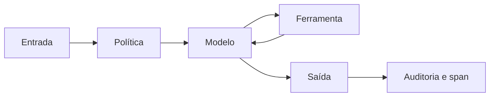

# ADR 0006: Guardrails em pipeline próprio, com Presidio e verificador de citações

**Status:** Aceito · **Data:** 2026-11-14 · **Fase:** F1 · **Ver também:** [Segurança e governança](../SEGURANCA-E-GOVERNANCA.md), [Avaliação](../AVALIACAO.md)

## Contexto

Os riscos de uma IA jurídica são concretos:

- citar jurisprudência que não existe (já há casos de peças punidas por isso);
- mandar CPF de cliente para um modelo de nuvem;
- deixar um documento da parte contrária, com instrução escondida, mandar o agente agir;
- vazar dado de um cliente na resposta dada a outro.

Esses controles precisam valer em todos os caminhos de entrada. Pela API e pelo console, o pedido chega aos grafos LangGraph. Pelo servidor MCP, a ferramenta é chamada direto por um cliente externo (Copilot, Claude Desktop), sem passar por agente nenhum.

Cada decisão de guardrail precisa ser auditável: o que foi bloqueado, mascarado ou marcado, e por quê.

## Decisão

**Pipeline no kit.** Um pipeline próprio em `ementa_kit.guardrails`, no padrão Chain of Responsibility. Cada verificação implementa a mesma interface e devolve uma decisão: permitir, mascarar, marcar ou bloquear, com o motivo.

**Estágios.** O pipeline tem quatro estágios: entrada, política, ferramenta e saída. O catálogo completo está em [Segurança e governança](../SEGURANCA-E-GOVERNANCA.md).

**Plugado em dois lugares:**

- como middleware do LangChain (antes e depois do modelo, e em volta de cada chamada de ferramenta), nos agentes;
- no wrapper das ferramentas do servidor MCP, para cliente externo.

**PII brasileira.** Presidio com reconhecedores próprios:

- CPF e CNPJ com validação do dígito verificador;
- RG, número da OAB, telefone e CEP;
- NER em português para nomes.

A pseudonimização troca o dado por marcador (`[CPF_1]`) antes da nuvem e reidrata a resposta para quem tem permissão (F2).

**Citações.** O verificador é determinístico. Ele extrai cada citação da resposta (artigo, súmula, lei) e exige que o id canônico (`cdc:art49`, `stj:sumula:385`) esteja entre as fontes que foram para o contexto daquela chamada; citação fora delas sai, mesmo que exista no corpus. Citação não verificada é removida e sinalizada; numa peça, bloqueia (F1).

**Rastro.** Toda decisão vira registro em `ai.guardrail_events` e evento no span `guardrail`.

## Alternativas consideradas

| Alternativa | A favor | Contra | Por que não agora |
|---|---|---|---|
| NeMo Guardrails | Linguagem própria (Colang) para fluxos de diálogo; rails prontos | Curva de aprendizado; modelo de fluxo de diálogo não casa com grafos e ferramentas MCP | Peso grande para checagens que são, na maioria, determinísticas |
| Guardrails AI | Validadores prontos; validação de saída estruturada | Foco na saída do modelo; pouco sobre ferramenta e política de roteamento | Os validadores podem ser plugados como passos do pipeline, se valer a pena |
| Só middleware do LangChain | Nativo dos agentes; `create_agent` já aceita | Não cobre a chamada direta pelo servidor MCP | Deixaria o caminho do cliente externo sem guardrail |

## Consequências

**Positivas**

- Uma regra, dois caminhos: o mesmo pipeline protege o agente e a ferramenta MCP.
- A maior parte das verificações é determinística: barata, rápida e testável sem modelo.
- Cada bloqueio tem motivo registrado, o que serve à auditoria e ao red team.

**Negativas e riscos**

- O código é nosso: os reconhecedores BR e o verificador de citação precisam de manutenção e de bons testes.
- O NER em português erra nome próprio incomum. Mitigação: as regras por padrão (CPF, CNPJ) valem sozinhas, e o NER entra como camada a mais.
- Excesso de bloqueio atrapalha o advogado. A meta de falso positivo (≤ 5%) é tão importante quanto a de bloqueio.

## Como validar

- Matriz de testes unitários por verificação: CPF válido e inválido, CNPJ formatado e cru, citação existente e inexistente, ferramenta fora da lista permitida.
- Red team com promptfoo na F6: bloqueio ≥ 95% dos ataques, com no máximo 5% de falso positivo num conjunto benigno.
- Na demo do Marco 1, pedir uma súmula inexistente: a citação some da resposta, com aviso.
- Gatilho para revisitar: uma biblioteca externa cobrir os reconhecedores brasileiros e o caso MCP com qualidade igual ou melhor.

## Referências

- Microsoft Presidio: <https://microsoft.github.io/presidio/>
- OWASP Top 10 para aplicações de LLM (2025): <https://genai.owasp.org/llm-top-10/>

---

[Índice de ADRs](README.md)
